# Documentación del Sistema — Fe Buen Asador Management

> Documento técnico de referencia sobre la estructura y el funcionamiento del frontend del sistema de gestión del restaurante "Buen Asador". Sirve como insumo para la documentación del proyecto de grado.
>
> **Alcance:** este documento describe el **frontend** (repositorio `fe-buen-asador-management`). El backend es un repositorio aparte; cuando aquí se menciona lo que hace el servidor, se describe tal como el frontend lo consume.

## Índice

1. [Visión general](#1-visión-general)
2. [Arquitectura del proyecto](#2-arquitectura-del-proyecto)
3. [Enrutamiento y navegación](#3-enrutamiento-y-navegación)
4. [Autenticación, sesión y autorización](#4-autenticación-sesión-y-autorización)
5. [Gestión de estado](#5-gestión-de-estado)
6. [Comunicación con el backend](#6-comunicación-con-el-backend)
7. [Tiempo real (Server-Sent Events)](#7-tiempo-real-server-sent-events)
8. [Sistema de diseño y componentes compartidos](#8-sistema-de-diseño-y-componentes-compartidos)
9. [Módulos funcionales](#9-módulos-funcionales)
10. [Matriz de acceso por rol](#10-matriz-de-acceso-por-rol)
11. [Casos de uso](#11-casos-de-uso)
12. [Pruebas y automatización](#12-pruebas-y-automatización)
13. [Convenciones transversales](#13-convenciones-transversales)
14. [Estado actual y observaciones técnicas](#14-estado-actual-y-observaciones-técnicas)
15. [Trabajo futuro (Fase 2)](#15-trabajo-futuro-fase-2)
16. [Resumen de valor para la memoria del proyecto](#16-resumen-de-valor-para-la-memoria-del-proyecto)

---

## 1. Visión general

**Fe Buen Asador Management** es una aplicación web de una sola página (SPA) para gestionar de forma integral un restaurante con **varias sucursales** que opera en Bolivia (moneda `BOB`/"Bs.", zona horaria `America/La_Paz`). Cubre cuatro frentes:

1. **Back-office administrativo:** usuarios, sucursales, catálogo (categorías, modificadores y productos), inventario de productos terminados, insumos y recetas.
2. **Operación de venta (POS):** apertura y cierre de turno de caja, armado de pedidos desde un menú visual, cobro, impresión de tickets, pedidos diferidos (delivery) y **venta sin conexión a internet**.
3. **Canal WhatsApp:** bandeja en tiempo real de los pedidos que los clientes hacen por WhatsApp, con su ciclo de aprobación, preparación, entrega y cobro.
4. **Finanzas y control:** egresos de caja, nómina diaria, arqueo y aprobación de cierres de caja, dashboard del día y reportes por período (ventas, egresos, nómina e insumos).

El sistema distingue **roles** (Gerente, Administrador, Cajero y Empleado) con acceso diferenciado por pantalla. Además es **multi-sucursal**: un mismo usuario puede tener roles distintos según la sucursal en la que trabaje.

### 1.1 Stack tecnológico

| Categoría | Tecnología |
|---|---|
| Framework de interfaz | React 19 + TypeScript 5.9 |
| Herramienta de build | Vite 8 |
| Enrutamiento | react-router-dom v7 (`createBrowserRouter`) |
| Datos remotos y caché | TanStack React Query v5 |
| Estado global del cliente | Zustand 5 (con `persist` para la sesión y la interfaz) |
| Formularios | Formik |
| Validación | Zod, con un adaptador propio (`zodToFormik`) |
| HTTP | Axios (un único cliente con interceptores) |
| Tiempo real | Server-Sent Events con un cliente propio sobre `fetch` |
| Almacenamiento sin conexión | IndexedDB (cola de ventas), localStorage (copia del menú y del turno) y Service Worker (archivos de la aplicación) |
| Estilos | Tailwind CSS + componentes estilo shadcn/ui sobre primitivas Radix UI |
| Iconos | lucide-react |
| Avisos (toasts) | sonner |
| Arrastrar y soltar | @dnd-kit (reordenar el carrito del POS) |
| Fechas | date-fns, react-datepicker |
| Audio | Web Audio API (aviso sonoro de pedidos de WhatsApp, sin archivos de audio) |
| Textos | Diccionario propio en español (`src/locales/es`) |

### 1.2 Scripts y configuración

```json
"dev" / "start": "vite"         // servidor de desarrollo
"build": "tsc -b && vite build" // verificación de tipos + build de producción
"lint": "eslint ."
"preview": "vite preview"
```

- **Entorno** (`src/config/env.ts`, variables `VITE_*` en `.env`): `VITE_API_URL` (URL base del backend; por defecto `http://localhost:3000/api`), `VITE_APP_NAME` y `VITE_VERSION`.
- **Negocio** (`src/config/app.config.ts`): nombre "Buen Asador", moneda `BOB`/"Bs.", timeout HTTP de 10 s, hasta 2 reintentos y paginación por defecto de 10 ítems (opciones 10/20/50/100).
- **Service Worker** (`public/sw.js`): se registra **solo en producción** para no interferir con la recarga en caliente de Vite durante el desarrollo.

---

## 2. Arquitectura del proyecto

### 2.1 Organización por dominio (*feature-based*)

El código de `src/` no se agrupa por tipo técnico (todos los componentes juntos, todos los hooks juntos), sino **por dominio de negocio**, dentro de `src/features/`:

```
src/features/
  auth/           # login, selección y cambio de sucursal, cambio de contraseña, renovación de sesión
  users/          # usuarios, cargos, restablecimiento de contraseña
  locations/      # sucursales y asignación de usuarios con su rol
  catalog/
    categories/   # categorías y disponibilidad masiva
    modifiers/    # modificadores (extras)
    products/     # productos y disponibilidad por sucursal
  inventory/      # stock de productos terminados, kardex, alertas
  supplies/       # insumos, stock de insumos y recetas
  pos/            # punto de venta: carrito, pago, ticket, turno, pedidos
  sales/          # historial y anulación de ventas
  shifts/         # caja del cajero, cierre, arqueo y aprobación
  whatsapp/       # bandeja de pedidos de WhatsApp en tiempo real
  offline/        # venta sin conexión: cola, sincronización y conectividad
  notifications/  # alertas de stock en tiempo real
  dashboard/      # resumen del día
  finances/
    expenses/     # egresos de caja
    payroll/      # nómina diaria
    reports/      # reportes por período
  public/         # página 404
```

Cada módulo repite **la misma estructura interna**:

```
módulo/
  dto/          # forma de los datos tal como los envía o recibe el backend
  models/       # forma adaptada a la interfaz
  mappers/      # funciones puras que convierten DTO ⇄ modelo ⇄ formulario
  validators/   # esquemas Zod (reglas y mensajes de validación)
  forms/        # tipos de formulario y su configuración (valores iniciales, validación, conversión a DTO)
  hooks/        # acceso a datos con React Query (consultas y mutaciones)
  config/       # constantes de interfaz del módulo (filtros, configuración de tabla)
  stores/       # estado propio del módulo con Zustand, cuando hace falta
  services/     # lógica fuera de React (solo en offline)
  utils/        # funciones auxiliares del módulo
  pages/        # pantallas y modales
  components/   # componentes que otros módulos reutilizan
```

El patrón **DTO → Mapper → Modelo** se aplica de forma estricta: ningún componente recibe un DTO del backend sin pasar por un mapper explícito. Así los cambios en el contrato de la API quedan aislados en un solo lugar y es fácil rastrearlos.

### 2.2 Estructura transversal (fuera de `features/`)

```
src/
  components/
    layout/     # AppLayout, Sidebar, Topbar
    shared/     # sistema de diseño propio (sección 8)
    ui/         # primitivas estilo shadcn/ui (button, input, dialog, table, etc.)
  routes/       # rutas y protecciones de acceso
  stores/       # stores globales de Zustand (auth, ui, error)
  hooks/        # hooks genéricos de acceso a datos (api.handlers.ts)
  services/     # cliente Axios, interceptores, sesión y cliente SSE
  constants/    # enums, mensajes, códigos de error, query keys, configuración de tablas
  config/       # entorno, negocio y navegación
  locales/es/   # textos en español
  types/        # tipos compartidos (envelope de API, auditoría, alias)
  lib/          # utilidades (zodToFormik, cn, formato de dinero y fechas, códigos de pedido)
```

### 2.3 Arranque de la aplicación (`src/main.tsx`)

1. Activa la copia local del menú y del turno activo (`persistOfflineQueries`) para poder vender sin conexión.
2. Registra el Service Worker (solo en producción).
3. Monta `QueryClientProvider` y el enrutador (`AppRouter`).

Al entrar al área autenticada, `AppLayout` monta **una sola vez** cuatro procesos en segundo plano:

| Hook | Función |
|---|---|
| `useSessionKeepAlive` | Renueva el token antes de que venza |
| `useStockAlertsStream` | Escucha las alertas de stock en tiempo real (Gerente y Administrador) |
| `useWhatsappOrdersStream` | Mantiene sincronizada la bandeja de WhatsApp |
| `useOfflineSync` | Detecta la conexión y sincroniza las ventas offline (Cajero) |

### 2.4 Diagrama de componentes

Muestra las capas del frontend y cómo se comunican con el backend y con el almacenamiento local del navegador.

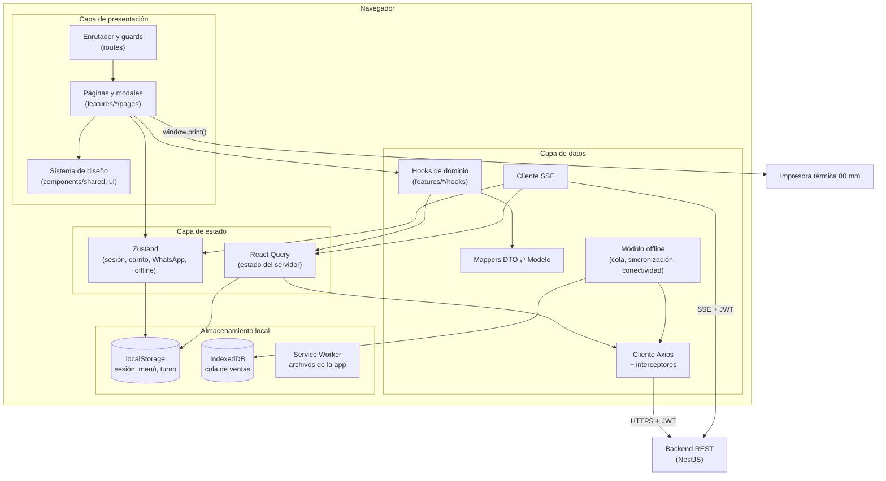

### 2.5 Diagrama de despliegue

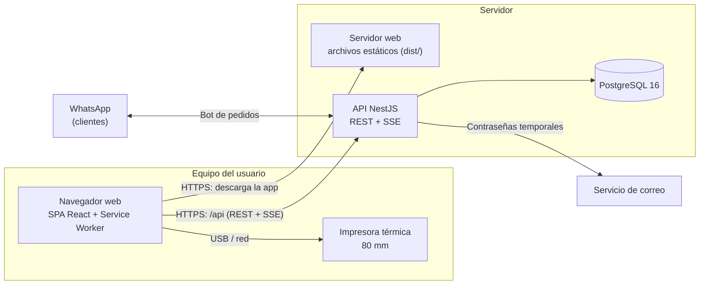

---

## 3. Enrutamiento y navegación

### 3.1 Árbol de rutas (`src/routes/Router.tsx`)

```
/login                              → Login (pública)
<ProtectedRoute>                     → exige sesión
  /change-password                   → ChangePassword (fuera del layout)
  <PasswordChangeGuard>              → bloquea si hay cambio de contraseña pendiente
    <AppLayout>                      → sidebar + topbar + contenido
      /                              → RoleBasedRedirect
      <RoleRoute [MANAGER, ADMIN]>
        /dashboard                   → Dashboard
      <RoleRoute [MANAGER]>
        /users                       → Usuarios
        /locations                   → Sucursales
        /reports                     → Reportes
      <RoleRoute [MANAGER, ADMIN]>
        /catalog/products            → Productos
        /catalog/categories          → Categorías
        /catalog/modifiers           → Modificadores
        /inventory                   → Inventario
        /ingredients                 → Insumos y recetas
      <RoleRoute [MANAGER, ADMIN, CASHIER]>
        /orders                      → Pedidos
        /whatsapp-orders             → Pedidos de WhatsApp
        /sales                       → Ventas
        /expenses                    → Egresos (vista según rol)
        /payroll                     → Nómina (vista según rol)
        /shifts                      → Caja (Cajero) / Turnos de caja (Admin, Gerente)
      <RoleRoute [CASHIER]>
        /pos                         → Punto de venta
      *                              → 404
* (fuera del layout)                 → redirige a /login
```

Todas las rutas están centralizadas como constantes en `src/routes/paths.ts` (`PATHS`), así no se repiten cadenas de texto por el código.

### 3.2 Protecciones de acceso (guards)

- **`ProtectedRoute`**: exige sesión (`token` y `user`). Si no la hay, redirige a `/login`.
- **`PasswordChangeGuard`**: si el usuario tiene `mustChangePassword`, lo envía a `/change-password` **antes** de montar el layout. Mientras ese cambio esté pendiente, el backend responde 403 a todo lo demás, así que esto evita peticiones que fallarían.
- **`RoleRoute`**: recibe los roles permitidos. Si el usuario no los tiene, lo envía a la pantalla de inicio de su rol. Si esa pantalla es justamente la prohibida, muestra 404 para no entrar en un bucle.
- **`RoleBasedRedirect`** y `getHomePath`: el Cajero va a `/pos`; el resto, a `/dashboard`.

### 3.3 Menú lateral (`src/config/navigation/navSections.ts`)

El menú se genera a partir de una configuración declarativa (`NAV_SECTIONS`) con las secciones **General, Administración, Finanzas, Operaciones y POS**. Cada ítem declara qué roles lo ven y puede tener hijos (por ejemplo, "Catálogo" agrupa Productos, Categorías y Modificadores). `Sidebar.tsx` filtra los ítems según el rol, resalta la ruta activa, permite grupos colapsables y puede plegarse para mostrar solo iconos.

Una misma ruta puede aparecer con otro nombre según el rol: `/shifts` es "Caja" para el Cajero y "Turnos de caja" para el Gerente y el Administrador. Lo que realmente decide el acceso es `Router.tsx` y, en última instancia, el backend.

### 3.4 Barra superior (`Topbar`)

- Muestra la sucursal activa.
- **Cajero:** indicador de conexión y de ventas offline pendientes (`OfflineStatusBadge`) y estado del turno ("Turno abierto" / "Sin turno"), que lleva a Caja.
- **Botón de WhatsApp** con el número de pedidos pendientes de aprobación (Cajero, Administrador y Gerente).
- **Campana de alertas de stock** con el número de alertas abiertas de productos e insumos (Gerente y Administrador).
- **Menú de usuario:** cambiar de sucursal (Administrador y Cajero) y cerrar sesión. Si el cajero tiene ventas offline sin sincronizar, pide confirmación antes de cerrar sesión.

### 3.5 Páginas que se adaptan al rol

`Orders`, `Sales`, `Expenses`, `Payroll` y `Shifts` funcionan como **despachadores**: según el rol muestran la vista del Gerente (alcance global, con filtro de sucursal) o la del Cajero/Administrador (fija en la sucursal activa). Dentro de esta última, las acciones se habilitan por rol: el Cajero registra y el Administrador gestiona y aprueba.

---

## 4. Autenticación, sesión y autorización

### 4.1 Roles del sistema (`RoleEnum`)

| Rol | Alcance | Responsabilidades |
|---|---|---|
| **MANAGER** (Gerente) | Todas las sucursales | Control total: usuarios, sucursales, catálogo, inventario e insumos. Ve de forma consolidada los pedidos, ventas, egresos, nómina y turnos. Es el único con acceso a Reportes. |
| **ADMIN** (Administrador) | Su sucursal | Catálogo, inventario e insumos. Gestiona pedidos (cambia estados), edita egresos y nómina, configura sueldos diarios y **aprueba los cierres de caja**. No cobra ni registra egresos o pagos. |
| **CASHIER** (Cajero) | Su sucursal | POS, cobros, pedidos de WhatsApp, **registro** de egresos y pagos de nómina, apertura y cierre de su turno. Necesita un turno abierto para operar. |
| **EMPLOYEE** (Empleado) | — | Definido pero sin pantallas (reservado para uso futuro). |

El **cargo** (`JobPositionEnum`: parrillero, cocinero, ayudante de cocina, cajero, mesero, repartidor, administrador u otro) es otro concepto: es descriptivo y **no otorga permisos**.

### 4.2 Inicio de sesión en dos pasos

**Paso 1 — Credenciales** (`POST /auth/login`).
- El usuario ingresa su usuario **o** correo (`identifier`) y su contraseña.
- El backend devuelve un **token temporal** y la lista de sucursales donde el usuario tiene acceso, con el rol que tiene en cada una (`LocationWithRole[]`).

**Paso 2 — Selección de sucursal** (`POST /auth/select-location`).
- Si el usuario es Gerente en todas sus sucursales, el sistema la selecciona sola con `locationId: null` (vista consolidada).
- Si no, el usuario elige la sucursal en una pantalla.
- El backend devuelve el **access token**, su duración (`expiresIn`), el **refresh token** y los datos del usuario (rol y sucursal fijados para la sesión, más `mustChangePassword`).
- Se borra **todo** el caché de React Query, porque los datos pertenecen a la sucursal anterior.
- Redirección: a `/change-password` si hay una contraseña temporal pendiente; si no, a la pantalla de inicio del rol.

**Cambio de sucursal en caliente** (`SwitchLocationModal`, Administrador y Cajero): repite el paso 2. Si el cajero tiene un turno abierto, el cambio se bloquea (el backend también lo rechaza con `SHIFT_STILL_OPEN`).

### 4.3 Contraseña temporal y cambio obligatorio

- Al crear un usuario, o cuando el Gerente restablece su contraseña, el backend genera una **contraseña temporal** y la envía por correo.
- En el primer ingreso, el usuario queda con `mustChangePassword = true` y solo puede usar la pantalla `/change-password` (`POST /users/change-password`, con la contraseña actual y la nueva).
- Si en cualquier momento el backend responde 403 `MUST_CHANGE_PASSWORD`, el interceptor marca la bandera y redirige a esa pantalla (`requirePasswordChange`).
- Al cambiar la contraseña, la sesión sigue activa y el usuario va a su pantalla de inicio.

### 4.4 Gestión de sesión con renovación de tokens

La sesión se guarda en `useAuthStore` (Zustand persistido en localStorage con la clave `auth-storage`): `user`, `token`, `refreshToken`, `accessTokenExpiresAt`, `tempToken` y `locations`.

| Mecanismo | Cómo funciona |
|---|---|
| **Encabezado de autorización** | El interceptor agrega `Authorization: Bearer <token ?? tempToken>` a cada petición. |
| **Renovación preventiva** (`useSessionKeepAlive`) | Renueva el token **60 s antes** de que venza, con un margen aleatorio de hasta 10 s para que varias pestañas no renueven a la vez. |
| **Renovación reactiva** (interceptor de errores) | Ante un 401 `TOKEN_EXPIRED`, renueva el token (`POST /auth/refresh`) y **repite la petición original**. |
| **Una renovación a la vez** | `refreshSession` comparte una sola promesa entre todas las peticiones que fallaron a la vez. Usa una instancia de Axios sin interceptores para evitar bucles. |
| **Rotación del refresh token** | Cada renovación entrega un refresh token nuevo. La sesión se sincroniza entre pestañas con el evento `storage`: antes de renovar, se relee el estado guardado y, si otra pestaña ya renovó, se reutiliza su token. Así se evita que el backend detecte una "reutilización" (indicio de robo) y revoque la sesión. |
| **Fin de sesión** | Si el refresh es rechazado (`REFRESH_TOKEN_INVALID`, `_EXPIRED`, `_REVOKED`, `_REUSED` o `SESSION_NO_LONGER_VALID`), se cierra la sesión con un aviso. Un error de red durante el refresh **no** cierra la sesión. |
| **Cierre de sesión** (`logoutSession`) | Avisa al backend (`POST /auth/logout`) para revocar el refresh token sin esperar la respuesta, limpia el store y el caché y vuelve a `/login`. |

### 4.5 Diagramas de secuencia de la sesión

**Inicio de sesión en dos pasos (CU-01 / CU-02):**

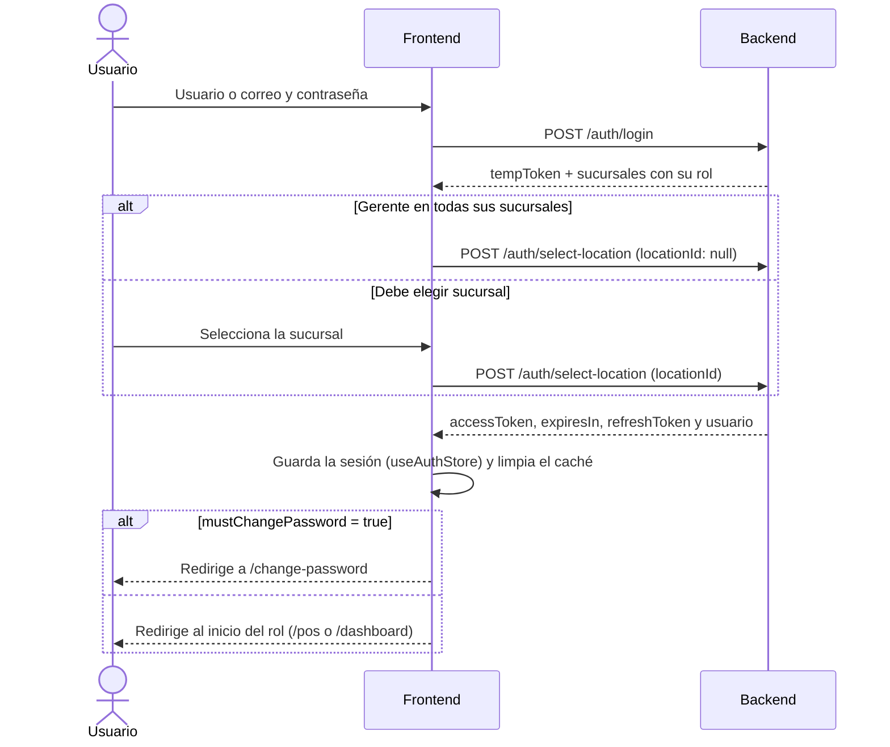

**Renovación reactiva del token:**

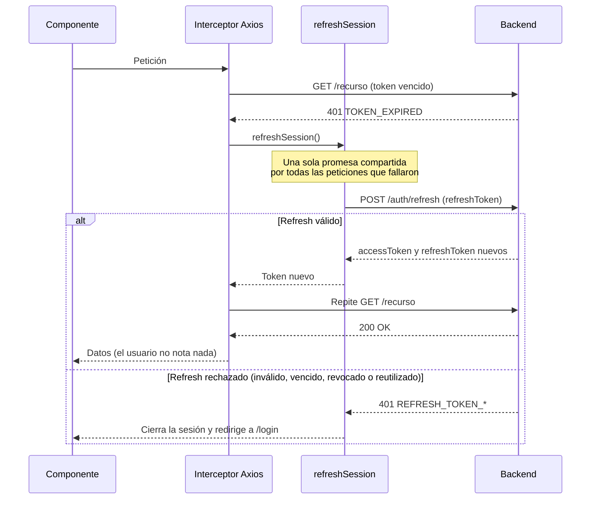

---

## 5. Gestión de estado

- **Estado del servidor** (listados, detalles y mutaciones): **TanStack React Query**. El `staleTime` se ajusta por endpoint: 0 para datos que deben estar siempre frescos (dashboard, turno) y varios minutos para catálogos que cambian poco.
- **Estado del cliente**: **Zustand**, en estos stores:

| Store | Persistencia | Contenido |
|---|---|---|
| `useAuthStore` | localStorage (`auth-storage`) | Sesión: usuario, tokens, vencimiento, sucursales del paso 1 |
| `useUiStore` | localStorage (`ui-storage`) | Sidebar plegado o desplegado |
| `useErrorStore` | No | Error puntual que se muestra como aviso global |
| `useCartStore` (POS) | No | Carrito: ítems y unidades, tipo y canal de pedido, cliente, descuento |
| `useWhatsappOrdersStore` | No (se reconstruye con GET + SSE) | Bandeja de WhatsApp indexada por `order.id`, estado de carga |
| `useOfflineStore` | No (la cola vive en IndexedDB) | `isOffline`, ventas en cola del usuario, `syncing` |

El turno activo no vive en un store: siempre se lee de `GET /shifts/active` con React Query (y, sin conexión, de su copia local).

No se usa Redux ni Context API para estado global.

---

## 6. Comunicación con el backend

### 6.1 Cliente Axios único (`src/services/http.client.ts`)

Un solo cliente (`httpClient`) con `baseURL` desde el entorno, timeout de 10 s y **tres interceptores** encadenados:

1. **Autenticación:** agrega el token leyéndolo directamente del store, fuera del ciclo de render de React.
2. **Errores** (`error.interceptor.ts`):
   - Normaliza cualquier error a un mensaje en español. Prioridad: (a) código de error de dominio conocido (p. ej. `INSUFFICIENT_STOCK`, `NO_ACTIVE_SHIFT`, `SHIFT_HAS_PENDING_ORDERS`); (b) mensaje del backend; (c) mensaje genérico según el código HTTP.
   - Muestra un aviso (uno por campo si el backend devuelve errores de validación). La opción `silentErrors` lo desactiva para peticiones que manejan su propio error, como la sincronización offline.
   - Renueva el token ante un 401 `TOKEN_EXPIRED` (sección 4.4) y redirige ante un 403 `MUST_CHANGE_PASSWORD`.
   - Cierra la sesión ante un 401 que no se puede resolver renovando.
   - **Detecta la falta de conexión:** si no hay respuesta del servidor, marca el POS como offline (`markOffline`) y rechaza con `networkError: true`.
3. **Reintento:** reintenta con espera progresiva (máx. 2 veces) **solo** ante timeout o error de red, nunca ante una respuesta 4xx/5xx.

### 6.2 Hooks genéricos (`src/hooks/api.handlers.ts`)

Todos los hooks de negocio se construyen sobre tres envoltorios de React Query:

- **`useGetHandler`**: consultas simples, con control de rol integrado. Si se indica `roles` y el usuario no los tiene, la petición no se hace.
- **`usePaginatedGetHandler`**: listados paginados; separa `data` de `meta` (total, página, límite y total de páginas).
- **`useSubmitHandler`** (y sus alias `usePostHandler`, `usePutHandler`, `usePatchHandler` y `useDeleteHandler`): mutaciones con aviso de éxito, invalidación de *query keys* y callbacks.

Las *query keys* están centralizadas en `src/constants/queryKeys/query-keys.ts` (`QUERY_KEYS`) para coordinar invalidaciones entre módulos. Por ejemplo, una venta sincronizada offline invalida ventas, turnos e inventario.

### 6.3 Contrato de la API

- **Respuesta normal:** `{ code, message, data?, meta? }` (`ApiResponse<T>`). Las rutas `/auth/*` responden sin este envoltorio.
- **Error:** `{ code, errorCode, message, errors[], timestamp, path }` (`ApiErrorResponse`).
- **Códigos de error de dominio** (`src/constants/httpCodes/error-codes.ts`):
  - Sesión: `TOKEN_EXPIRED`, `TOKEN_INVALID`, `REFRESH_TOKEN_*`, `SESSION_NO_LONGER_VALID`, `MUST_CHANGE_PASSWORD`.
  - Stock: `INSUFFICIENT_STOCK`, `NOT_QUANTIFIABLE`, `STOCK_NOT_FOUND`, `ALERT_NOT_FOUND`, `ALERT_WRONG_LOCATION`.
  - Turnos: `NO_ACTIVE_SHIFT`, `SHIFT_ALREADY_OPEN`, `SHIFT_HAS_PENDING_ORDERS`, `SHIFT_STILL_OPEN`, `SHIFT_NOT_OWNED`, `SHIFT_CLOSED`, `SHIFT_NOT_PENDING`, `SHIFT_REVIEW_NOTES_REQUIRED`, `SHIFT_NOT_CLOSED`.
  - Otros: `LOCATION_ID_REQUIRED`.

---

## 7. Tiempo real (Server-Sent Events)

### 7.1 Cliente SSE propio (`src/services/sse.client.ts`)

No se usa el `EventSource` nativo porque **no permite enviar encabezados**, y el backend autentica con `Authorization: Bearer`. Poner el token en la URL lo dejaría expuesto en los registros de servidores y proxies. El cliente propio, construido sobre `fetch`:

- Interpreta el protocolo SSE (`event:`, `data:` y comentarios `:`).
- **Se reconecta automáticamente** con espera exponencial: 1 s, 2 s, 4 s… hasta 30 s.
- Tiene un **vigilante de inactividad**: si en 75 s no llega nada (ni siquiera el `ping` que el backend envía cada 30 s), da la conexión por muerta y la reabre.
- Ante un 401/403 detiene los reintentos y avisa con `onFatalError`. Si es un 401 `TOKEN_EXPIRED`, quien escucha renueva la sesión y el stream se reabre con el token nuevo.
- `onOpen` indica si la conexión es una **reconexión**, para volver a consultar lo que se perdió: el servidor no reenvía los eventos emitidos mientras el stream estuvo caído.

### 7.2 Streams del sistema

| Stream | Roles | Eventos | Efecto |
|---|---|---|---|
| `/notifications/stream` | Gerente, Administrador | `alert`, `ping` | Aviso de stock bajo; actualiza alertas, stock y dashboard (sección 9.17) |
| `/whatsapp/orders/stream` | Cajero, Administrador, Gerente | `whatsapp-order`, `order-status`, `ping` | Agrega o actualiza pedidos en la bandeja, con sonido y aviso (sección 9.11) |

---

## 8. Sistema de diseño y componentes compartidos

### 8.1 Layout (`src/components/layout/`)

- **`AppLayout`**: estructura general (sidebar + topbar + contenido). Monta los avisos y los procesos en segundo plano (sección 2.3).
- **`Sidebar`**: menú dinámico según el rol, plegable (sección 3.3).
- **`Topbar`**: barra superior (sección 3.4).

### 8.2 Sistema de diseño propio (`src/components/shared/`)

Se apoya en las primitivas estilo shadcn/ui de `src/components/ui/`.

- **`DataTable/`**: tablas paginadas usadas en casi todos los listados. Incluyen orden por columna, paginación numerada, estados de carga (skeleton) y de vacío, filtros (`TableFilters`, con rango de fechas), edición numérica en línea (`InlineNumberEdit`) y el hook `useTableState`, que centraliza página, orden y filtros.
- **`Form/`**: campos conectados a Formik (`FormInput`, `FormPassword`, `FormTextarea` con contador de caracteres, `FormSection`).
- **`Basics/`**: `Button` (variantes, tamaños y estado de carga), `Label`, `ErrorMessage`, `FormSwitch`, `Switch` e `Image`.
- **`Overlay/`**: modales (`AppModal`, tamaños xs–full) y paneles laterales (`AppOffcanvas`), con cabecera y pie estandarizados.
- **`Interactives/`**:
  - `AsyncDropdown`: selector con datos remotos y búsqueda.
  - `MultiSelectDropdown`: selección múltiple con chips.
  - `MoneyInput`: campo de dinero en bolivianos.
  - `ImageUploader`: arrastrar y soltar, con vista previa y validación.
  - `UserRoleAssigner`: asignación de pares usuario + rol.
  - `PasswordField`.
  - `DatePicker`: fecha simple y rango, en español.
- **`OrderBadges`** y **`GlobalErrorToast`**.

### 8.3 Validación de formularios

Cada formulario define sus reglas con **Zod** (`validators/*.schema.ts`) y el adaptador `src/lib/zodToFormik.ts` las convierte en una función `validate` para **Formik**. Todo el proyecto usa Formik + Zod de forma consistente.

### 8.4 Impresión térmica

Los tickets de venta (`TicketPrint`) y los comprobantes de cierre de caja (`ShiftReceiptPrint`) se generan como una vista oculta con estilos de impresión de **80 mm** (`ticket.css`) y se imprimen con `window.print()` mediante el hook `usePrintTicket`.

---

## 9. Módulos funcionales

> Cada módulo se describe con su objetivo, quién lo usa, sus funcionalidades y cómo funciona.

### 9.1 Autenticación (`features/auth`) — `/login`, `/change-password`

**Objetivo:** controlar el acceso al sistema y mantener la sesión.

**Funcionalidades:** login en dos pasos, selección y cambio de sucursal, cambio obligatorio de contraseña, renovación automática de la sesión y cierre de sesión. El detalle técnico está en la sección 4.

### 9.2 Dashboard (`features/dashboard`) — `/dashboard`, Gerente y Administrador

**Objetivo:** dar una foto operativa **del día** (hora de Bolivia).

**Contenido:**
- **4 indicadores:** ventas de hoy (monto y cantidad), ticket promedio, egresos de hoy (incluye nómina) y balance (ventas − egresos, en rojo si es negativo).
- **Cajas:** por sucursal, si el turno está abierto, quién es el cajero y desde qué hora.
- **Pedidos:** pendientes, en preparación y listos (incluye los entregados que esperan el cobro).
- **Alertas:** alertas de stock de productos y de insumos.
- **Gráfico de los últimos 7 días** de ventas (el último día es hoy).
- **Tabla por sucursal:** ventas, cantidad, caja abierta y alertas. Solo aparece para el Gerente cuando elige "Todas las sucursales".

**Cómo funciona:**
- Consulta `GET /finances/reports/dashboard`. El Gerente puede elegir una sucursal o todas; para el Administrador, el backend usa siempre su sucursal.
- Se actualiza **cada 60 s**, al volver a la pestaña y al instante cuando llega una alerta de stock por SSE.
- Muestra mensajes específicos ante un 403 o un 404, y el aviso "Aún no hay ventas hoy" cuando corresponde.

### 9.3 Usuarios (`features/users`) — `/users`, solo Gerente

**Objetivo:** gestionar el personal del restaurante.

**Funcionalidades:**
- **Crear y editar usuarios:** nombre, apellido, usuario y correo (estos tres no se pueden cambiar tras la creación), teléfono, descripción y uno o varios **cargos**.
- **Desactivar** (borrado lógico, conserva el historial).
- **Credenciales por correo:** al crear un usuario o al **restablecer su contraseña** (`POST /users/:id/reset-password`), el backend genera una contraseña temporal y la envía por correo.
  - La tabla muestra el estado del envío: *Pendiente*, *Enviado* o *Fallido* (`CredentialsEmailBadge`).
  - El hook `usePasswordReset` consulta `GET /users/:id` cada 2 s, durante un máximo de 30 s, y muestra el estado al instante.
  - Si el envío falla, se puede **reintentar**. Cada restablecimiento invalida la contraseña temporal anterior.
- La relación usuario ↔ sucursal ↔ rol es de muchos a muchos. Se **edita en Sucursales**; aquí se muestra en modo lectura.

### 9.4 Sucursales (`features/locations`) — `/locations`, solo Gerente

**Objetivo:** gestionar los locales físicos y quién trabaja en cada uno.

**Funcionalidades:**
- Crear y editar sucursales (nombre y dirección).
- Activar o desactivar con doble confirmación (borrado lógico).
- **Asignar usuarios con su rol** en un modal de dos pasos: datos de la sucursal → usuarios y roles (`StepCard`, `AssignRoles`).

Es la base del modelo multi-sucursal: el login devuelve estas asignaciones, y los datos operativos (stock, ventas, pedidos, turnos) se separan por sucursal.

### 9.5 Catálogo (`features/catalog`) — `/catalog/*`, Gerente y Administrador

**Categorías** (`/catalog/categories`):
- Agrupan los productos del menú y definen su orden de aparición. Se asignan a una o varias sucursales.
- **Disponibilidad masiva** (`PATCH /categories/:id/availability`): activa o desactiva de una vez todos los productos de la categoría, en una sucursal o en todas.
  - El interruptor tiene cuatro estados (encendido, apagado, parcial y sin productos), calculados con `productsCount` y `availableProductsCount`.
  - Se pide confirmación (`CategoryAvailabilityModal`) y luego se informa cuántos productos cambiaron.
  - No modifica el stock ni las recetas.

**Modificadores** (`/catalog/modifiers`):
- Extras con precio adicional que se agregan a un producto en el POS (p. ej. "Carne extra +Bs 15").
- Tienen precio, estado activo o inactivo y sucursales asignadas.

**Productos** (`/catalog/products`):
- Tabla paginada con nombre, marca, descripción, **imagen** (subida de archivo), precio, categoría y orden.
- Dos opciones clave:
  - `isQuantifiable`: el producto controla stock en Inventario.
  - `haveModifiers`: el producto acepta modificadores en el POS.
- **Disponibilidad en dos niveles** (`product-availability.ts`):
  - *Global*: se cambia desde el formulario del producto. Si está apagada, el producto no se vende en ninguna sucursal.
  - *Por sucursal*: se cambia con un interruptor en la tabla. Si el Gerente ve "todas las sucursales", el interruptor puede mostrar el estado *parcial*.

En los tres submódulos, el Gerente asigna libremente las sucursales. El Administrador queda restringido a la suya, tanto en la interfaz como antes de enviar el formulario; el backend también lo valida.

### 9.6 Inventario (`features/inventory`) — `/inventory`, Gerente y Administrador

**Objetivo:** controlar el stock de **productos terminados** cuantificables, por sucursal.

**Funcionalidades:**
- **Registrar el stock inicial** de un producto en una sucursal, con su unidad de medida y su stock mínimo (`CreateStockModal`).
- **Ajustar el stock:** sumar, restar o fijar un valor (`AdjustStockModal`).
- **Kardex** (`KardexModal`): historial de entradas y salidas con su motivo: `SALE` (venta), `MANUAL_ENTRY` (entrada manual) y `SALE_ANNULMENT` (devolución por anulación).
- **Alertas de stock bajo** (`StockAlertsModal`): comparan la cantidad actual con el mínimo y se pueden marcar como resueltas. También llegan en tiempo real (sección 9.17).

El Gerente puede ver y filtrar cualquier sucursal; el Administrador, solo la suya. Las ventas descuentan stock y las anulaciones lo devuelven (lo hace el backend).

### 9.7 Insumos y recetas (`features/supplies`) — `/ingredients`, Gerente y Administrador

Es la contraparte del Inventario para la **materia prima**. Tiene tres pestañas:

1. **Insumos:** catálogo de ingredientes con su unidad (kg, lb, arroba o unidad).
2. **Stock de insumos:**
   - Mismo esquema que Inventario: alta, ajustes, kardex y alertas.
   - Además registra el **costo unitario** de cada compra, lo que permite costear.
   - Motivos del kardex: `PURCHASE` (compra), `SALE_CONSUMPTION` (consumo por venta), `ADJUSTMENT` (ajuste), `WASTE` (**merma**) y `SALE_ANNULMENT` (anulación de venta).
3. **Recetas:**
   - Vinculan un producto con los insumos (y cantidades) que consume **por unidad vendida**.
   - Al crear una receta, se registra stock en 0 de esos insumos en todas las sucursales donde se vende el producto.
   - Gracias a esto, cada venta descuenta automáticamente los insumos.

### 9.8 Punto de Venta — POS (`features/pos`) — `/pos`, solo Cajero

**Objetivo:** vender rápido en el mostrador.

**Flujo de estados:** `idle → review → payment → success`.

1. **Turno obligatorio:** sin un turno abierto, la pantalla queda bloqueada por un modal (`ShiftModal`) donde se registra el **monto inicial de caja** (`POST /shifts/open`).
2. **Menú visual:** pestañas por categoría (`CategoryTabs`) y tarjetas con imagen, nombre, marca y precio (`ProductGrid`). El menú sale de `GET /products/menu`; solo se agregan productos disponibles.
3. **Carrito** (`CartPanel`, `useCartStore`):
   - Cada línea tiene **varias unidades** y **cada unidad lleva sus propios modificadores y notas** (`CartItemEditModal`).
   - Las líneas se reordenan arrastrándolas (dnd-kit) y se puede editar la cantidad.
   - **Tipo de pedido:** Presencial (canal en tienda), Para llevar (en tienda) o Delivery (en línea).
4. **Revisión** (`ReviewOrderModal`):
   - Resumen agrupado por producto con sus modificadores.
   - Datos del cliente según el tipo: Delivery exige nombre, teléfono y dirección; Para llevar exige nombre.
   - Se puede **cancelar** el pedido con un motivo obligatorio.
5. **Pago** (`PaymentModal`):
   - Métodos: **Efectivo**, **QR** o **Tarjeta** (en la API, la tarjeta es `BANK_TRANSFER`).
   - Admite descuento.
   - En efectivo calcula el **cambio** en tiempo real y envía `receivedAmount`.
6. **Éxito e impresión** (`OrderSuccessModal`, `TicketPrint`): muestra el código del ticket y el detalle, e **imprime automáticamente** un ticket de 80 mm con el tipo de pedido y el método de pago.
7. **Venta sin conexión:** si no hay conexión, el mismo flujo registra una venta offline (sección 9.16).

> La **facturación electrónica** quedó para la **Fase 2**. Su código está comentado y marcado con `FASE 2 - Facturación` (sección 15).

**Diagrama de secuencia — venta en el POS con conexión (CU-23):**

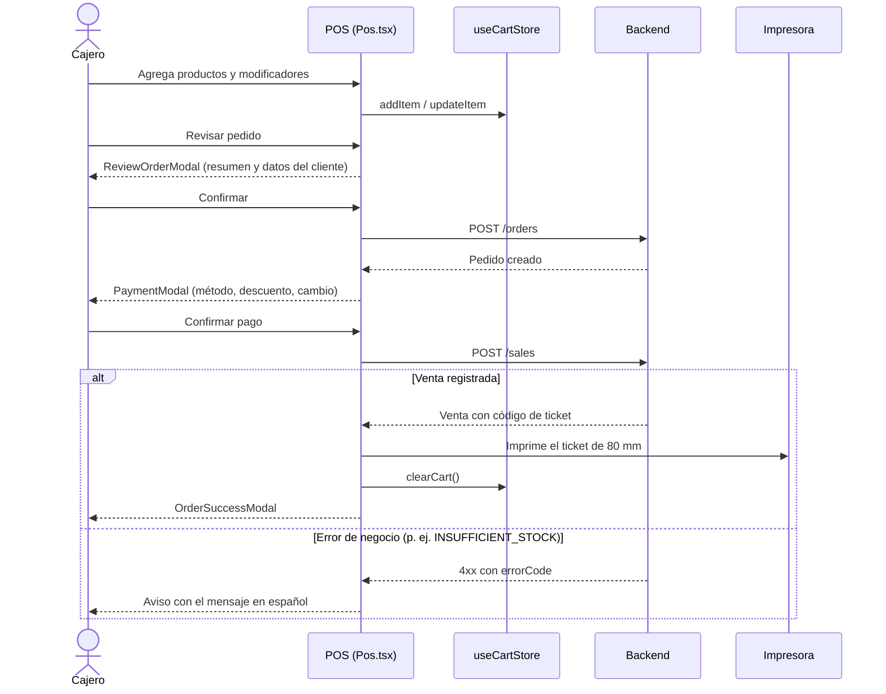

### 9.9 Pedidos (`features/pos/page/order`) — `/orders`, Gerente, Administrador y Cajero

**Objetivo:** consultar y dar seguimiento a los pedidos.

- **Filtros:** búsqueda, estado, tipo y canal. El Gerente filtra además por sucursal y fecha.
- **Estados** (`OrderStatusEnum`): `PENDING → CONFIRMED → PREPARING → READY → (DELIVERED) → PAID`, o `CANCELLED`.
- **Cobro diferido:** el cajero abre un pedido pendiente de pago (p. ej. un delivery que se paga al entregar) y lo cobra con el mismo flujo de revisión, pago y éxito del POS.
- **Cancelación:** exige escribir un motivo (máx. 500 caracteres), que se envía como `reason` y luego se ve en el detalle del pedido (`cancellationReason`).

**Diagrama de estados del pedido:**

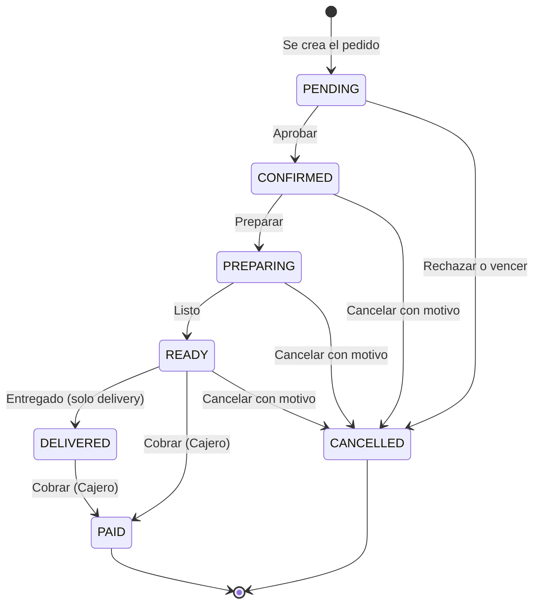

### 9.10 Ventas (`features/sales`) — `/sales`, Gerente, Administrador y Cajero

**Objetivo:** consultar y auditar las ventas. Una venta nace al cobrar un pedido.

- Cada venta registra subtotal, descuento, total, monto recibido, cambio, método de pago y estado (`OPEN`, `CLOSED` o `ANNULLED`), con el detalle de ítems agrupados por producto.
- El Cajero y el Administrador ven su sucursal. El Gerente ve todas y filtra por sucursal, método de pago y cajero.
- El detalle permite **reimprimir el ticket**.
- **Anulación de venta** (`PUT /sales/:id/annul`, `AnnulSaleModal`):
  - Exige un motivo (máx. 500 caracteres).
  - **Devuelve el stock de productos e insumos** (kardex `SALE_ANNULMENT`) y deja el pedido cancelado.
  - Es irreversible. Si no se permite anular (por ejemplo, porque el turno ya cerró), el botón se deshabilita y explica el motivo.
- Las ventas offline sincronizadas se distinguen con un indicador propio (`OfflineChip`).

### 9.11 Pedidos de WhatsApp (`features/whatsapp`) — `/whatsapp-orders`, Cajero, Administrador y Gerente

**Objetivo:** atender en tiempo real los pedidos que los clientes arman por WhatsApp. El bot conversacional vive en el backend.

**Sincronización** (`useWhatsappOrdersStream`, montado en el layout):
1. Carga inicial con `GET /whatsapp/orders`: pedidos activos (ni pagados ni cancelados), del más antiguo al más nuevo.
2. Abre el stream `GET /whatsapp/orders/stream`:
   - `whatsapp-order`: agrega el pedido, emite un **aviso sonoro** (dos tonos generados con Web Audio, que se habilita tras la primera interacción del usuario porque el navegador bloquea el audio hasta entonces) y muestra un aviso con el botón **Ver**.
   - `order-status`: actualiza el estado del pedido. Si quedó pagado o cancelado, lo quita de la bandeja. Si el sistema lo canceló porque nadie lo aprobó a tiempo (`automatic: true`), avisa del vencimiento.
   - Si llega un cambio de estado de un pedido desconocido, recarga la bandeja.
3. En cada reconexión vuelve a hacer la consulta inicial.
4. La bandeja vive en `useWhatsappOrdersStore`, indexada por `order.id` para no duplicar lo que llega por la consulta y por el stream. Al cerrar sesión se vacía.

**Pantalla:**
- **Pestañas:** *Pendientes* (`PENDING`), *En curso* (`CONFIRMED`, `PREPARING`) y *Listos* (`READY`, `DELIVERED`), cada una con su contador.
- **Columnas:** código (primeros 8 caracteres del id), espera, cliente, tipo, total, preferencia de pago (Efectivo o QR) y acción.
- **Columna "Espera"** (`WaitTime`):
  - En pedidos pendientes con plazo, muestra una **cuenta regresiva** hasta `expiresAt`, en verde (más de 10 min), amarillo (5 a 10 min) o rojo (menos de 5 min). Al llegar a 0 muestra "Venciendo…": el frontend no cancela, espera el evento del backend.
  - En los demás estados muestra el tiempo transcurrido ("hace 18 min").
- **Detalle lateral** (`WhatsappOrderDrawer`): ítems agrupados, dirección (con los enlaces de Google Maps separados) y acceso directo al chat del cliente (`wa.me`).

**Acciones según el estado** (`order-actions.ts`):

| Estado | Acción principal |
|---|---|
| `PENDING` | **Aprobar** → `CONFIRMED`. Al aprobar, el backend envía la confirmación y el QR al cliente. Cancelar equivale a *rechazar*. |
| `CONFIRMED` | **Preparar** → `PREPARING` |
| `PREPARING` | **Listo** → `READY` |
| `READY` (delivery) | **Entregado** → `DELIVERED` |
| `READY` / `DELIVERED` | **Cobrar** (solo Cajero) |
| `PENDING` a `READY` | **Cancelar** con motivo (`CancelOrderModal`) |

**Permisos:** el Cajero cambia estados y cobra; el Administrador cambia estados pero no cobra; el Gerente solo consulta. Al cobrar se propone el método de pago que eligió el cliente.

**Concurrencia:** si otro cajero ya movió el pedido (el backend responde 409 o 400), se recarga ese pedido con `GET /orders/:id` y se actualiza la bandeja.

### 9.12 Turnos de caja (`features/shifts`) — `/shifts`

**Ciclo de vida:** `OPEN → (el cajero cierra y declara) → PENDING → (el administrador aprueba) → CLOSED`. Solo puede haber un turno `OPEN` por sucursal; un turno `PENDING` no impide abrir el siguiente.

**Cajero — pantalla "Caja":**
- Ve su turno activo y su resumen (`GET /shifts/active/summary`).
- **Cierre ciego:** el resumen llega con todos los montos en `null` y la pantalla solo muestra cantidades (ventas por método, anuladas, egresos, nómina y pedidos pendientes).
- **Declaración:** el cajero declara el efectivo contado (`declaredCash`), el total de la app del QR (`declaredQr`) y el total del datáfono (`declaredBankTransfer`), con una nota opcional.
- **El primer envío es definitivo:** el turno pasa a `PENDING` con lo declarado, haya o no diferencia.
- Después del cierre, la respuesta ya no es ciega: muestra el cuadre por método (declarado / esperado / diferencia) y **se imprime automáticamente el comprobante de cierre** (80 mm, con ventas por método, egresos y nómina detallados, cuadre, conciliación y línea de firma). Se puede reimprimir.
- Si quedan pedidos sin cobrar ni cancelar, no se puede cerrar (`SHIFT_HAS_PENDING_ORDERS`).

**Administrador y Gerente — "Turnos de caja":**
- Historial paginado (`GET /shifts/page`) con filtros de estado y fechas. El Gerente filtra además por sucursal.
- **El Administrador aprueba** los cierres pendientes (`POST /shifts/:id/approve`). El comentario es obligatorio si hay diferencia en cualquier método (`hasDifference`). El Gerente solo consulta.
- El detalle (`ShiftDetailModal`) muestra el arqueo por método y los movimientos. Desde ahí se reimprime el comprobante (`GET /shifts/:id/receipt`).

**Arqueo:**
- Efectivo esperado = monto inicial + ventas en efectivo − egresos − nómina.
- QR y tarjeta: el esperado es lo vendido por ese medio.

**Diagrama de estados del turno:**

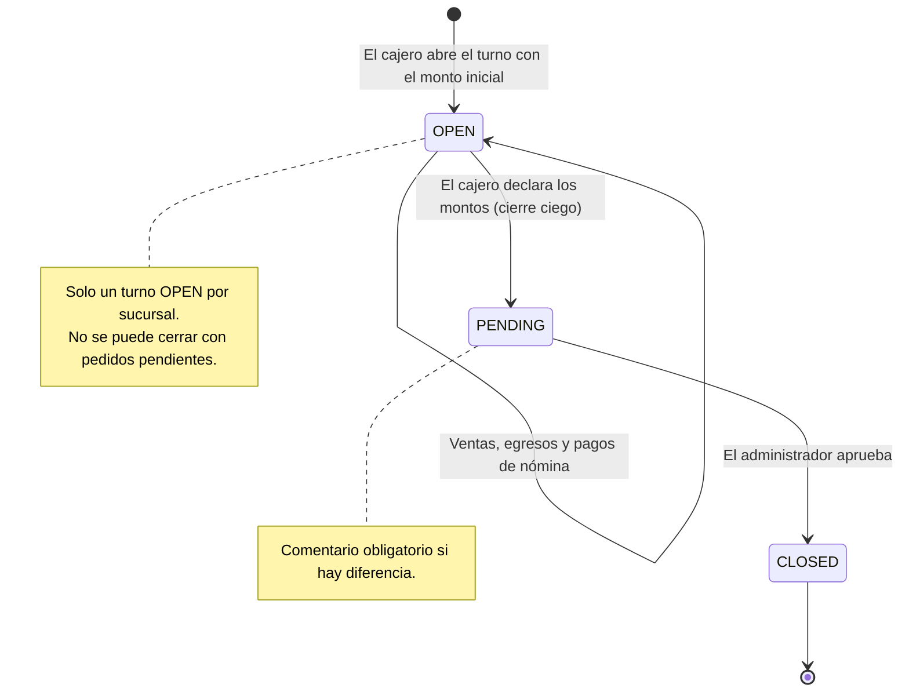

**Diagrama de actividad — cierre y aprobación de caja (CU-38 / CU-39):**

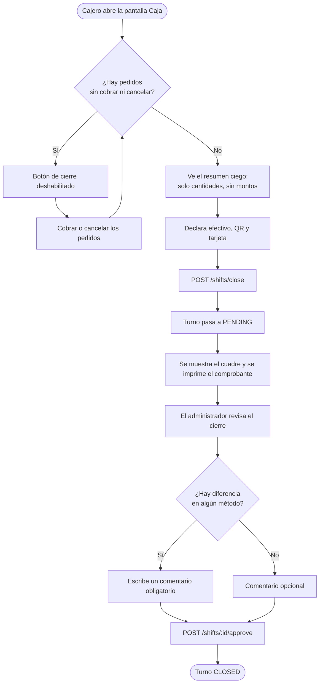

### 9.13 Egresos (`features/finances/expenses`) — `/expenses`

**Objetivo:** registrar los gastos pagados desde la caja.

- **Datos:** categoría (servicios, personal, insumos, mantenimiento u otros), descripción (máx. 500 caracteres), monto y URL del comprobante (opcional).
- Cada egreso queda **vinculado al turno** en que se registró.

| Acción | Cajero | Administrador | Gerente |
|---|---|---|---|
| Registrar | Sí (solo con turno abierto) | No | No |
| Ver listado | Su turno activo | Su sucursal | Elige la sucursal |
| Editar o eliminar | No | Sí, si el turno sigue `OPEN` | Sí, si el turno sigue `OPEN` |
| Reporte por categoría | No | Su sucursal | Elige la sucursal |

**Reglas:**
- Sin turno abierto, el botón de registrar se deshabilita (`NO_ACTIVE_SHIFT`).
- Si el turno ya está `PENDING` o `CLOSED`, el egreso queda en solo lectura (`SHIFT_CLOSED`), porque cambiarlo alteraría el arqueo declarado.
- La edición es un `PUT` completo; la eliminación es definitiva.

### 9.14 Nómina (`features/finances/payroll`) — `/payroll`

**Objetivo:** pagar los **sueldos diarios** desde la caja.

- **Sueldos** (`PayrollWagesView`, Administrador y Gerente): sueldo diario por trabajador **y por sucursal** (`PATCH /users/:id/locations/:locationId/wage`).
- **Hoja de pago:** trabajadores activos con su sueldo, sus cargos y si ya cobraron hoy (es informativo, no bloquea).
- **Pago masivo** (`BatchPayrollModal`, Cajero):
  - Todos los trabajadores aparecen marcados, con el monto sugerido igual a su sueldo.
  - El cajero desmarca a quien no trabajó y ajusta los montos.
  - Se envía en **una sola transacción** de hasta 200 pagos: si uno falla, se revierte todo.
- **Pago individual** (`CreatePayrollModal`, Cajero): incluso a personas que no son usuarios del sistema.
- **Cada pago genera automáticamente un egreso** de categoría "Personal".
- **Listado:**
  - El Cajero ve los pagos de su turno activo.
  - El Administrador y el Gerente ven una tabla paginada con búsqueda y fechas; el Gerente puede elegir una sucursal o todas.
- **Reporte:** total y desglose por empleado. El Gerente puede pedir el consolidado de todas las sucursales.

### 9.15 Reportes (`features/finances/reports`) — `/reports`, solo Gerente

**Objetivo:** analizar el negocio por período y sucursal.

- **Filtros:**
  - Período: últimos 7 días, este mes (por defecto) o mes pasado. El rango se calcula en días locales (`report-period.ts`).
  - Sucursal: una o todas.
- **Tres pestañas.** Cada una consulta solo su endpoint `GET /finances/reports/{tipo}`, con caché por parámetros:

| Pestaña | Contenido |
|---|---|
| **Ventas** | Total bruto, descuentos, neto, cantidad de ventas y ticket promedio; ventas por día (incluye los días sin ventas); distribución por método de pago con porcentaje; **top 10 de productos** por ingreso |
| **Egresos y nómina** | Total y desglose de egresos por categoría; total pagado y desglose por empleado |
| **Insumos** | Por insumo: **comprado, consumido, mermado y restante**, más el costo total |

### 9.16 Venta sin conexión (`features/offline`) — Cajero

**Objetivo:** que el POS **siga vendiendo si se cae internet** y que las ventas lleguen al backend cuando vuelva la conexión.

**Piezas:**

| Pieza | Responsabilidad |
|---|---|
| `public/sw.js` (Service Worker) | Guarda los archivos de la aplicación para que el POS abra sin internet |
| `offline-cache.ts` | Copia en localStorage del **menú** y del **turno activo**, por usuario y sucursal. Se actualiza en cada respuesta exitosa y se usa como respaldo cuando una petición falla por red. También genera el identificador del equipo (`deviceId`) y pide almacenamiento persistente. |
| `connectivity.ts` | Comprueba si hay conexión consultando el backend. Cualquier respuesta, incluso un 401, cuenta como conexión. |
| `offline-queue.ts` | Cola de ventas en **IndexedDB** (`buen-asador-pos` / `offline-sales`), con índice por usuario. Avisa a las demás pestañas con `BroadcastChannel`. |
| `offline-sale.builder.ts` | Valida si la venta puede hacerse offline, genera el código del ticket y arma la venta |
| `offline-sync.service.ts` | Envía la cola a `POST /sales/offline-sync` |
| `useOfflineSync` | Orquesta todo: al iniciar sesión, al volver la conexión y cada 20 s mientras haya ventas pendientes o falte conexión |
| `OfflineStatusBadge`, `OfflineQueueModal`, `OfflineChip` | Interfaz: indicador en la barra superior, revisión de la cola y marca de venta offline |

**Reglas de la venta offline:**
- Solo **Presencial** o **Para llevar** (Delivery se deshabilita) y solo **Efectivo** o **Tarjeta**.
- Requiere un turno abierto guardado en el equipo: sin conexión no se puede abrir turno.
- Máximo 100 unidades por venta.
- Código de ticket con la marca `OFF`: `PREF-AAAAMMDD-OFF-XXXXXXXX`.
- Cada venta lleva un **UUID como clave de idempotencia**, para que una misma venta no se registre dos veces.
- Se guarda la hora real de la venta (`occurredAt`).
- El ticket impreso indica que la venta aún no está sincronizada.

**Sincronización:**
- Lotes de 50 ventas, con una pausa de 600 ms entre lotes. Ante un 429 (demasiadas solicitudes) espera y reintenta una vez.
- **Solo una sincronización a la vez**, también entre pestañas (`navigator.locks`).
- Resultado por venta:
  - `CREATED` o `DUPLICATE`: sale de la cola.
  - `REJECTED` reintentable: se queda en la cola y suma un intento.
  - `REJECTED` no reintentable: pasa a **"con conflicto"**. El cajero la revisa en `OfflineQueueModal` y puede descartarla.
- Si el lote falla sin respuesta o con un error 5xx, la cola queda intacta para el próximo intento.
- Se informa el resultado con advertencias: precio distinto al del catálogo, producto desactivado, código de ticket regenerado u hora ajustada.
- Al sincronizar, se actualizan ventas, turnos e inventario.

**Seguridad de los datos:**
- La cola **sobrevive a recargas y al cierre de sesión**.
- Cada venta guarda el `userId` del cajero y solo se sincroniza con su sesión.
- Al cerrar sesión con ventas pendientes se pide confirmación.

**Diagrama de estados de una venta en la cola offline:**

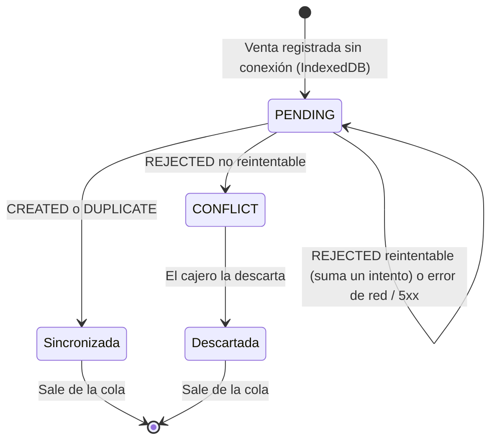

**Diagrama de secuencia — venta sin conexión y sincronización (CU-24 / CU-25):**

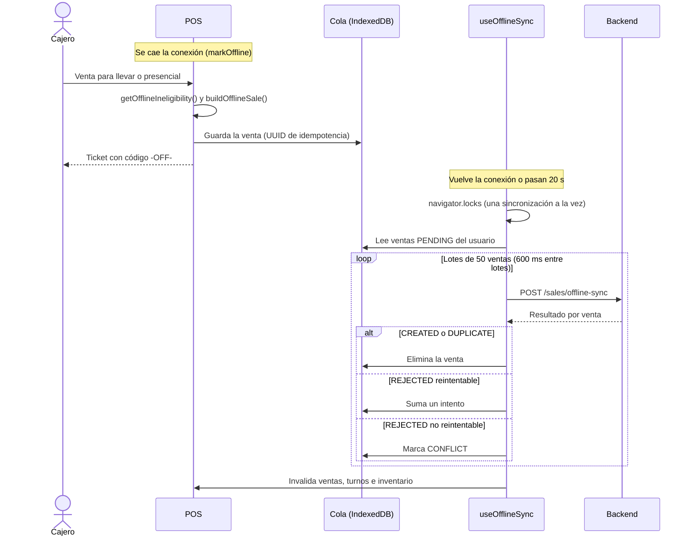

### 9.17 Notificaciones de stock (`features/notifications`) — Gerente y Administrador

**Objetivo:** avisar en tiempo real cuando un producto o un insumo baja de su stock mínimo.

- `useStockAlertsStream` escucha `/notifications/stream`. Por cada evento `alert`:
  - Muestra un aviso ("Stock bajo: X" o "Insumo bajo: X", con "Quedan N (mínimo M)" o "Sin stock disponible") con el botón **Ver**, que lleva a Inventario o a la pestaña de stock de Insumos.
  - Actualiza las alertas, el stock y el dashboard.
  - Usa el id de la alerta para no repetir el aviso si el evento llega dos veces.
- **Campana** (`StockAlertsBell`): el conteo sale de las consultas de alertas, no de sumar eventos, para coincidir siempre con el servidor.
- Al reconectar, vuelve a consultar alertas y stock.
- El Cajero no recibe este stream (el backend responde 403).

---

## 10. Matriz de acceso por rol

| Módulo / acción | Gerente | Administrador | Cajero |
|---|:-:|:-:|:-:|
| Dashboard | ✅ todas o una sucursal | ✅ su sucursal | — |
| Usuarios | ✅ | — | — |
| Sucursales | ✅ | — | — |
| Reportes | ✅ | — | — |
| Catálogo | ✅ | ✅ (su sucursal) | — |
| Inventario e insumos | ✅ | ✅ (su sucursal) | — |
| Alertas de stock en tiempo real | ✅ | ✅ | — |
| POS (vender, cobrar) | — | — | ✅ |
| Venta offline | — | — | ✅ |
| Pedidos | ✅ consulta | ✅ | ✅ cobra |
| Pedidos de WhatsApp | ✅ consulta | ✅ cambia estados | ✅ cambia estados y cobra |
| Ventas: consultar | ✅ | ✅ | ✅ |
| Ventas: anular | ✅ | ✅ | ✅ |
| Egresos | ✅ edita y consulta | ✅ edita y consulta | ✅ registra |
| Nómina: pagar | — | — | ✅ |
| Nómina: sueldos y reporte | ✅ | ✅ | — |
| Turnos: abrir y cerrar | — | — | ✅ |
| Turnos: aprobar cierre | — | ✅ | — |
| Turnos: historial | ✅ | ✅ | — |
| Cambiar de sucursal | — | ✅ | ✅ (sin turno abierto) |

> La anulación de ventas depende además de reglas del backend (por ejemplo, el estado del turno). La interfaz muestra el motivo cuando no está permitida.

---

## 11. Casos de uso

### 11.1 Actores

| Actor | Descripción |
|---|---|
| **Gerente** | Dueño o encargado general. Supervisa todas las sucursales. |
| **Administrador** | Responsable de una sucursal. |
| **Cajero** | Atiende la caja de una sucursal. |
| **Cliente de WhatsApp** | Actor externo: arma su pedido por WhatsApp a través del bot del backend. |
| **Sistema (backend)** | Actor secundario: vence pedidos no aprobados, emite alertas de stock y envía correos. |

### 11.2 Catálogo de casos de uso

| ID | Caso de uso | Actor principal | Módulo |
|---|---|---|---|
| CU-01 | Iniciar sesión | Todos | Autenticación |
| CU-02 | Seleccionar sucursal | Todos | Autenticación |
| CU-03 | Cambiar contraseña temporal | Todos | Autenticación |
| CU-04 | Cambiar de sucursal | Administrador, Cajero | Autenticación |
| CU-05 | Cerrar sesión | Todos | Autenticación |
| CU-06 | Gestionar usuarios | Gerente | Usuarios |
| CU-07 | Restablecer contraseña de un usuario | Gerente | Usuarios |
| CU-08 | Gestionar sucursales | Gerente | Sucursales |
| CU-09 | Asignar usuarios y roles a una sucursal | Gerente | Sucursales |
| CU-10 | Gestionar categorías | Gerente, Administrador | Catálogo |
| CU-11 | Activar o desactivar una categoría completa | Gerente, Administrador | Catálogo |
| CU-12 | Gestionar modificadores | Gerente, Administrador | Catálogo |
| CU-13 | Gestionar productos | Gerente, Administrador | Catálogo |
| CU-14 | Cambiar la disponibilidad de un producto | Gerente, Administrador | Catálogo |
| CU-15 | Registrar stock inicial de un producto | Gerente, Administrador | Inventario |
| CU-16 | Ajustar stock de un producto | Gerente, Administrador | Inventario |
| CU-17 | Consultar kardex | Gerente, Administrador | Inventario / Insumos |
| CU-18 | Resolver alertas de stock | Gerente, Administrador | Inventario / Insumos |
| CU-19 | Gestionar insumos | Gerente, Administrador | Insumos |
| CU-20 | Registrar compra o merma de insumos | Gerente, Administrador | Insumos |
| CU-21 | Gestionar recetas | Gerente, Administrador | Insumos |
| CU-22 | Abrir turno de caja | Cajero | POS / Turnos |
| CU-23 | Registrar venta en el POS | Cajero | POS |
| CU-24 | Registrar venta sin conexión | Cajero | Offline |
| CU-25 | Sincronizar ventas offline | Cajero / Sistema | Offline |
| CU-26 | Cobrar pedido pendiente | Cajero | Pedidos |
| CU-27 | Cancelar pedido | Cajero, Administrador | Pedidos / WhatsApp |
| CU-28 | Consultar pedidos | Todos | Pedidos |
| CU-29 | Atender pedido de WhatsApp | Cajero, Administrador | WhatsApp |
| CU-30 | Cobrar pedido de WhatsApp | Cajero | WhatsApp |
| CU-31 | Consultar ventas y reimprimir ticket | Todos | Ventas |
| CU-32 | Anular venta | Según permisos | Ventas |
| CU-33 | Registrar egreso de caja | Cajero | Egresos |
| CU-34 | Editar o eliminar egreso | Administrador, Gerente | Egresos |
| CU-35 | Configurar sueldo diario | Administrador, Gerente | Nómina |
| CU-36 | Registrar pago masivo de nómina | Cajero | Nómina |
| CU-37 | Registrar pago individual de nómina | Cajero | Nómina |
| CU-38 | Cerrar turno de caja (arqueo ciego) | Cajero | Turnos |
| CU-39 | Aprobar cierre de caja | Administrador | Turnos |
| CU-40 | Consultar historial de turnos | Administrador, Gerente | Turnos |
| CU-41 | Consultar dashboard del día | Gerente, Administrador | Dashboard |
| CU-42 | Consultar reportes por período | Gerente | Reportes |
| CU-43 | Recibir alerta de stock en tiempo real | Gerente, Administrador | Notificaciones |

### 11.3 Diagrama de casos de uso (resumen)

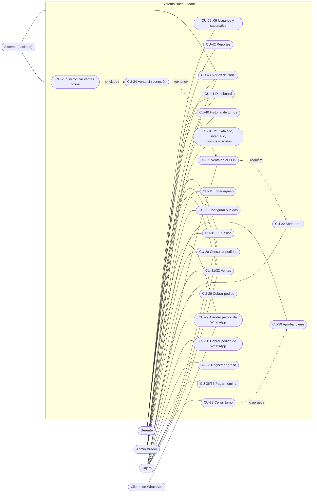

> La herencia Gerente → Administrador es conceptual (el Gerente supervisa lo que gestiona el Administrador). En el sistema, algunas acciones operativas son exclusivas del Administrador (aprobar cierres) o del Cajero (cobrar).

### 11.4 Especificación de los casos de uso principales

#### CU-01 / CU-02 — Iniciar sesión y seleccionar sucursal

| Campo | Descripción |
|---|---|
| **Actor** | Gerente, Administrador o Cajero |
| **Precondición** | El usuario está activo y tiene al menos una sucursal asignada |
| **Postcondición** | Sesión completa con access token y refresh token; el usuario está en la pantalla de inicio de su rol |

**Flujo principal:**
1. El usuario ingresa su usuario o correo y su contraseña.
2. El sistema valida las credenciales y muestra las sucursales disponibles con el rol en cada una.
3. El usuario elige una sucursal.
4. El sistema crea la sesión, limpia los datos en caché y redirige: el Cajero al POS; el Administrador y el Gerente al Dashboard.

**Flujos alternativos:**
- **2a.** Credenciales incorrectas: el sistema muestra el error y no avanza.
- **2b.** El usuario es Gerente en todas sus sucursales: el sistema omite el paso 3 y entra con vista consolidada.
- **4a.** El usuario tiene una contraseña temporal: el sistema lo lleva a CU-03.

#### CU-03 — Cambiar contraseña temporal

| Campo | Descripción |
|---|---|
| **Actor** | Cualquier usuario con `mustChangePassword` |
| **Precondición** | Sesión iniciada con una contraseña temporal |
| **Postcondición** | Contraseña nueva guardada; acceso completo al sistema |

**Flujo principal:**
1. El sistema muestra la pantalla de cambio de contraseña y bloquea el resto.
2. El usuario ingresa la contraseña actual, la nueva y su confirmación.
3. El sistema valida y guarda.
4. El sistema redirige a la pantalla de inicio del rol.

**Flujo alternativo:**
- **3a.** La contraseña actual es incorrecta o la nueva es igual a la actual: se muestra el error.

#### CU-07 — Restablecer contraseña de un usuario

| Campo | Descripción |
|---|---|
| **Actor** | Gerente |
| **Precondición** | El usuario existe y tiene correo |
| **Postcondición** | Se generó una contraseña temporal nueva y se envió por correo; la anterior deja de servir |

**Flujo principal:**
1. El Gerente pulsa "Restablecer contraseña" en la fila del usuario.
2. El sistema genera la contraseña temporal y muestra el estado del correo como *Pendiente*.
3. El sistema consulta el estado hasta que cambia a *Enviado*.

**Flujo alternativo:**
- **3a.** El estado pasa a *Fallido*: el Gerente puede reintentar.

#### CU-22 — Abrir turno de caja

| Campo | Descripción |
|---|---|
| **Actor** | Cajero |
| **Precondición** | No hay un turno `OPEN` en la sucursal |
| **Postcondición** | Turno `OPEN` vinculado al cajero; el POS queda habilitado |

**Flujo principal:**
1. El cajero entra al POS y el sistema muestra el modal de apertura.
2. El cajero ingresa el monto inicial de caja.
3. El sistema abre el turno y desbloquea el POS.

**Flujos alternativos:**
- **3a.** Ya hay un turno abierto en la sucursal (`SHIFT_ALREADY_OPEN`): se muestra el error.
- **1a.** No hay conexión: no se puede abrir turno.

#### CU-23 — Registrar venta en el POS

| Campo | Descripción |
|---|---|
| **Actor** | Cajero |
| **Precondición** | Turno abierto; hay productos disponibles en la sucursal |
| **Postcondición** | Pedido y venta registrados; stock de productos e insumos descontado; ticket impreso |

**Flujo principal:**
1. El cajero elige productos del menú por categoría.
2. Para cada unidad, opcionalmente agrega modificadores y notas.
3. El cajero elige el tipo de pedido (Presencial, Para llevar o Delivery).
4. El cajero revisa el pedido e ingresa los datos del cliente si corresponde.
5. El cajero elige el método de pago, aplica un descuento si hay, y en efectivo ingresa el monto recibido.
6. El sistema muestra el cambio, registra la venta e imprime el ticket.
7. El cajero inicia un nuevo pedido.

**Flujos alternativos:**
- **4a.** Faltan datos obligatorios del cliente (Delivery: nombre, teléfono y dirección; Para llevar: nombre): el sistema no permite continuar.
- **4b.** El cajero cancela el pedido indicando un motivo.
- **5a.** El monto recibido en efectivo es menor que el total: no se permite confirmar.
- **6a.** Stock insuficiente (`INSUFFICIENT_STOCK`): se muestra el error y la venta no se registra.
- **6b.** Sin conexión: continúa en CU-24.

#### CU-24 / CU-25 — Registrar y sincronizar venta sin conexión

| Campo | Descripción |
|---|---|
| **Actor** | Cajero; Sistema (sincronización automática) |
| **Precondición** | El POS detectó que no hay conexión; hay un turno abierto guardado en el equipo |
| **Postcondición** | La venta queda en la cola local y, al volver la conexión, registrada en el backend |

**Flujo principal:**
1. El sistema muestra el indicador "Sin conexión".
2. El cajero arma la venta (solo Presencial o Para llevar) y cobra en Efectivo o Tarjeta.
3. El sistema genera un código de ticket con la marca `OFF`, guarda la venta en el equipo e imprime el ticket.
4. Cuando vuelve la conexión, el sistema envía la cola por lotes.
5. El sistema informa cuántas ventas se sincronizaron y con qué advertencias.

**Flujos alternativos:**
- **2a.** Venta de tipo Delivery, más de 100 unidades o sin turno guardado: el sistema avisa el motivo y no permite la venta offline.
- **4a.** Una venta es rechazada de forma definitiva: queda "con conflicto" y el cajero la revisa o descarta.
- **4b.** El servidor no responde: la cola queda intacta y se reintenta cada 20 s.

#### CU-29 / CU-30 — Atender y cobrar un pedido de WhatsApp

| Campo | Descripción |
|---|---|
| **Actor** | Cajero (atiende y cobra), Administrador (solo atiende); Cliente de WhatsApp |
| **Precondición** | El cliente confirmó un pedido en el bot de WhatsApp |
| **Postcondición** | Pedido pagado (sale de la bandeja) o cancelado |

**Flujo principal:**
1. El sistema recibe el pedido en tiempo real, emite un sonido y muestra un aviso.
2. El usuario revisa el detalle y pulsa **Aprobar**. El cliente recibe la confirmación y el QR.
3. El usuario avanza el pedido: **Preparar** → **Listo** (→ **Entregado** si es delivery).
4. El cajero pulsa **Cobrar**. El sistema propone el método que eligió el cliente, registra la venta y quita el pedido de la bandeja.

**Flujos alternativos:**
- **2a.** Nadie aprueba antes del vencimiento: el sistema cancela el pedido automáticamente y avisa.
- **2b.** El usuario rechaza o cancela el pedido indicando un motivo.
- **3a.** Otro cajero ya movió el pedido (409): el sistema recarga su estado.
- **4a.** El usuario es Administrador: el sistema indica que solo el cajero puede cobrar.

#### CU-32 — Anular venta

| Campo | Descripción |
|---|---|
| **Actor** | Usuario con permiso de anulación |
| **Precondición** | La venta está cobrada y la regla de negocio permite anularla |
| **Postcondición** | Venta `ANNULLED`; pedido cancelado; stock de productos e insumos devuelto |

**Flujo principal:**
1. El usuario abre el detalle de la venta y pulsa **Anular venta**.
2. El sistema advierte que la acción es irreversible y pide el motivo.
3. El usuario confirma y el sistema anula la venta y devuelve el stock.

**Flujo alternativo:**
- **1a.** La venta no se puede anular: el botón está deshabilitado y explica el motivo.

#### CU-36 — Registrar pago masivo de nómina

| Campo | Descripción |
|---|---|
| **Actor** | Cajero |
| **Precondición** | Turno abierto; trabajadores con sueldo diario configurado |
| **Postcondición** | Un pago y su egreso "Personal" por cada trabajador marcado |

**Flujo principal:**
1. El cajero abre "Pago masivo".
2. El sistema muestra la hoja de pago con todos los trabajadores marcados y su sueldo sugerido.
3. El cajero desmarca a quien no trabajó y ajusta montos.
4. El sistema registra todos los pagos en una sola transacción.

**Flujo alternativo:**
- **4a.** Un pago falla: se revierte el lote completo y se muestra el error.

#### CU-38 — Cerrar turno de caja (arqueo ciego)

| Campo | Descripción |
|---|---|
| **Actor** | Cajero |
| **Precondición** | Turno `OPEN` del cajero, sin pedidos pendientes |
| **Postcondición** | Turno `PENDING` con los montos declarados; comprobante impreso |

**Flujo principal:**
1. El cajero abre "Caja" y ve las cantidades de su turno, sin montos esperados.
2. El cajero declara el efectivo contado, el total de QR y el total de tarjeta, con una nota opcional.
3. El sistema registra el cierre (definitivo) y muestra el cuadre por método.
4. El sistema imprime el comprobante de cierre.

**Flujo alternativo:**
- **1a.** Hay pedidos sin cobrar ni cancelar: el botón de cierre está deshabilitado.

#### CU-39 — Aprobar cierre de caja

| Campo | Descripción |
|---|---|
| **Actor** | Administrador |
| **Precondición** | Turno `PENDING` de su sucursal |
| **Postcondición** | Turno `CLOSED` con la revisión del administrador |

**Flujo principal:**
1. El Administrador abre la bandeja de cierres pendientes.
2. El Administrador revisa el arqueo por método (declarado / esperado / diferencia).
3. El Administrador aprueba, con comentario opcional.

**Flujo alternativo:**
- **3a.** Hay diferencia en algún método: el comentario es obligatorio (`SHIFT_REVIEW_NOTES_REQUIRED`).

#### CU-42 — Consultar reportes por período

| Campo | Descripción |
|---|---|
| **Actor** | Gerente |
| **Precondición** | Sesión de Gerente |
| **Postcondición** | Ninguna (consulta) |

**Flujo principal:**
1. El Gerente elige el período y la sucursal (o todas).
2. El Gerente elige una pestaña: Ventas, Egresos y nómina, o Insumos.
3. El sistema muestra los indicadores, las tablas y los gráficos del período.

#### CU-43 — Recibir alerta de stock en tiempo real

| Campo | Descripción |
|---|---|
| **Actor** | Sistema (emite); Gerente o Administrador (recibe) |
| **Precondición** | Sesión de Gerente o Administrador; stock mínimo configurado |
| **Postcondición** | Alerta visible en la campana; tablas y dashboard actualizados |

**Flujo principal:**
1. Una venta o un ajuste deja un producto o insumo por debajo del mínimo.
2. El sistema emite la alerta y el usuario ve el aviso con la cantidad restante.
3. El usuario pulsa **Ver** y llega a la pantalla de stock correspondiente.

**Flujo alternativo:**
- **2a.** Se perdió la conexión: al reconectar, el sistema vuelve a consultar alertas y stock.

---

## 12. Pruebas y automatización

La verificación del frontend combina tres niveles: **análisis estático**, **pruebas unitarias automatizadas** de la lógica que vive solo en el cliente y **pruebas funcionales manuales** de los casos de uso contra el backend real. La lógica de negocio principal (stock, ventas, turnos, permisos) se valida además en el backend, que cuenta con sus propias pruebas.

### 12.1 Situación actual

| Aspecto | Herramienta | Estado |
|---|---|---|
| Verificación de tipos | TypeScript (`tsc -b`) | ✅ Sin errores |
| Análisis estático | ESLint (`npm run lint`) | ✅ 0 errores; 11 advertencias de dependencias de hooks (sección 14.2) |
| Pruebas unitarias | Vitest (`npm test`) | ✅ 47 pruebas en 7 archivos, todas aprobadas |
| Cobertura de los módulos probados | `@vitest/coverage-v8` (`npm run test:coverage`) | ✅ 87,6 % de sentencias · 76,8 % de ramas |
| Integración continua | GitHub Actions (`.github/workflows/ci.yml`) | ✅ Se ejecuta en cada *push* y *pull request* a `develop` y `main` |
| Pruebas funcionales | Manuales, con los casos de la sección 12.4 | ✅ Flujos validados contra el backend durante el desarrollo |

### 12.2 Pruebas unitarias

Se priorizó la lógica crítica que se ejecuta solo en el navegador: cálculos de dinero, carrito, ventas sin conexión y reglas de permisos por rol y estado. Las pruebas están junto al código que prueban (`*.test.ts`).

| Archivo de prueba | Qué valida | Casos |
|---|---|---|
| `components/shared/Interactives/money-input.utils.test.ts` | Entrada de montos: coma decimal, un solo punto, máximo 2 decimales y 10 dígitos enteros, tope máximo | 10 |
| `lib/money.test.ts` | Conversión de texto a monto y total sin errores de coma flotante | 4 |
| `features/pos/stores/cart.store.test.ts` | Carrito del POS: agregar, unidades independientes, cambiar cantidad, modificadores por unidad, descuento, vaciado | 6 |
| `features/offline/utils/offline-sale.builder.test.ts` | Venta offline: formato del código `-OFF-`, elegibilidad (turno, sucursal, tipo de pedido, carrito vacío), armado de la venta, efectivo insuficiente, método de pago no permitido | 10 |
| `features/whatsapp/utils/order-actions.test.ts` | Acciones de un pedido de WhatsApp según estado y rol (cajero, administrador, gerente), delivery y separación de links en la dirección | 7 |
| `features/catalog/products/utils/product-availability.test.ts` | Estado del interruptor de disponibilidad por sucursal y global, y de las categorías | 5 |
| `features/finances/reports/utils/report-period.test.ts` | Rangos de "Últimos 7 días", "Este mes" y "Mes pasado" (incluido el cambio de año) | 5 |

### 12.3 Automatización

- **Scripts** en `package.json`:
  - `npm test`: ejecuta las pruebas una vez.
  - `npm run test:watch`: modo observación durante el desarrollo.
  - `npm run test:coverage`: pruebas con reporte de cobertura (carpeta `coverage/`, excluida del repositorio).
  - `npm run analyze`: build de producción que abre `stats.html` con el treemap del tamaño del bundle.
- **Guía de métricas:** `docs/GUIA_GRAFICOS_METRICAS.md` explica cómo obtener los gráficos de cobertura, Lighthouse, bundle y usabilidad (SUS). Los diagramas Mermaid también están como archivos sueltos en `docs/diagramas/`.
- **Pipeline de CI** (`.github/workflows/ci.yml`): `npm ci` → `npm run lint` → `npm run test:coverage` → `npm run build` (incluye `tsc -b`). Si un paso falla, el *push* o *pull request* queda marcado en rojo.

### 12.4 Casos de prueba funcionales

Se ejecutan manualmente contra el backend. La columna **Automatizado** indica los casos cuya lógica también está cubierta por una prueba unitaria. La columna **Técnica** indica la técnica de caja negra con que se diseñó (sección 12.6). La columna **Estado** se completa al ejecutar la prueba (✅ aprobado · ❌ fallido · ⏳ pendiente).

| ID | Caso de uso | Técnica | Escenario | Resultado esperado | Automatizado | Estado |
|---|---|---|---|---|---|---|
| CP-01 | CU-01 | PE | Credenciales válidas | Se muestran las sucursales del usuario con su rol | — | ⏳ |
| CP-02 | CU-01 | PE | Contraseña incorrecta | Mensaje de error; no avanza | — | ⏳ |
| CP-03 | CU-02 | TD | Gerente en todas sus sucursales | Entra directo al Dashboard con "Todas las sucursales" | — | ⏳ |
| CP-04 | CU-03 | TE | Usuario con contraseña temporal | Solo puede ver `/change-password`; tras cambiarla accede a su inicio | — | ⏳ |
| CP-05 | — | TE | El token vence durante el uso | La petición se repite sola con un token nuevo; el usuario no lo nota | — | ⏳ |
| CP-06 | — | TD | Cajero entra a `/users` escribiendo la URL | Es redirigido a `/pos` | — | ⏳ |
| CP-07 | CU-04 | TD | Cajero con turno abierto intenta cambiar de sucursal | El botón está deshabilitado | — | ⏳ |
| CP-08 | CU-07 | TE | Restablecer contraseña | El estado del correo pasa de *Pendiente* a *Enviado* | — | ⏳ |
| CP-09 | CU-11 | ES | Desactivar una categoría en una sucursal | Sus productos dejan de aparecer en el POS de esa sucursal | — | ⏳ |
| CP-10 | CU-14 | TD | Producto desactivado globalmente | El interruptor por sucursal está deshabilitado y explica el motivo | ✅ product-availability | ⏳ |
| CP-11 | CU-16 | VL | Ajuste "restar" mayor que el stock | Error de stock insuficiente | — | ⏳ |
| CP-12 | CU-21 | ES | Crear receta | Aparece stock en 0 de los insumos en las sucursales del producto | — | ⏳ |
| CP-13 | CU-22 | TE | Entrar al POS sin turno | Modal de apertura que bloquea la venta | — | ⏳ |
| CP-14 | CU-23 | VL | Venta en efectivo con monto recibido mayor que el total | Muestra el cambio correcto, registra la venta e imprime el ticket | ✅ cart.store, money | ⏳ |
| CP-15 | CU-23 | PE | Delivery sin dirección | No permite pasar al pago | — | ⏳ |
| CP-16 | CU-23 | PE | 3 unidades del mismo producto con modificadores distintos | El ticket refleja cada unidad con sus extras | ✅ cart.store | ⏳ |
| CP-17 | CU-23 | VL | Venta que deja el stock bajo el mínimo | El Gerente y el Administrador reciben la alerta en tiempo real | — | ⏳ |
| CP-18 | CU-24 | PE | Cortar la red y vender "para llevar" en efectivo | Ticket con código `-OFF-`; la venta aparece en la cola | ✅ offline-sale.builder | ⏳ |
| CP-19 | CU-24 | PE | Sin red, elegir Delivery | La opción está deshabilitada | ✅ offline-sale.builder | ⏳ |
| CP-20 | CU-25 | TE | Restaurar la red | La venta se sincroniza y aparece en Ventas | — | ⏳ |
| CP-21 | CU-25 | TE | Venta offline rechazada de forma definitiva | Queda "con conflicto" y se puede descartar | — | ⏳ |
| CP-22 | CU-29 | ES | Llega un pedido de WhatsApp | Suena, aparece el aviso y sube el contador del botón | — | ⏳ |
| CP-23 | CU-29 | TE | El pedido vence sin aprobarse | Desaparece de la bandeja con aviso de vencimiento | — | ⏳ |
| CP-24 | CU-29 | ES | Dos cajeros aprueban el mismo pedido | El segundo recibe el estado actualizado sin duplicar | — | ⏳ |
| CP-25 | CU-30 | TD | Administrador intenta cobrar | Se le indica que solo el cajero cobra | ✅ order-actions | ⏳ |
| CP-26 | CU-32 | TE | Anular una venta | Estado anulado y stock devuelto (visible en el kardex) | — | ⏳ |
| CP-27 | CU-33 | TE | Registrar egreso sin turno | El botón está deshabilitado | — | ⏳ |
| CP-28 | CU-34 | TE | Editar un egreso de un turno cerrado | El modal está en solo lectura | — | ⏳ |
| CP-29 | CU-36 | PE | Pago masivo con un pago inválido | Ningún pago se registra | — | ⏳ |
| CP-30 | CU-38 | TE | Cerrar turno con pedidos pendientes | El botón de cierre está deshabilitado | — | ⏳ |
| CP-31 | CU-38 | TE | Declarar montos con diferencia | El turno pasa a `PENDING`, muestra la diferencia e imprime el comprobante | — | ⏳ |
| CP-32 | CU-39 | TD | Aprobar un cierre con diferencia sin comentario | No se permite | — | ⏳ |
| CP-33 | CU-41 | ES | Registrar una venta con el Dashboard abierto | Los indicadores se actualizan en 60 s o menos | — | ⏳ |
| CP-34 | CU-42 | VL | Reporte "Mes pasado" | El rango va del primer al último día del mes anterior | ✅ report-period | ⏳ |

### 12.5 Pruebas de caja blanca

Las pruebas de caja blanca se diseñan conociendo el código: su objetivo es recorrer las sentencias y las ramas (`if`, `switch`, condiciones) de la lógica crítica. Se implementaron como las pruebas unitarias de la sección 12.2 y se midieron con el reporte de cobertura de Vitest (`npm run test:coverage`).

| Módulo | Sentencias | Ramas | Funciones | Líneas |
|---|---:|---:|---:|---:|
| `money-input.utils.ts` (entrada de montos) | 100 % | 100 % | 100 % | 100 % |
| `product-availability.ts` (disponibilidad) | 100 % | 100 % | 100 % | 100 % |
| `order-actions.ts` (acciones de WhatsApp) | 100 % | 93,8 % | 100 % | 100 % |
| `cart.store.ts` (carrito del POS) | 87,3 % | 63,6 % | 83,3 % | 86,7 % |
| `report-period.ts` (períodos de reportes) | 84,6 % | 100 % | 66,7 % | 84,6 % |
| `money.ts` (utilidades de dinero) | 82,4 % | 80,0 % | 66,7 % | 78,6 % |
| `offline-sale.builder.ts` (venta offline) | 78,1 % | 55,6 % | 69,2 % | 76,3 % |
| **Total** | **87,6 %** | **76,8 %** | **80,3 %** | **86,3 %** |

Lo que queda sin cubrir son funciones de formato de presentación (`formatMoney`, `formatReportDayShort`) y la conversión de la venta en cola al modelo del ticket (`mapQueuedSaleToSaleModel`), que no contienen reglas de negocio. El reporte detallado, línea por línea, se genera en `coverage/index.html`.

### 12.6 Pruebas de caja negra

Las pruebas de caja negra se diseñan **sin mirar el código**, solo a partir de los requisitos: se dan entradas y se comparan las salidas con el resultado esperado. Son los casos funcionales de la sección 12.4, ejecutados manualmente sobre la aplicación. Cada caso indica la técnica con que se diseñó:

| Sigla | Técnica | En qué consiste | Ejemplo en el sistema |
|---|---|---|---|
| **PE** | Partición de equivalencia | Las entradas se dividen en clases válidas e inválidas y se prueba un representante de cada clase | Tipo de pedido offline: Presencial / Para llevar (válidas) frente a Delivery (inválida) |
| **VL** | Valores límite | Se prueban los bordes de cada clase, donde suelen estar los errores | Monto recibido igual al total y 0,01 por debajo; 100 y 101 unidades offline |
| **TD** | Tabla de decisión | Se combinan condiciones (rol, estado) y se verifica la acción resultante | Rol × acción sobre un pedido de WhatsApp (tabla de abajo) |
| **TE** | Transición de estados | Se recorren las transiciones válidas e inválidas de un diagrama de estados | Pedido, turno y venta offline (diagramas de las secciones 9.9, 9.12 y 9.16) |
| **ES** | Escenario de caso de uso | Se recorre el flujo principal o un flujo alternativo de un caso de uso | Llega un pedido de WhatsApp y suena el aviso |

**Tabla de decisión — acciones sobre un pedido de WhatsApp:**

| Condición / acción | R1 | R2 | R3 | R4 | R5 | R6 |
|---|:-:|:-:|:-:|:-:|:-:|:-:|
| Rol | Cajero | Cajero | Cajero | Administrador | Administrador | Gerente |
| Estado del pedido | `PENDING` | `READY` | `PAID` | `PENDING` | `READY` | cualquiera |
| **Puede avanzar el estado** | ✅ Aprobar | ✅ (delivery: Entregado) | — | ✅ Aprobar | ✅ (delivery: Entregado) | — |
| **Puede cobrar** | — | ✅ | — | — | — (aviso "solo el cajero cobra") | — |
| **Puede cancelar** | ✅ (rechazar) | ✅ | — | ✅ (rechazar) | ✅ | — |

**Casos adicionales de valores límite** (se suman a la tabla de la sección 12.4):

| ID | Caso de uso | Técnica | Escenario | Resultado esperado | Automatizado | Estado |
|---|---|---|---|---|---|---|
| CP-35 | CU-23 | VL | Efectivo: monto recibido igual al total | Permite confirmar; cambio 0 | — | ⏳ |
| CP-36 | CU-23 | VL | Efectivo: monto recibido 0,01 por debajo del total | Botón de confirmar deshabilitado; muestra cuánto falta | — | ⏳ |
| CP-37 | CU-23 | VL | Escribir un monto con 11 dígitos enteros o 3 decimales | Se recorta a 10 dígitos enteros y 2 decimales | ✅ money-input.utils | ⏳ |
| CP-38 | CU-24 | VL | Venta offline con 100 unidades y luego con 101 | 100 se permite; 101 se rechaza con mensaje | ✅ offline-sale.builder | ⏳ |
| CP-39 | CU-27 | VL | Motivo de cancelación con 500 y con 501 caracteres | 500 se acepta; 501 no se permite | — | ⏳ |
| CP-40 | CU-42 | VL | Reporte "Mes pasado" consultado en enero | El rango es diciembre del año anterior | ✅ report-period | ⏳ |

---

## 13. Convenciones transversales

- **Contrato de API uniforme** (sección 6.3): permite que el interceptor y los hooks genéricos traten cualquier endpoint de la misma forma.
- **Auditoría uniforme:** las entidades incluyen un bloque `audit` (`createdAt`, `updatedAt`, `createdBy`, `updatedBy`).
- **Errores de dominio traducidos:** los códigos de negocio del backend se convierten en mensajes curados en español.
- **Confirmación por doble clic** para acciones sensibles (desactivar una sucursal o un usuario, marcar un delivery como pagado). Las acciones irreversibles con impacto contable (**cancelar un pedido**, **anular una venta**) exigen escribir un motivo.
- **Avisos sin duplicados:** los avisos de eventos en tiempo real usan un `id` estable (id de la alerta o del pedido), así un evento repetido no genera dos avisos.
- **Fechas en hora boliviana:** los rangos se envían como `YYYY-MM-DD` y se formatean sin pasar por `Date`, para evitar desfases de zona horaria.
- **Códigos de pedido cortos:** se usan los primeros 8 caracteres del UUID en mayúsculas (`shortOrderId`).
- **Marcas de fases:** el código postergado se comenta con la etiqueta `FASE 2 - <funcionalidad>`, para encontrarlo con una sola búsqueda.

---

## 14. Estado actual y observaciones técnicas

### 14.1 Avance por módulo

| Módulo | Ruta | Estado |
|---|---|---|
| Login, selección y cambio de sucursal, cambio de contraseña | `/login`, `/change-password` | ✅ Implementado |
| Renovación de sesión (refresh token con rotación) | — | ✅ Implementado |
| Usuarios (con credenciales por correo) | `/users` | ✅ Implementado |
| Sucursales | `/locations` | ✅ Implementado |
| Catálogo (productos, categorías, modificadores, disponibilidad) | `/catalog/*` | ✅ Implementado |
| Inventario | `/inventory` | ✅ Implementado |
| Insumos y recetas | `/ingredients` | ✅ Implementado |
| POS (turno, carrito, pago, ticket) | `/pos` | ✅ Implementado |
| Venta sin conexión | — | ✅ Implementado |
| Pedidos | `/orders` | ✅ Implementado |
| Pedidos de WhatsApp | `/whatsapp-orders` | ✅ Implementado |
| Ventas (con anulación) | `/sales` | ✅ Implementado |
| Caja y turnos (cierre ciego, arqueo, aprobación, comprobante) | `/shifts` | ✅ Implementado |
| Egresos | `/expenses` | ✅ Implementado |
| Nómina | `/payroll` | ✅ Implementado |
| Dashboard | `/dashboard` | ✅ Implementado |
| Reportes | `/reports` | ✅ Implementado |
| Alertas de stock en tiempo real | — | ✅ Implementado |
| Facturación electrónica | — | ⏸️ Fase 2 (código comentado) |
| Pruebas automatizadas y CI | — | ✅ Vitest + GitHub Actions (sección 12) |

### 14.2 Observaciones detectadas en la revisión

- **Dos `<Toaster>` montados**, uno en `main.tsx` y otro en `AppLayout.tsx`, en la misma posición. Es probable que cada aviso se dibuje dos veces. Se recomienda dejar uno solo.
- **ESLint: 0 errores y 11 advertencias.** Las advertencias son dependencias de hooks (`exhaustive-deps`) que se dejaron sin cambiar porque corregirlas puede alterar el comportamiento. Los 8 errores anteriores se resolvieron: `setState` dentro de `useEffect` en `ImageUploader` y `MoneyInput` se reemplazó por sincronización durante el render, y la regla `react-refresh/only-export-components` se desactivó puntualmente en los componentes de shadcn y en `Router.tsx`.
- **Bundle en un único archivo:** el build genera un solo JavaScript de 1,6 MB (443 kB comprimido con gzip), por encima de los 500 kB que recomienda Vite. Se puede reducir con carga diferida por ruta (`React.lazy` en `Router.tsx`).
- **Restos de la plantilla de Vite:** `src/App.tsx` y `src/App.css` no se usan (la entrada real es `main.tsx`).
- **Dependencias poco usadas:**
  - `react-hook-form` y `@hookform/resolvers` solo los usa el componente generado `ui/form.tsx`; el proyecto usa Formik.
  - Conviven dos librerías de fechas (`react-datepicker` y `react-day-picker`).
- **Nombres de archivo con erratas:** `catalog/categories/dto/cateogory.dto.ts` y `forms/category.fom.ts`.
- **Rol `EMPLOYEE`** definido pero sin pantallas.
- **Comentario desactualizado** en `useOfflineSync.ts`: dice "cada 30 s", pero el intervalo real es de 20 s.

---

## 15. Trabajo futuro (Fase 2)

### 15.1 Facturación electrónica

El código existe pero está **comentado** con la marca `FASE 2 - Facturación`:

| Archivo | Contenido comentado |
|---|---|
| `features/pos/components/InvoiceOffcanvas.tsx` | Panel de emisión (NIT/CI + nombre o razón social, validado con Zod) |
| `features/pos/components/reviewAndPayment/OrderSuccessModal.tsx` | Botón "Emitir factura" y propiedad `onEmitInvoice` |
| `features/pos/page/Pos.tsx` | Vista `"invoice"`, `handleEmitInvoice` y montaje del panel |
| `features/pos/page/order/Orders.tsx` | `handleEmitInvoice` |
| `features/sales/page/Sales.tsx`, `ManagerSales.tsx`, `features/whatsapp/pages/WhatsappOrders.tsx` | Propiedad `onEmitInvoice` |
| `constants/enums/invoice.enum.ts` (+ `index.ts`) | `InvoiceStatusEnum` (`PENDING`, `ISSUED`, `CANCELLED`) |
| `constants/queryKeys/query-keys.ts` | `INVOICES` |

**Para reactivarla:**
1. Buscar `FASE 2 - Facturación` y descomentar.
2. Crear el hook de emisión contra el endpoint del backend.
3. Integrarlo con el servicio de facturación del ente tributario (SIN).

### 15.2 Otras mejoras sugeridas

- Ampliar las pruebas: componentes con React Testing Library, interceptor HTTP y sincronización offline simulando el backend (MSW), y pruebas de extremo a extremo con Playwright para los flujos de venta en el POS y venta offline.
- Resolver las observaciones de la sección 14.2.
- Definir las pantallas del rol `EMPLOYEE` o retirarlo.

---

## 16. Resumen de valor para la memoria del proyecto

- **Arquitectura por dominio (feature-based)** en lugar de por capa técnica: cada módulo de negocio crece y se mantiene de forma independiente.
- **Separación estricta de responsabilidades** entre el transporte de datos (DTO), el modelo de interfaz (model) y la transformación explícita (mapper), lo que aísla la aplicación de los cambios en el contrato del backend.
- **Seguridad de sesión robusta:** login en dos pasos, contraseña temporal con cambio obligatorio, access token de vida corta con refresh token rotativo, renovación preventiva y reactiva, y sincronización entre pestañas para evitar falsos positivos de robo de token.
- **Control de acceso en dos niveles** (autenticación y autorización por rol) con protecciones de ruta declarativas y combinables, reforzado por el backend.
- **Modelo multi-sucursal como eje transversal:** stock, ventas, pedidos y turnos se separan por sucursal, y el rol de un usuario puede variar según la sucursal.
- **Tiempo real** con Server-Sent Events autenticados (alertas de stock y pedidos de WhatsApp), con reconexión, vigilante de inactividad y recuperación de eventos perdidos.
- **Resiliencia operativa (offline-first en el POS):** Service Worker, copia local de datos críticos, cola persistente en IndexedDB, idempotencia por UUID y sincronización por lotes coordinada entre pestañas.
- **Control financiero:** arqueo de caja ciego por método de pago, cierre definitivo, aprobación con justificación obligatoria ante diferencias, y trazabilidad de egresos y nómina por turno.
- **Trazabilidad del inventario:** kardex de productos e insumos, descuento automático por receta, registro de mermas y devolución de stock al anular una venta.
- **Consistencia de patrones** (hooks de datos, validación, formularios, manejo de errores) que reduce la duplicación y facilita agregar funcionalidades nuevas.

---

*Documento generado a partir del análisis del código fuente del repositorio (rama `develop`, commit `2b3db5c`, más la Fase 2 de facturación comentada). Actualizado en noviembre de 2026.*
