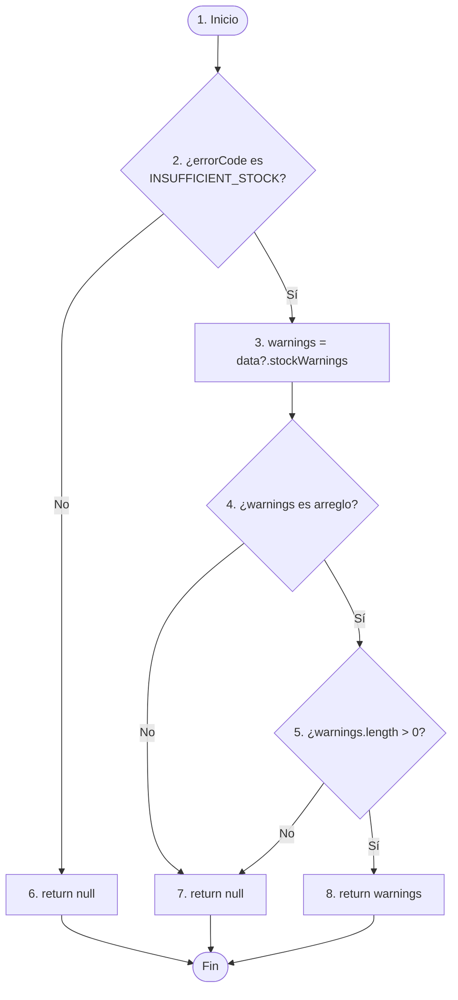
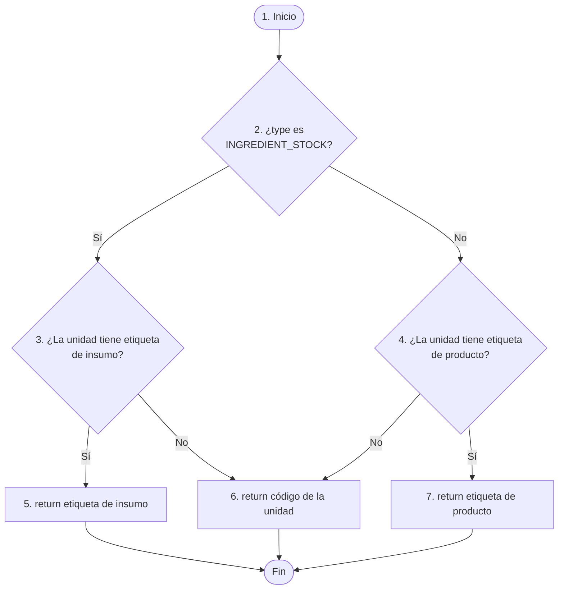
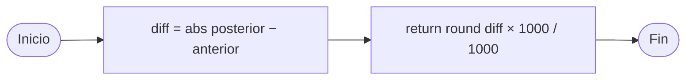

# Informe de pruebas del sistema Buen Asador Management

**Fecha de ejecución:** 23/11/2026
**Alcance:** frontend (`fe-buen-asador-management`) y, en las pruebas de estrés, la API del backend (`be-buen-asador-management`)

> Todos los resultados de este documento salen de corridas reales hechas el 23/11/2026 en el equipo descrito en la sección 2. Las salidas de consola se copiaron sin modificar. Los archivos de evidencia están en [`docs/evidencias-pruebas/`](evidencias-pruebas/).

---

## Índice

1. [Resumen ejecutivo](#1-resumen-ejecutivo)
2. [Entorno de pruebas](#2-entorno-de-pruebas)
3. [Estrategia de pruebas](#3-estrategia-de-pruebas)
4. [Pruebas unitarias (caja negra)](#4-pruebas-unitarias-caja-negra)
5. [Pruebas de caja blanca](#5-pruebas-de-caja-blanca)
6. [Pruebas de extremo a extremo (E2E)](#6-pruebas-de-extremo-a-extremo-e2e)
7. [Pruebas de regresión](#7-pruebas-de-regresión)
8. [Análisis estático](#8-análisis-estático)
9. [Pruebas de rendimiento del frontend](#9-pruebas-de-rendimiento-del-frontend)
10. [Pruebas de estrés (API del backend)](#10-pruebas-de-estrés-api-del-backend)
11. [Pruebas de seguridad: tríada CID](#11-pruebas-de-seguridad-tríada-cid)
12. [Defectos y hallazgos](#12-defectos-y-hallazgos)
13. [Cómo ejecutar cada prueba y qué capturar](#13-cómo-ejecutar-cada-prueba-y-qué-capturar)
14. [Alcance y limitaciones](#14-alcance-y-limitaciones)
15. [Conclusiones](#15-conclusiones)
16. [Anexo A: lista completa de pruebas unitarias](#anexo-a-lista-completa-de-pruebas-unitarias)
17. [Anexo B: lista completa de casos E2E](#anexo-b-lista-completa-de-casos-e2e)

---

## 1. Resumen ejecutivo

| # | Tipo de prueba | Enfoque | Herramienta | Ejecutadas | Aprobadas | Fallidas | Resultado |
|---|---|---|---|---:|---:|---:|---|
| 1 | Unitarias | Caja negra | Vitest 5.1.0 | 297 | 297 | 0 | ✅ |
| 2 | Cobertura de código | Caja blanca | Vitest + V8 | 16 módulos | 97,79 % sentencias · 93,79 % ramas | — | ✅ |
| 3 | Caminos básicos (complejidad ciclomática) | Caja blanca | Análisis manual + V8 | 9 caminos | 9 | 0 | ✅ |
| 4 | Extremo a extremo (E2E) | Caja negra (sistema) | Playwright 1.65.1 | 67 | 67 (1 al 2.º intento) | 0 | ✅ |
| 5 | Regresión | Caja negra | Vitest | 297 | 297 | 0 | ✅ |
| 6 | Comprobación de tipos | Estática | TypeScript (`tsc -b`) | Proyecto completo | Sin errores | — | ✅ |
| 7 | Análisis de código | Estática | ESLint | Proyecto completo | 0 errores · 11 advertencias en el código fuente | — | ✅ |
| 8 | Build de producción | Rendimiento | Vite 8.0.1 | 1 | 1 | 0 | ✅ |
| 9 | Rendimiento web | Rendimiento | Lighthouse 13.6.0 | 2 perfiles | Escritorio 98 · Móvil 80 | — | ⚠️ Móvil mejorable |
| 10 | Estrés de la API | Carga, estrés, pico | Suite propia (Node `fetch`) | 8 escenarios | 7 | 1 (E2) | ⚠️ |
| 11 | Seguridad: confidencialidad | Caja negra + revisión | Playwright + revisión de código | 41 casos | 41 | 0 | ✅ con hallazgos |
| 12 | Seguridad: integridad | Caja negra | Playwright + estrés E7 | 4 casos | 4 | 0 | ✅ |
| 13 | Seguridad: disponibilidad | Estrés | Estrés E6, E8 | 2 escenarios | 2 | 0 | ✅ |
| 14 | Vulnerabilidades de dependencias | Análisis de composición | `npm audit` | 479 paquetes | 27 vulnerabilidades (0 críticas) | — | ⚠️ |

**Conclusión general:** todas las pruebas funcionales (unitarias, E2E y regresión) se aprobaron. Hay cuatro puntos de mejora:

- la latencia del catálogo del POS con 100 usuarios simultáneos (escenario E2);
- el rendimiento en móvil, por un bundle de JavaScript sin dividir;
- las vulnerabilidades conocidas de algunas dependencias;
- algunos refuerzos de seguridad en el frontend.

El detalle está en la [sección 12](#12-defectos-y-hallazgos).

---

## 2. Entorno de pruebas

### 2.1 Hardware y sistema

| Elemento | Valor |
|---|---|
| Procesador | Intel Core i5-10300H a 2,50 GHz (8 hilos) |
| Memoria RAM | 23,8 GB |
| Sistema operativo | Windows 11 Home (10.0.26300) |
| Node.js | v22.23.1 |
| Base de datos | PostgreSQL 16 (contenedor Docker `postgres:16-alpine`) |

### 2.2 Versiones del código probado

| Repositorio | Commit | Observación |
|---|---|---|
| Frontend | `c33cdbd` (22/11/2026) | Más los cambios sin confirmar de avisos de stock y kárdex |
| Backend | `75a9b4c` | Más la suite de estrés sin confirmar (`test/stress/`) |

### 2.3 Herramientas

| Herramienta | Versión | Uso |
|---|---|---|
| Vitest | 5.1.0 | Pruebas unitarias, de regresión y de cobertura |
| @vitest/coverage-v8 | 5.1.x | Medición de cobertura (sentencias, ramas, funciones y líneas) |
| Playwright | 1.65.1 | Pruebas E2E en Chromium |
| TypeScript | 5.9.3 | Comprobación de tipos |
| ESLint | 9.39.4 | Análisis estático |
| Vite | 8.0.1 | Build de producción |
| Lighthouse | 13.6.0 | Auditoría de rendimiento, accesibilidad y buenas prácticas |
| npm audit | npm 10.9.8 | Vulnerabilidades conocidas en dependencias |
| Suite de estrés propia | — | Carga HTTP contra la API (backend, `test/stress/`) |

### 2.4 Aislamiento de los datos

Las pruebas E2E y las de estrés **no usan la base de datos real**. Cada corrida:

1. crea una base nueva llamada `buen_asador_e2e`;
2. levanta la API en el puerto 3998, con un servidor de correo de prueba;
3. crea los usuarios de prueba por rol (gerente, administrador y cajero) y los datos necesarios;
4. borra la base al terminar, aunque las pruebas fallen.

Así, las pruebas se pueden repetir sin efectos sobre los datos del negocio.

---

## 3. Estrategia de pruebas

### 3.1 Niveles de prueba

| Nivel | Qué valida | Tipo |
|---|---|---|
| Unitario | Funciones puras aisladas: cálculos, mapeos, validaciones y estado | Caja negra y caja blanca |
| Sistema (E2E) | Flujos completos en el navegador contra el backend real | Caja negra |
| No funcional | Rendimiento, carga, estrés y seguridad | Caja negra |

### 3.2 Técnicas de diseño de casos

| Técnica | Descripción | Dónde se aplicó |
|---|---|---|
| Partición de equivalencia | Las entradas se dividen en clases que el sistema trata igual, y se prueba un caso de cada clase | Unitarias, inicio de sesión (RF-01) y tipos de pedido (RF-03) |
| Análisis de valores límite | Se prueban los extremos de cada rango | Efectivo recibido (P − 0,01; P; P + 25), stock 0 y negativo, listas vacías |
| Tabla de decisión | Se prueba cada combinación de condiciones | Rol × ruta (RF-02, 30 casos) y permisos del catálogo (RF-08) |
| Transición de estados | Se recorre cada transición válida e inválida | Pedidos por WhatsApp (RF-04) |
| Caminos básicos (McCabe) | Se prueba cada camino independiente del grafo de flujo | Caja blanca (sección 5) |
| Cobertura de sentencias y ramas | Se mide qué código ejecutaron las pruebas | Caja blanca (sección 5) |
| Carga, estrés y pico | Se aumenta la concurrencia hasta encontrar el límite | Estrés (sección 10) |

### 3.3 Criterios de aceptación

- **Funcionales:** el 100 % de los casos unitarios y E2E se aprueban.
- **Cobertura:** al menos 90 % de ramas en los módulos de lógica de negocio.
- **Estáticos:** 0 errores de TypeScript y 0 errores de ESLint.
- **Estrés:** los umbrales de cada escenario (sección 10.2).
- **Seguridad:** sin accesos indebidos entre roles, sin pérdida de integridad bajo concurrencia, y la API sigue disponible ante ráfagas abusivas.

---

## 4. Pruebas unitarias (caja negra)

### 4.1 Objetivo

Comprobar que la lógica de negocio del frontend da el resultado correcto para cada clase de entrada, sin depender del servidor ni de la interfaz.

### 4.2 Configuración

En `vite.config.ts`:

```ts
test: {
  environment: "node",
  include: ["src/**/*.test.ts"],
  env: { TZ: "America/La_Paz" }, // resultados de fechas iguales en cualquier equipo
}
```

### 4.3 Resultado de la ejecución

**Comando:** `npm test`

```
 Test Files  17 passed (17)
      Tests  297 passed (297)
   Start at  16:22:36
   Duration  3.78s
```

### 4.4 Resumen por módulo

| # | Archivo de pruebas | Módulo probado | Pruebas | Resultado |
|---|---|---|---:|---|
| 1 | `src/lib/formatters.test.ts` | Formato de fechas, montos y textos | 34 | ✅ 34/34 |
| 2 | `src/lib/money.test.ts` | Aritmética de dinero sin errores de coma flotante | 11 | ✅ 11/11 |
| 3 | `src/components/shared/Interactives/money-input.utils.test.ts` | Campo de montos (lectura y formato) | 10 | ✅ 10/10 |
| 4 | `src/services/interceptors/error-message.test.ts` | Mensajes de error de la API | 49 | ✅ 49/49 |
| 5 | `src/services/interceptors/error-toast.retry.test.ts` | Reintentos y avisos ante errores de red | 7 | ✅ 7/7 |
| 6 | `src/utils/validation-errors.test.ts` | Errores de validación por campo | 33 | ✅ 33/33 |
| 7 | `src/utils/kardex.test.ts` | Cantidad movida en el kárdex | 3 | ✅ 3/3 |
| 8 | `src/features/pos/models/stock-warning.test.ts` | Avisos de stock insuficiente | 6 | ✅ 6/6 |
| 9 | `src/features/pos/mappers/order.mapper.test.ts` | Conversión del carrito en pedido | 18 | ✅ 18/18 |
| 10 | `src/features/pos/stores/cart.store.test.ts` | Estado del carrito del POS | 15 | ✅ 15/15 |
| 11 | `src/features/offline/utils/offline-sale.builder.test.ts` | Ventas sin conexión | 23 | ✅ 23/23 |
| 12 | `src/features/whatsapp/mappers/whatsapp-order.mapper.test.ts` | Pedidos de WhatsApp | 15 | ✅ 15/15 |
| 13 | `src/features/whatsapp/stores/whatsapp-orders.store.test.ts` | Bandeja de pedidos de WhatsApp | 19 | ✅ 19/19 |
| 14 | `src/features/whatsapp/utils/order-actions.test.ts` | Acciones válidas por estado del pedido | 7 | ✅ 7/7 |
| 15 | `src/features/catalog/products/mappers/product.mapper.test.ts` | Formulario de producto | 2 | ✅ 2/2 |
| 16 | `src/features/catalog/products/utils/product-availability.test.ts` | Disponibilidad del producto | 5 | ✅ 5/5 |
| 17 | `src/features/finances/reports/utils/report-period.test.ts` | Periodos de los reportes | 40 | ✅ 40/40 |
| | **Total** | | **297** | **✅ 297/297** |

La lista de las 297 pruebas, una por una, está en el [Anexo A](#anexo-a-lista-completa-de-pruebas-unitarias).

### 4.5 Detalle: cantidad movida en el kárdex

**Problema:** en un ajuste de inventario de tipo SET (fijar el stock en un valor), el backend guarda en `quantity` el **valor final fijado**, no la diferencia. Por ejemplo, si había 10 unidades y se fijó el stock en 3, el kárdex mostraba "−3" cuando salieron 7.

**Solución:** `kardexMovedQuantity` (`src/utils/kardex.ts`) calcula `|posterior − anterior|` y redondea a 3 decimales.

```ts
export function kardexMovedQuantity(movement: {
  previousQuantity: number;
  subsequentQuantity: number;
}): number {
  const diff = Math.abs(movement.subsequentQuantity - movement.previousQuantity);
  return Math.round(diff * 1000) / 1000;
}
```

| ID | Objetivo | Técnica | Anterior | Posterior | Esperado | Obtenido | Estado |
|---|---|---|---:|---:|---:|---:|---|
| CP-K-01 | Ajuste SET que baja el stock: mostrar la diferencia, no el valor fijado | Partición | 10 | 3 | 7 | 7 | ✅ |
| CP-K-02 | Ajuste SET que sube el stock | Partición | 2 | 5 | 3 | 3 | ✅ |
| CP-K-03 | Fijar el mismo valor que ya había | Valor límite | 4 | 4 | 0 | 0 | ✅ |
| CP-K-04 | Stock negativo (se permite vender sin stock) | Valor límite | −2 | 1 | 3 | 3 | ✅ |
| CP-K-05 | Evitar el error de coma flotante (0,4 − 0,1 = 0,30000000000000004) | Valor límite | 0,1 | 0,4 | 0,3 | 0,3 | ✅ |

### 4.6 Detalle: avisos de stock insuficiente

**Problema:** al crear un pedido sin stock suficiente, el backend responde **409** con `errorCode: "INSUFFICIENT_STOCK"` y la lista `data.stockWarnings`. Antes, el POS mostraba solo un mensaje genérico. Ahora muestra qué productos o insumos faltan, y el cajero decide si crea el pedido igual (`forceCreate: true`).

**Solución:** `getStockWarnings` (`src/features/pos/models/stock-warning.ts`) devuelve la lista solo si el código es `INSUFFICIENT_STOCK` y `stockWarnings` es un arreglo no vacío. En cualquier otro caso devuelve `null`.

**Datos de prueba:**

| Tipo | Producto | Insumo | Stock actual | Unidad |
|---|---|---|---:|---|
| `PRODUCT_STOCK` | Pollo entero | — | 0 | UNIT |
| `INGREDIENT_STOCK` | Pique | Papa | −2 | KG |

| ID | Objetivo | Técnica | Entrada | Esperado | Obtenido | Estado |
|---|---|---|---|---|---|---|
| CP-S-01 | Leer los avisos del 409 | Partición (válida) | `INSUFFICIENT_STOCK` con los 2 avisos | La misma lista | La misma lista | ✅ |
| CP-S-02 | Otro código de error, aunque traiga la lista | Partición (inválida) | `NOT_FOUND` con lista | `null` | `null` | ✅ |
| CP-S-03 | Código correcto, pero sin `data` | Partición (inválida) | `INSUFFICIENT_STOCK` sin `data` | `null` | `null` | ✅ |
| CP-S-04 | Lista vacía | Valor límite | `stockWarnings: []` | `null` | `null` | ✅ |
| CP-S-05 | Error nulo | Valor límite | `null` | `null` | `null` | ✅ |

Las pruebas CB-S-01 a CB-S-03 y CB-L-01 a CB-L-04 de este mismo archivo salieron del análisis de caja blanca (sección 5).

---

## 5. Pruebas de caja blanca

Las pruebas de caja blanca se diseñan **mirando el código interno**. Se aplicaron dos técnicas:

1. **Cobertura de código:** se mide qué sentencias, ramas, funciones y líneas ejecutan las pruebas.
2. **Caminos básicos (McCabe):** se dibuja el grafo de flujo de cada función, se calcula su complejidad ciclomática y se escribe una prueba para cada camino independiente.

### 5.1 Cobertura de los módulos de lógica de negocio

**Comando:** `npm run test:coverage`

| Módulo | % Sentencias | % Ramas | % Funciones | % Líneas | Ramas cubiertas |
|---|---:|---:|---:|---:|---:|
| `src/lib/formatters.ts` | 100 | 100 | 100 | 100 | 28/28 |
| `src/lib/money.ts` | 100 | 100 | 100 | 100 | 10/10 |
| `src/services/interceptors/error-message.ts` | 100 | 100 | 100 | 100 | 68/68 |
| `src/utils/validation-errors.ts` | 100 | 100 | 100 | 100 | 16/16 |
| `src/utils/kardex.ts` | 100 | 100 (sin ramas) | 100 | 100 | 0/0 |
| `src/features/pos/models/stock-warning.ts` | 100 | 100 | 100 | 100 | 12/12 |
| `src/features/offline/utils/offline-sale.builder.ts` | 100 | 100 | 100 | 100 | 54/54 |
| `src/features/catalog/products/utils/product-availability.ts` | 100 | 100 | 100 | 100 | 20/20 |
| `src/features/finances/reports/utils/report-period.ts` | 100 | 97,87 | 100 | 100 | 46/47 |
| `src/components/shared/Interactives/money-input.utils.ts` | 96,55 | 96,15 | 100 | 100 | 25/26 |
| `src/features/whatsapp/mappers/whatsapp-order.mapper.ts` | 100 | 95,83 | 100 | 100 | 23/24 |
| `src/features/pos/stores/cart.store.ts` | 100 | 95,45 | 100 | 100 | 21/22 |
| `src/features/whatsapp/stores/whatsapp-orders.store.ts` | 93,33 | 95,00 | 85,00 | 94,11 | 19/20 |
| `src/features/whatsapp/utils/order-actions.ts` | 100 | 93,75 | 100 | 100 | 15/16 |
| `src/features/pos/mappers/order.mapper.ts` | 100 | 93,02 | 100 | 100 | 40/43 |
| `src/features/catalog/products/mappers/product.mapper.ts` | 50 | 37,93 | 42,85 | 50 | 11/29 |
| **Total** | **97,79** | **93,79** | **96,17** | **98,04** | **408/435** |

```
=============================== Coverage summary ===============================
Statements   : 97.79% ( 576/589 )
Branches     : 93.79% ( 408/435 )
Functions    : 96.17% ( 176/183 )
Lines        : 98.04% ( 501/511 )
================================================================================
```

**Interpretación:**

- 15 de 16 módulos superan el 90 % de ramas, y 8 llegan al 100 %.
- `product.mapper.ts` tiene 37,93 % de ramas: solo se prueba `mapProductFormToDTO`, y las demás funciones de conversión no tienen pruebas (hallazgo H-02).

### 5.2 Cobertura de todo el frontend

Para no presentar un número engañoso, también se midió la cobertura unitaria de **todo** `src/` (408 archivos):

| Métrica | Cobertura |
|---|---:|
| Sentencias | 11,47 % (759/6.612) |
| Ramas | 7,93 % (454/5.725) |
| Funciones | 7,94 % (202/2.544) |
| Líneas | 11,20 % (679/6.060) |

Es una cifra esperada en una aplicación React. La mayor parte del código son componentes visuales, páginas y hooks que llaman a la API, y esos se validan con las **pruebas E2E** (sección 6), no con pruebas unitarias. Las pruebas unitarias se concentran en la lógica de negocio pura, que es donde está la cobertura de la tabla 5.1.

### 5.3 Caminos básicos de `getStockWarnings`

**Grafo de flujo:**



**Complejidad ciclomática:** V(G) = P + 1 = 3 decisiones + 1 = **4 caminos independientes**.

| Camino | Recorrido | Prueba | Entrada | Esperado | Obtenido | Estado |
|---|---|---|---|---|---|---|
| C1 | 1 → 2 → 6 | CP-S-02 | `errorCode: "NOT_FOUND"` | `null` | `null` | ✅ |
| C1 | 1 → 2 → 6 | CP-S-05 | `null` | `null` | `null` | ✅ |
| C1 | 1 → 2 → 6 | CB-S-03 | `undefined` | `null` | `null` | ✅ |
| C2 | 1 → 2 → 3 → 4 → 7 | CP-S-03 | Sin `data` | `null` | `null` | ✅ |
| C2 | 1 → 2 → 3 → 4 → 7 | CB-S-01 | `stockWarnings: "sin stock"` (no es arreglo) | `null` | `null` | ✅ |
| C2 | 1 → 2 → 3 → 4 → 7 | CB-S-02 | `data: {}` | `null` | `null` | ✅ |
| C3 | 1 → 2 → 3 → 4 → 5 → 7 | CP-S-04 | `stockWarnings: []` | `null` | `null` | ✅ |
| C4 | 1 → 2 → 3 → 4 → 5 → 8 | CP-S-01 | Lista con 2 avisos | La lista | La lista | ✅ |

### 5.4 Caminos básicos de `stockWarningUnitLabel`

Esta función devuelve el nombre legible de la unidad ("Kilogramo", "Arroba", etc.) que se muestra en el modal de avisos.

```ts
export function stockWarningUnitLabel(warning: StockWarning): string {
  return warning.type === "INGREDIENT_STOCK"
    ? (INGREDIENT_UNIT_LABELS[warning.unit] ?? warning.unit)
    : (STOCK_UNIT_LABELS[warning.unit] ?? warning.unit);
}
```

**Grafo de flujo:**



**Complejidad ciclomática:** V(G) = 3 decisiones + 1 = **4 caminos independientes**.

| Camino | Recorrido | Prueba | Entrada | Esperado | Obtenido | Estado |
|---|---|---|---|---|---|---|
| C1 | 1 → 2 → 3 → 5 | CB-L-02 | Insumo, unidad `ARROBA` | "Arroba" | "Arroba" | ✅ |
| C2 | 1 → 2 → 3 → 6 | CB-L-04 | Insumo, unidad `BOLSA` (sin etiqueta) | "BOLSA" | "BOLSA" | ✅ |
| C3 | 1 → 2 → 4 → 7 | CB-L-01 | Producto, unidad `KILOGRAM` | "Kilogramo" | "Kilogramo" | ✅ |
| C4 | 1 → 2 → 4 → 6 | CB-L-03 | Producto, unidad `CAJA` (sin etiqueta) | "CAJA" | "CAJA" | ✅ |

### 5.5 Caminos básicos de `kardexMovedQuantity`

La función no tiene decisiones (ni `if` ni operadores condicionales): es una secuencia de tres operaciones (resta, valor absoluto y redondeo).



**Complejidad ciclomática:** V(G) = 0 + 1 = **1 camino**, cubierto por CP-K-01 a CP-K-05 con 100 % de sentencias y líneas.

### 5.6 Defecto de cobertura encontrado y corregido

La primera medición de cobertura de `stock-warning.ts` dio este resultado:

```
stock-warning.ts |      80 |       50 |      50 |      75 | 44
```

Es decir: 50 % de ramas y 50 % de funciones. La función `stockWarningUnitLabel` (línea 44) **no tenía ninguna prueba**. Se agregaron las pruebas CB-S-01 a CB-S-03 y CB-L-01 a CB-L-04, y la nueva medición quedó así:

```
Statements   : 100% ( 7/7 )
Branches     : 100% ( 12/12 )
Functions    : 100% ( 3/3 )
Lines        : 100% ( 6/6 )
```

| Métrica de `stock-warning.ts` | Antes | Después |
|---|---:|---:|
| Sentencias | 80 % | **100 %** |
| Ramas | 50 % (6/12) | **100 % (12/12)** |
| Funciones | 50 % | **100 %** |
| Líneas | 75 % | **100 %** |

---

## 6. Pruebas de extremo a extremo (E2E)

### 6.1 Objetivo

Validar los requisitos funcionales manejando la aplicación **desde el navegador**, como lo haría un usuario, contra el **backend real**.

### 6.2 Configuración

| Parámetro | Valor |
|---|---|
| Navegador | Chromium (Desktop Chrome), 1440 × 900 |
| Idioma y zona horaria | `es-BO`, `America/La_Paz` |
| Ejecución | En serie (1 worker), porque las pruebas comparten la base |
| Reintentos | 1 (si una prueba pasa al segundo intento, se marca como inestable o *flaky*) |
| Tiempo máximo por prueba | 30 s |
| Evidencia | Captura, video y traza de cada fallo |
| Patrón de diseño | Page Object (`e2e/pages/`) |
| Modo de ejecución | `npm run e2e:isolated`: backend aislado, con base nueva |

### 6.3 Resultado de la ejecución

**Comando:** `npm run e2e:isolated`

```
Running 67 tests using 1 worker
  ...
  1 flaky
    [setup] › e2e\auth.setup.ts:10:3 › sesión de manager
  66 passed (10.5m)
```

| Métrica | Valor |
|---|---:|
| Casos ejecutados | 67 |
| Aprobados al primer intento | 66 |
| Aprobados al segundo intento (inestables) | 1 |
| Fallidos | 0 |
| Omitidos | 0 |
| Duración total | 10 min 29 s |

### 6.4 Resultados por requisito funcional

| Requisito | Archivo | Técnica | Casos | Resultado |
|---|---|---|---:|---|
| Preparación: sesión por rol | `auth.setup.ts` | — | 3 | ✅ 3/3 (1 al 2.º intento) |
| RF-01 Autenticación | `auth.spec.ts` | Partición de equivalencia | 9 | ✅ 9/9 |
| RF-02 Control de acceso por rol | `permissions.spec.ts` | Tabla de decisión rol × ruta | 30 | ✅ 30/30 |
| RF-03 Venta en el POS | `pos-sale.spec.ts` | Partición y valores límite | 11 | ✅ 11/11 |
| RF-04 Pedidos por WhatsApp | `whatsapp-orders.spec.ts` | Transición de estados | 5 | ✅ 5/5 |
| RF-08, RF-09, RF-33 y RF-34 Catálogo | `catalog.spec.ts` | Tabla de decisión, partición y tiempo real | 9 | ✅ 9/9 |
| **Total** | | | **67** | **✅ 67/67** |

### 6.5 Casos destacados

**RF-02: tabla de decisión rol × ruta** (✔ = permitido; ✘ = redirige al inicio del rol)

| Ruta | Gerente | Administrador | Cajero |
|---|:---:|:---:|:---:|
| /users | ✔ | ✘ | ✘ |
| /locations | ✔ | ✘ | ✘ |
| /reports | ✔ | ✘ | ✘ |
| /catalog/products | ✔ | ✔ | ✘ |
| /catalog/categories | ✔ | ✔ | ✘ |
| /catalog/modifiers | ✔ | ✔ | ✘ |
| /inventory | ✔ | ✔ | ✘ |
| /dashboard | ✔ | ✔ | ✘ |
| /sales | ✔ | ✔ | ✔ |
| /pos | ✘ | ✘ | ✔ |

Las 30 celdas (CP-PER-01 a CP-PER-30) se aprobaron.

**RF-03: valores límite del efectivo recibido** (CP-POS-08; P = total del pedido)

| Efectivo recibido | Esperado | Resultado |
|---|---|---|
| Vacío | "Confirmar cobro" deshabilitado | ✅ |
| P − 0,01 | Muestra "Falta" y el botón sigue deshabilitado | ✅ |
| P | Muestra "Cambio" y el botón se habilita | ✅ |
| P + 25 | "Vuelto" de 25,00 y el botón se habilita | ✅ |

**CP-POS-11: producto sin stock (valida el cambio nuevo)**

| Paso | Acción | Resultado esperado | Resultado |
|---|---|---|---|
| 1 | El cajero agrega «E2E Sin Stock» (stock 0) | Se agrega al carrito | ✅ |
| 2 | Elige "Presencial" y abre la revisión | Se muestra la revisión del pedido | ✅ |
| 3 | Confirma el pedido | El backend responde **409** | ✅ |
| 4 | — | Se muestra "Algunos productos no tienen stock suficiente" (modal nuevo `StockWarningsModal`) | ✅ |
| 5 | — | No se abre la pantalla de cobro | ✅ |

**RF-04: transición de estados de un pedido por WhatsApp**

```
PENDING ──Aprobar──▶ CONFIRMED ──Preparar──▶ PREPARING ──Listo──▶ READY ──Cobrar──▶ PAID
   │                                                                │
   └──Rechazar (motivo)──▶ CANCELLED        (delivery) READY ──Entregado──▶ DELIVERED ──Cobrar──▶ PAID
```

### 6.6 Análisis del caso inestable

| Dato | Valor |
|---|---|
| Caso | `auth.setup.ts › sesión de manager` (la primera prueba de la corrida) |
| Error del 1.er intento | `Test timeout of 30000ms exceeded while setting up "page"` |
| 2.º intento | Aprobado en 19,6 s |
| Causa | Arranque en frío: es la primera página de la corrida, y Vite compila los módulos de la aplicación por primera vez mientras se abre el navegador |
| ¿Defecto de la aplicación? | No. Las 66 pruebas siguientes no tuvieron ningún problema de tiempos |
| Evidencia | Video, captura y traza en `e2e-results/artifacts/auth.setup.ts-sesión-de-manager-setup/` |

La lista completa de los 67 casos, con su duración, está en el [Anexo B](#anexo-b-lista-completa-de-casos-e2e).

---

## 7. Pruebas de regresión

**Objetivo:** comprobar que los cambios nuevos (avisos de stock y kárdex) no rompieron funciones que ya existían.

| Suite | Antes de agregar las pruebas nuevas | Después | Fallidas |
|---|---:|---:|---:|
| Unitarias | 288 | 297 (288 + 9 nuevas) | 0 |
| E2E | 67 | 67 | 0 |

**Resultado:** no hay regresiones. CP-POS-11 también confirma que el flujo de "producto sin stock" del POS sigue funcionando con el modal nuevo.

---

## 8. Análisis estático

### 8.1 Comprobación de tipos con TypeScript

**Comando:** `npx tsc -b` (el mismo paso que ejecuta `npm run build`)

**Resultado:** terminó sin errores (código de salida 0). ✅

### 8.2 ESLint

**Comando:** `npm run lint`

```
✖ 15 problems (0 errors, 15 warnings)
  0 errors and 4 warnings potentially fixable with the `--fix` option.
```

| Archivo | Advertencias | Regla |
|---|---:|---|
| `src/hooks/useApiAlert.ts` | 4 | `react-hooks/exhaustive-deps` |
| `src/features/auth/pages/Login.tsx` | 2 | `react-hooks/exhaustive-deps` |
| `src/features/auth/pages/SelectLocation.tsx` | 1 | `react-hooks/exhaustive-deps` |
| `src/features/catalog/categories/pages/Categories.tsx` | 1 | `react-hooks/exhaustive-deps` |
| `src/features/catalog/modifiers/pages/Modifiers.tsx` | 1 | `react-hooks/exhaustive-deps` |
| `src/features/pos/page/Pos.tsx` | 1 | `react-hooks/exhaustive-deps` |
| `src/hooks/useFieldErrors.ts` | 1 | `react-hooks/exhaustive-deps` |
| **Subtotal en el código fuente** | **11** | |
| `coverage/*.js` (4 archivos generados por el reporte de cobertura) | 4 | Directiva `eslint-disable` sin uso |

**Resultado:** 0 errores. ✅

- Las **11 advertencias del código fuente** son de la misma regla: dependencias que faltan en `useEffect` (hallazgo H-08). La de `Pos.tsx` ya existía antes de los cambios probados.
- Las otras 4 vienen de la carpeta `coverage/`, que genera el reporte de cobertura y no forma parte del código. Desaparecen si se agrega `coverage` a los archivos ignorados de `eslint.config.js`.

---

## 9. Pruebas de rendimiento del frontend

### 9.1 Build de producción

**Comando:** `npm run build`

```
✓ 3215 modules transformed.
dist/index.html                     0.64 kB │ gzip:   0.35 kB
dist/assets/index-DlIeHNEn.css     99.88 kB │ gzip:  16.94 kB
dist/assets/index-DHgB0tXv.js   1,734.63 kB │ gzip: 471.32 kB
✓ built in 23.78s
```

| Recurso | Tamaño | Comprimido (gzip) |
|---|---:|---:|
| HTML | 0,64 kB | 0,35 kB |
| CSS | 99,88 kB | 16,94 kB |
| JavaScript (un solo archivo) | 1.734,63 kB | 471,32 kB |

**Observación:** toda la aplicación se entrega en **un solo archivo de JavaScript** de 1,73 MB. No se divide por rutas, así que el usuario descarga los módulos de todos los roles aunque solo use el POS (hallazgo H-03).

### 9.2 Lighthouse

**Página analizada:** `/login`, sobre el build de producción servido con `vite preview`.

| Categoría | Escritorio | Móvil |
|---|---:|---:|
| Rendimiento | **98** | **80** |
| Accesibilidad | 93 | 93 |
| Buenas prácticas | 100 | 100 |
| SEO | 91 | 91 |

| Métrica (Core Web Vitals) | Escritorio | Móvil | Umbral "bueno" |
|---|---:|---:|---:|
| First Contentful Paint (FCP) | 0,5 s | 0,9 s | ≤ 1,8 s |
| Largest Contentful Paint (LCP) | 1,0 s | 0,9 s | ≤ 2,5 s |
| Total Blocking Time (TBT) | 80 ms | **850 ms** | ≤ 200 ms |
| Cumulative Layout Shift (CLS) | 0 | 0 | ≤ 0,1 |
| Speed Index | 0,9 s | 1,3 s | ≤ 3,4 s |
| Time to Interactive | 1,1 s | **4,2 s** | ≤ 3,8 s |
| Peso total transferido | 476 KiB | 475 KiB | — |
| JavaScript sin usar | 342 KiB | 342 KiB | — |

**Interpretación:**

- En escritorio, el rendimiento es excelente (98).
- En móvil baja a 80. El tiempo de bloqueo (850 ms) y el tiempo hasta que la página responde (4,2 s) pasan los umbrales recomendados. La causa es el bundle único: el navegador descarga y ejecuta 342 KiB de JavaScript que la pantalla de login no necesita (hallazgo H-03).
- En accesibilidad hay dos auditorías fallidas: contraste de color insuficiente en algunos textos y falta de una región `<main>` en la página (hallazgo H-09).

Los reportes completos están en [`evidencias-pruebas/lighthouse-escritorio.html`](evidencias-pruebas/lighthouse-escritorio.html) y [`evidencias-pruebas/lighthouse-movil.html`](evidencias-pruebas/lighthouse-movil.html).

---

## 10. Pruebas de estrés (API del backend)

> El frontend no recibe carga de usuarios concurrentes: cada navegador ejecuta su propia copia. Por eso, las pruebas de carga y estrés se hacen sobre la **API del backend**, que es la que comparten todos los usuarios. La suite está en `be-buen-asador-management/test/stress/`.

### 10.1 Metodología

| Aspecto | Descripción |
|---|---|
| Modelo de carga | Cerrado: cada usuario virtual (VU) envía la siguiente petición apenas recibe la respuesta, sin pausa. 50 VU equivalen a una carga más intensa que la de 50 cajeros reales. |
| Perfil | `standard`: 20 s por etapa con los VU nominales |
| Generador | `fetch` de Node, con tiempos medidos con `performance.now()`. Los percentiles se calculan sobre todas las muestras. |
| IP por petición | Cada petición simula una IP distinta (`X-Forwarded-For`), salvo en E8 |
| Entorno | Generador y API en la misma máquina: compiten por la CPU, así que los valores son una cota inferior de lo que rendiría un servidor dedicado |
| Duración total | 437 s |

**Indicadores:**

- **p95:** el 95 % de las peticiones respondió en ese tiempo o menos. Es el criterio principal, porque el promedio oculta los casos lentos.
- **Pet/s:** peticiones atendidas por segundo (rendimiento).
- **Error:** respuestas 5xx, fallos de red o respuestas inesperadas.

### 10.2 Escenarios y criterios

| ID | Escenario | Tipo | Etapas (VU) | Criterio de aceptación |
|---|---|---|---|---|
| E1 | Línea base (`GET /health`) | Carga ligera | 10 | 0 % de error, p95 ≤ 100 ms |
| E2 | Catálogo del POS (`GET /products/menu`) | Carga creciente (lectura) | 10 → 50 → 100 | Error ≤ 1 %, p95 ≤ 500 ms, sin 5xx |
| E3 | Inicio de sesión masivo | Carga creciente (CPU, bcrypt) | 5 → 20 → 40 | Error ≤ 1 %, p95 del login ≤ 2000 ms |
| E4 | Flujo de caja: pedido + cobro | Carga creciente (escritura) | 10 → 25 → 50 | Error ≤ 1 %, p95 ≤ 1500 ms por operación |
| E5 | Carga mixta escalonada | Estrés hasta el quiebre | 10 → 25 → 50 → 100 → 150 → 200 | Sostener ≥ 50 VU con p95 ≤ 1000 ms |
| E6 | Pico repentino y recuperación | Pico (*spike*) | 10 → 200 → 10 | Sin 5xx en el pico; después, p95 ≤ 2 × el previo |
| E7 | Integridad bajo concurrencia | Condiciones de carrera | Ráfagas simultáneas | Sin cobros dobles ni actualizaciones perdidas |
| E8 | Ráfaga desde una sola IP | Abuso / denegación de servicio | 300 peticiones a la vez | La mayoría recibe 429, sin 5xx, y los demás clientes siguen atendidos |

### 10.3 Resumen de resultados

```
[stress] Perfil: standard · escenarios: E1, E2, E3, E4, E5, E6, E7, E8
...
[stress] 7/8 escenarios cumplen · no cumplen: E2
```

| ID | Escenario | Resultado clave | Estado |
|---|---|---|---|
| E1 | Línea base | 755,6 pet/s · p95 21,2 ms · 0 % de error | ✅ Cumple |
| E2 | Catálogo del POS | p95 de **1.428 ms** con 100 VU (límite: 500 ms) · 0 % de error | ❌ No cumple |
| E3 | Inicio de sesión masivo | p95 del login 919,9 ms con 40 VU · 0 % de error | ✅ Cumple |
| E4 | Flujo de caja | p95 de `POST /orders` 1.091 ms y de `POST /sales` 1.001 ms con 50 VU · 0 % de error | ✅ Cumple |
| E5 | Carga mixta | Capacidad sostenida: **50 VU** · quiebre desde 100 VU · 0 errores de red con 200 VU | ✅ Cumple |
| E6 | Pico y recuperación | p95 de 3.245,6 ms en el pico, sin errores; recupera 261,5 ms (antes: 260,6 ms) | ✅ Cumple |
| E7 | Integridad | 0 cobros dobles · 0 actualizaciones de stock perdidas | ✅ Cumple |
| E8 | Ráfaga desde una IP | 290 de 300 rechazadas con 429 · 0 errores 5xx · 20/20 otros clientes atendidos | ✅ Cumple |

**Resultado: 7 de 8 escenarios cumplen.**

### 10.4 Detalle por escenario

**E1 · Línea base**

| Etapa | VU | Peticiones | Pet/s | Prom. (ms) | p50 | p90 | p95 | p99 | Máx. | Error |
|---|---:|---:|---:|---:|---:|---:|---:|---:|---:|---:|
| Base | 10 | 15.190 | 755,6 | 13,2 | 11,9 | 18,1 | 21,2 | 33,1 | 323,3 | 0,00 % |

**E2 · Catálogo del POS** ❌

| Etapa | VU | Peticiones | Pet/s | Prom. (ms) | p50 | p90 | p95 | p99 | Máx. | Error |
|---|---:|---:|---:|---:|---:|---:|---:|---:|---:|---:|
| 10 VU | 10 | 6.415 | 320,2 | 31,2 | 29,7 | 38,7 | 43,0 | 57,2 | 132,4 | 0,00 % |
| 50 VU | 50 | 5.943 | 294,3 | 169,2 | 149,4 | 255,1 | 302,7 | 378,2 | 458,1 | 0,00 % |
| 100 VU | 100 | 3.192 | 158,1 | 630,3 | 539,2 | 1.215,9 | **1.428,0** | 1.672,5 | 1.853,0 | 0,00 % |

Con 50 VU cumple (p95 = 302,7 ms). Con 100 VU, el p95 pasa el límite de 500 ms y el rendimiento cae de 294 a 158 pet/s: el servidor llegó a su capacidad y las peticiones se encolan. No hubo errores (hallazgo H-04).

**E3 · Inicio de sesión masivo**

| Etapa | VU | Peticiones | Pet/s | p50 (ms) | p95 | p99 | Error |
|---|---:|---:|---:|---:|---:|---:|---:|
| 5 VU | 5 | 1.752 | 87,2 | 65,8 | 102,1 | 147,6 | 0,00 % |
| 20 VU | 20 | 2.028 | 99,5 | 179,1 | 430,7 | 520,9 | 0,00 % |
| 40 VU | 40 | 1.958 | 93,8 | 189,1 | 901,5 | 942,0 | 0,00 % |

p95 de `POST /auth/login` con 40 VU: 919,9 ms (límite: 2000 ms). bcrypt usa la CPU a propósito, para que adivinar contraseñas sea costoso.

**E4 · Flujo de caja (pedido + cobro)**

| Etapa | VU | Peticiones | Pet/s | p50 (ms) | p95 | p99 | Error |
|---|---:|---:|---:|---:|---:|---:|---:|
| 10 VU | 10 | 932 | 45,8 | 207,2 | 382,7 | 487,0 | 0,00 % |
| 25 VU | 25 | 1.216 | 58,6 | 406,0 | 595,5 | 682,2 | 0,00 % |
| 50 VU | 50 | 1.354 | 64,2 | 754,5 | 1.041,2 | 1.173,0 | 0,00 % |

| Operación (50 VU) | Peticiones | p95 (ms) | Límite | Estado |
|---|---:|---:|---:|---|
| `POST /orders` | 677 | 1.091,3 | 1.500 | ✅ |
| `POST /sales` | 677 | 1.001,1 | 1.500 | ✅ |

**E5 · Carga mixta escalonada (punto de quiebre)**

La mezcla de operaciones imita el uso real: 50 % consulta del menú, 30 % pedido y cobro, 15 % pedidos listos y 5 % dashboard.

| Etapa | VU | Peticiones | Pet/s | p50 (ms) | p95 | p99 | Error |
|---|---:|---:|---:|---:|---:|---:|---:|
| 10 VU | 10 | 2.086 | 103,3 | 64,1 | 225,3 | 298,8 | 0,00 % |
| 25 VU | 25 | 1.923 | 94,2 | 276,6 | 452,2 | 532,4 | 0,00 % |
| **50 VU** | 50 | 1.901 | 91,6 | 505,9 | **954,5** | 1.188,7 | 0,00 % |
| 100 VU | 100 | 2.246 | 105,1 | 832,1 | 1.678,7 | 2.104,2 | 0,00 % |
| 150 VU | 150 | 2.131 | 95,8 | 1.367,4 | 2.475,7 | 3.385,0 | 0,00 % |
| 200 VU | 200 | 2.225 | 95,4 | 1.795,3 | 3.272,9 | 4.658,2 | 0,00 % |

- **Capacidad sostenida:** 50 VU (p95 = 954,5 ms ≤ 1000 ms).
- **Punto de quiebre:** desde 100 VU (p95 = 1.678,7 ms).
- **Rendimiento máximo:** 105,1 pet/s.
- **Robustez:** con 200 VU la latencia sube, pero **no hay ningún error**: la API se degrada sin caerse.

**E6 · Pico repentino y recuperación**

| Etapa | VU | Peticiones | Pet/s | p50 (ms) | p95 | p99 | Error |
|---|---:|---:|---:|---:|---:|---:|---:|
| Antes | 10 | 941 | 92,5 | 85,3 | 260,6 | 331,3 | 0,00 % |
| Pico | 200 | 1.724 | 100,2 | 1.745,0 | 3.245,6 | 3.382,8 | 0,00 % |
| Recuperación | 10 | 965 | 94,3 | 56,9 | 261,5 | 339,0 | 0,00 % |

Después del pico, el p95 vuelve a 261,5 ms, prácticamente igual al de antes (260,6 ms). La API no queda degradada.

**E7 · Integridad bajo concurrencia**

| Caso | Ráfaga | Esperado | Obtenido | Estado |
|---|---|---|---|---|
| Cobro doble | 20 cobros simultáneos del mismo pedido, × 10 pedidos | Exactamente 1 venta por pedido, sin 5xx | 10/10 pedidos con 1 venta · 0 respuestas 5xx | ✅ |
| Ajustes de stock | 100 × `ADD 1` al mismo stock | Stock final = 0 + 100 | 100 aceptados · stock 0 → 100 | ✅ |
| Ventas con stock | 50 cobros simultáneos del mismo producto | Stock final = 100 − 50 | 50 ventas · stock 100 → 50 | ✅ |

Mecanismo que lo garantiza: bloqueo `pessimistic_write` de la fila (pedido o stock) dentro de la transacción.

**E8 · Ráfaga desde una sola IP**

| Criterio | Esperado | Obtenido | Estado |
|---|---|---|---|
| 300 peticiones simultáneas desde la misma IP | La mayoría recibe 429 | 290 × 429 · 10 × 200 | ✅ |
| Sin errores 5xx durante la ráfaga | 0 | 0 | ✅ |
| Otros clientes (IP distinta) durante la ráfaga | 20/20 con 200 | 20/20 | ✅ |

Límite configurado por IP: 10 peticiones por segundo y 200 por minuto.

### 10.5 Reproducibilidad

La suite se ejecutó dos veces el mismo día, con resultados coherentes:

| Indicador | Corrida 1 (14:50) | Corrida 2 (16:10) |
|---|---:|---:|
| Escenarios que cumplen | 7/8 | 7/8 |
| E2: p95 con 100 VU | 1.301,8 ms ❌ | 1.428,0 ms ❌ |
| E5: capacidad sostenida | 50 VU | 50 VU |
| E5: punto de quiebre | 100 VU | 100 VU |
| E7: integridad | ✅ | ✅ |
| E8: 429 recibidos | — | 290/300 |

El informe completo de la corrida 2 está en [`evidencias-pruebas/estres-resultados.md`](evidencias-pruebas/estres-resultados.md).

---

## 11. Pruebas de seguridad: tríada CID

La seguridad se evaluó con los tres pilares de la tríada **CID**: **C**onfidencialidad, **I**ntegridad y **D**isponibilidad (en inglés, *CIA triad*). Para cada pilar se combinan pruebas ejecutadas (E2E y estrés) con una revisión del código del frontend.

### 11.1 Confidencialidad

> Solo las personas autorizadas acceden a la información.

**Pruebas ejecutadas:**

| ID | Prueba | Resultado esperado | Resultado |
|---|---|---|---|
| CP-AUT-01 | Login con campos vacíos | No se envía la petición | ✅ |
| CP-AUT-02 | Contraseña incorrecta | "Credenciales inválidas" y no entra | ✅ |
| CP-AUT-03 | Usuario inexistente | Mismo mensaje genérico (no revela si el usuario existe) | ✅ |
| CP-AUT-04 a 08 | Login válido de cada rol y elección de sucursal | Cada rol entra a su pantalla | ✅ |
| CP-AUT-09 | Ruta protegida sin sesión | Redirige a /login | ✅ |
| CP-PER-01 a 30 | Cada rol en cada ruta (tabla de decisión) | Solo entra a las rutas permitidas | ✅ 30/30 |
| CP-CAT-02 | El administrador en el catálogo | No ve "Nuevo producto" ni "Nueva categoría" | ✅ |
| CP-CAT-03 | El administrador hace clic en un producto | No se abre el formulario de edición | ✅ |
| **Total** | | | **✅ 41/41** |

**Revisión del código del frontend:**

| Control | Evidencia en el código | Evaluación |
|---|---|---|
| Rutas protegidas por sesión y por rol | `src/routes/ProtectedRoute.tsx`, `RoleRoute.tsx` | ✅ Presente y validado por RF-02 |
| Cierre de sesión completo | `logoutSession()` revoca el *refresh token* en el backend (`/auth/logout`) y limpia el estado de sesión y la caché de datos | ✅ |
| Renovación de token con rotación | `session.service.ts`; las pestañas se sincronizan para no reutilizar un token rotado (el backend lo detecta como robo) | ✅ |
| Token del canal en tiempo real (SSE) | Va en la cabecera `Authorization`, no en la URL (`sse.client.ts`), así que no queda en registros ni en el historial | ✅ |
| Sin secretos en el repositorio | `.env` y `.env.e2e` no están en git; solo se versiona `.env.e2e.example` | ✅ |
| Sin inserción de HTML sin escapar | No hay `dangerouslySetInnerHTML`, `eval` ni `new Function`. El único `innerHTML` copia el ticket ya renderizado (y escapado) por React para imprimirlo | ✅ |
| Almacenamiento de tokens | El *access token* y el *refresh token* se guardan en `localStorage` (`auth-storage`). Ante una vulnerabilidad XSS, un script podría leerlos | ⚠️ Hallazgo H-06 |
| Copia offline del menú | El menú y el turno activo quedan en `localStorage` después de cerrar sesión. Son datos de baja sensibilidad, separados por usuario y sucursal | ⚠️ Menor (H-06) |
| Cabeceras de seguridad HTTP | `vercel.json` no define `Content-Security-Policy`, `X-Frame-Options` ni `X-Content-Type-Options` | ⚠️ Hallazgo H-07 |

### 11.2 Integridad

> La información no se altera de forma indebida ni se corrompe.

| ID | Prueba | Resultado esperado | Resultado |
|---|---|---|---|
| E7-a | 20 cobros simultáneos del mismo pedido (× 10) | Exactamente 1 venta por pedido | ✅ 10/10 |
| E7-b | 100 ajustes simultáneos de stock | Stock final exacto (0 → 100) | ✅ |
| E7-c | 50 ventas simultáneas del mismo producto | Stock final exacto (100 → 50) | ✅ |
| CP-WA-05 | Webhook de WhatsApp con firma HMAC-SHA256 inválida o sin firma | El backend lo rechaza con 401 | ✅ |
| CP-POS-04, 06 | Pedido para llevar o delivery con datos incompletos | No se puede confirmar | ✅ |
| CP-POS-08 | Efectivo menor al total | No se puede cobrar | ✅ |
| Unitarias | `money.ts`, `money-input.utils.ts` y `kardex.ts`: montos y cantidades sin errores de coma flotante | Valores exactos | ✅ |

### 11.3 Disponibilidad

> El sistema sigue funcionando y respondiendo cuando se necesita.

| ID | Prueba | Resultado esperado | Resultado |
|---|---|---|---|
| E5 | Carga mixta hasta 200 VU | La API no se cae | ✅ 0 errores con 200 VU |
| E6 | Pico de 10 a 200 VU | Se recupera después del pico | ✅ p95 vuelve a 261,5 ms |
| E8 | Ráfaga abusiva de 300 peticiones desde una IP | El limitador corta con 429 y los demás clientes siguen atendidos | ✅ 290 × 429 · 20/20 atendidos |
| E2 | Catálogo con 100 VU | p95 ≤ 500 ms | ❌ 1.428 ms (lento, pero sin errores) |
| Unitarias | `offline-sale.builder.ts` (23 pruebas): ventas sin conexión | El POS puede cobrar sin conexión | ✅ |
| Unitarias | `error-toast.retry.test.ts` (7 pruebas): reintentos ante fallos de red | Reintenta y avisa | ✅ |

### 11.4 Vulnerabilidades de dependencias (`npm audit`)

**Comando:** `npm audit`

| Severidad | Todas las dependencias | Solo producción (`--omit=dev`) |
|---|---:|---:|
| Crítica | 0 | 0 |
| Alta | 15 | 7 |
| Moderada | 11 | 1 |
| Baja | 1 | 0 |
| **Total** | **27** | **8** |

**Dependencias de producción afectadas** (son las que llegan al navegador del usuario):

| Paquete | Severidad | Tipo | Ejemplo de vulnerabilidad | ¿Hay corrección? |
|---|---|---|---|---|
| `axios` | Alta | Directa | Evasión de NO_PROXY (SSRF); contaminación de prototipo en `validateStatus` | Sí |
| `react-router` / `react-router-dom` | Alta | Directa | Redirección abierta con rutas que empiezan con `//`; XSS en redirecciones del modo RSC | Sí |
| `zod` | Alta | Directa | Agotamiento de memoria con colecciones muy grandes | Sí |
| `lodash` / `lodash-es` | Alta | Transitiva | Inyección de código en `_.template`; contaminación de prototipo | Sí |
| `form-data` | Alta | Transitiva | Inyección CRLF en nombres de campos | Sí |
| `follow-redirects` | Moderada | Transitiva | Filtra cabeceras de autenticación al redirigir a otro dominio | Sí |

Las otras 19 vulnerabilidades están en herramientas de desarrollo (`vite`, `eslint`, `postcss`, `babel`, etc.) que no se incluyen en el build de producción. Las de `vite` afectan solo al servidor de desarrollo.

**Todas tienen corrección disponible** con `npm audit fix` (hallazgo H-05). El detalle completo está en [`evidencias-pruebas/npm-audit.json`](evidencias-pruebas/npm-audit.json).

### 11.5 Resumen de la tríada

| Pilar | Pruebas ejecutadas | Aprobadas | Hallazgos |
|---|---:|---:|---|
| Confidencialidad | 41 | 41 | H-06 (tokens en `localStorage`), H-07 (cabeceras de seguridad) |
| Integridad | 4 de seguridad + validaciones | Todas | — |
| Disponibilidad | 3 escenarios de estrés de seguridad + E2 | 3 de 4 | H-04 (latencia de E2) |
| Dependencias | 479 paquetes analizados | — | H-05 (27 vulnerabilidades, 0 críticas) |

---

## 12. Defectos y hallazgos

| ID | Tipo | Descripción | Severidad | Encontrado por | Estado |
|---|---|---|---|---|---|
| H-01 | Calidad de pruebas | `stockWarningUnitLabel` no tenía pruebas (50 % de ramas en `stock-warning.ts`) | Baja | Cobertura (caja blanca) | ✅ Corregido: 7 pruebas nuevas, 100 % |
| H-02 | Calidad de pruebas | `product.mapper.ts` tiene 37,93 % de ramas cubiertas | Baja | Cobertura (caja blanca) | ⏳ Pendiente |
| H-03 | Rendimiento | Bundle único de 1,73 MB (471 KB comprimido) con 342 KiB de JavaScript sin usar en el login. En móvil, TBT de 850 ms y TTI de 4,2 s | Media | Build + Lighthouse | ⏳ Recomendación: dividir por rutas con `React.lazy` |
| H-04 | Rendimiento (backend) | `GET /products/menu` con 100 VU: p95 de 1.428 ms (límite: 500 ms) | Media | Estrés E2 | ⏳ Recomendación: caché del menú por sucursal |
| H-05 | Seguridad | 27 vulnerabilidades conocidas en dependencias (8 en producción, 0 críticas), todas con corrección | Media | `npm audit` | ⏳ Recomendación: `npm audit fix` y volver a correr las pruebas |
| H-06 | Seguridad | Tokens de sesión en `localStorage`, accesibles para un script inyectado | Media | Revisión de código | ⏳ Recomendación: *refresh token* en cookie `HttpOnly` |
| H-07 | Seguridad | Sin cabeceras CSP, `X-Frame-Options` ni `X-Content-Type-Options` en `vercel.json` | Baja | Revisión de configuración | ⏳ Recomendación: agregarlas en `headers` |
| H-08 | Mantenibilidad | 11 advertencias de `react-hooks/exhaustive-deps` en el código fuente | Baja | ESLint | ⏳ Pendiente |
| H-09 | Accesibilidad | Contraste insuficiente en algunos textos y falta una región `<main>` en el login | Baja | Lighthouse | ⏳ Pendiente |
| H-10 | Estabilidad de pruebas | La primera prueba E2E puede agotar el tiempo por el arranque en frío | Baja | Playwright (*flaky*) | ⏳ Recomendación: calentar Vite antes de la corrida |
| D-01 | Defecto funcional | El kárdex mostraba el valor fijado en vez de la cantidad movida en los ajustes SET | Media | Revisión funcional | ✅ Corregido (CP-K-01 a 05) |
| D-02 | Defecto funcional | Ante falta de stock, el POS mostraba un mensaje genérico sin detalle ni opción de continuar | Media | Revisión funcional | ✅ Corregido (CP-S-01 a 05, CP-POS-11) |

---

## 13. Cómo ejecutar cada prueba y qué capturar

> Los comandos están escritos para **PowerShell** (Windows) y se ejecutan desde la carpeta del repositorio indicado.

### 13.1 Requisitos previos

```powershell
# 1. Dependencias del frontend y del backend
cd "D:\Universidad\0.- Proyecto de Grado\fe-buen-asador-management"; npm install
cd "D:\Universidad\0.- Proyecto de Grado\be-buen-asador-management"; npm install

# 2. PostgreSQL levantado (solo para E2E y estrés)
docker start buen_asador_db
docker ps    # debe aparecer buen_asador_db con estado "Up"
```

### 13.2 Pruebas unitarias

```powershell
cd "D:\Universidad\0.- Proyecto de Grado\fe-buen-asador-management"
npx vitest run --reporter=verbose
```

| Captura | Qué debe verse |
|---|---|
| **Figura 1** | La lista de pruebas con ✓ y, al final, `Test Files 17 passed (17)` y `Tests 297 passed (297)` |

Para capturar solo las pruebas de stock y kárdex:

```powershell
npx vitest run src/features/pos/models/stock-warning.test.ts src/utils/kardex.test.ts --reporter=verbose
```

| Captura | Qué debe verse |
|---|---|
| **Figura 2** | 9 pruebas en verde (3 del kárdex y 6 de los avisos de stock) |

### 13.3 Cobertura (caja blanca)

```powershell
npm run test:coverage
Start-Process coverage\index.html
```

| Captura | Qué debe verse |
|---|---|
| **Figura 3** | En la terminal, la tabla `% Stmts / % Branch / % Funcs / % Lines` y el resumen (97,79 % de sentencias y 93,79 % de ramas) |
| **Figura 4** | En el navegador, el reporte HTML con la lista de módulos y sus barras de cobertura |
| **Figura 5** | Clic en `stock-warning.ts`: el código con todas las líneas en verde (100 %) |

### 13.4 Pruebas E2E

```powershell
cd "D:\Universidad\0.- Proyecto de Grado\fe-buen-asador-management"
npm run e2e:isolated      # ≈ 11 minutos; levanta y borra un backend aislado
npm run e2e:report        # abre el reporte HTML en el navegador
```

| Captura | Qué debe verse |
|---|---|
| **Figura 6** | El final de la terminal: `66 passed`, `1 flaky` (o `67 passed`) |
| **Figura 7** | El reporte HTML: el resumen con el total de pruebas aprobadas |
| **Figura 8** | En el reporte, el detalle de CP-POS-11 (producto sin stock) con sus pasos |
| **Figura 9** (opcional) | Modo visual paso a paso: `npm run e2e:ui` (necesita `.env.e2e` y el backend levantado; ver `e2e/README.md`) |

Para correr solo un archivo: `npm run e2e:isolated -- pos-sale`

### 13.5 Análisis estático

```powershell
npx tsc -b; echo "Código de salida: $LASTEXITCODE"
npm run lint
```

| Captura | Qué debe verse |
|---|---|
| **Figura 10** | `Código de salida: 0` (sin errores de tipos) |
| **Figura 11** | `✖ 15 problems (0 errors, 15 warnings)`: 11 del código fuente y 4 de `coverage/`, si ya se generó el reporte de cobertura. Sin la carpeta `coverage/` aparecen 11. |

### 13.6 Build y tamaño del bundle

```powershell
npm run build
npm run analyze
Start-Process stats.html
```

| Captura | Qué debe verse |
|---|---|
| **Figura 12** | La tabla de archivos de `dist/` con sus tamaños (JS de 1.734,63 kB y 471,32 kB comprimido) |
| **Figura 13** | El mapa (*treemap*) de `stats.html`, con el peso de cada librería en el bundle |

### 13.7 Lighthouse

**Opción A (reportes ya generados):** abrir los archivos de evidencia.

```powershell
Start-Process docs\evidencias-pruebas\lighthouse-escritorio.html
Start-Process docs\evidencias-pruebas\lighthouse-movil.html
```

**Opción B (repetir la prueba desde el navegador):**

1. Ejecutar `npm run build` y después `npx vite preview`.
2. Abrir `http://localhost:4173/login` en Microsoft Edge o en Google Chrome.
3. Pulsar **F12** y elegir la pestaña **Lighthouse**.
4. Elegir el modo **Navegación**, el dispositivo (**Escritorio** o **Móvil**) y pulsar **Analizar la carga de la página**.

| Captura | Qué debe verse |
|---|---|
| **Figura 14** | Los cuatro círculos de puntuación en escritorio (98 / 93 / 100 / 91) |
| **Figura 15** | Los cuatro círculos en móvil (80 / 93 / 100 / 91) |
| **Figura 16** | La sección *Metrics*, con FCP, LCP, TBT, CLS y Speed Index |

> Lighthouse puede variar unos puntos entre corridas según la carga del equipo. Conviene cerrar otros programas antes de ejecutarlo.

### 13.8 Pruebas de estrés (backend)

```powershell
cd "D:\Universidad\0.- Proyecto de Grado\be-buen-asador-management"

# Corrida completa del informe (≈ 8 minutos)
npm run test:stress

# Verificación rápida (≈ 2 minutos; sus números no son concluyentes)
$env:STRESS_PROFILE='smoke'; npm run test:stress; Remove-Item Env:STRESS_PROFILE

# Solo algunos escenarios
$env:STRESS_SCENARIOS='E7,E8'; npm run test:stress; Remove-Item Env:STRESS_SCENARIOS
```

Para ver el informe en VS Code, abrir `test\stress-results\resultados.md` y pulsar **Ctrl + Shift + V** (vista previa).

| Captura | Qué debe verse |
|---|---|
| **Figura 17** | En la terminal, cada escenario con sus ✔ y ✘ y la última línea `7/8 escenarios cumplen · no cumplen: E2` |
| **Figura 18** | La vista previa de `resultados.md`: la tabla resumen de los 8 escenarios |
| **Figura 19** | La tabla de E5 (carga mixta), donde se ve el punto de quiebre |
| **Figura 20** | Las tablas de E7 (integridad) y E8 (ráfaga desde una IP), como evidencia de seguridad |

### 13.9 Auditoría de dependencias

```powershell
cd "D:\Universidad\0.- Proyecto de Grado\fe-buen-asador-management"
npm audit
npm audit --omit=dev
```

| Captura | Qué debe verse |
|---|---|
| **Figura 21** | El final: `27 vulnerabilities (1 low, 11 moderate, 15 high)` |
| **Figura 22** | Solo producción: `8 vulnerabilities (1 moderate, 7 high)` |

---

## 14. Alcance y limitaciones

| Aspecto | Limitación |
|---|---|
| Cobertura unitaria | Mide los 16 módulos de lógica de negocio. Sobre todo `src/` es 11,47 %: la interfaz se valida con E2E, no con pruebas unitarias. |
| Navegadores | Las E2E se ejecutaron solo en Chromium. No se probaron Firefox, Safari ni dispositivos móviles reales. |
| Estrés | El generador de carga y la API corren en la misma máquina, así que los valores absolutos son una cota inferior de lo que rendiría un servidor dedicado. |
| Lighthouse | Solo se analizó la página de login (las demás requieren sesión). |
| Seguridad | Se hizo una revisión de código y de dependencias más pruebas funcionales de acceso. **No** se hizo una prueba de penetración con herramientas especializadas (por ejemplo, OWASP ZAP), ni una auditoría de la configuración del servidor en producción. |
| Confirmación con `forceCreate` | Que el cajero confirme el modal de stock y el pedido se cree igual no está automatizado en E2E. Se recomienda una prueba manual o agregar ese caso a `pos-sale.spec.ts`. |
| Usabilidad | No se hicieron pruebas con usuarios reales. |

---

## 15. Conclusiones

1. **Funcionalidad:** se aprobaron las **297 pruebas unitarias** y los **67 casos E2E**, que cubren autenticación, control de acceso por rol, venta en el POS, pedidos por WhatsApp y catálogo. No hay regresiones.
2. **Caja blanca:** los módulos de lógica de negocio tienen **97,79 % de sentencias** y **93,79 % de ramas** cubiertas. El análisis de caminos básicos encontró una función sin pruebas (`stockWarningUnitLabel`), que ahora tiene el 100 % de sus caminos cubiertos.
3. **Calidad estática:** 0 errores de TypeScript y 0 errores de ESLint.
4. **Rendimiento:** en escritorio, el frontend obtiene **98** en Lighthouse. En móvil obtiene **80**, por el bundle único de JavaScript, que conviene dividir por rutas.
5. **Estrés:** la API sostiene **50 usuarios concurrentes** dentro de los límites, aguanta **200** sin ningún error, se recupera de un pico y mantiene la integridad de los datos bajo concurrencia. El catálogo del POS no cumple su límite de latencia con 100 usuarios.
6. **Seguridad:**
   - **Confidencialidad:** los controles de acceso se validaron en 41 casos.
   - **Integridad:** se garantiza ante cobros y ajustes simultáneos.
   - **Disponibilidad:** el limitador por IP protege la API ante ráfagas abusivas.
   - **Puntos de mejora:** actualizar dependencias, guardar los tokens fuera de `localStorage` y agregar cabeceras de seguridad HTTP.

---

## Anexo A: lista completa de pruebas unitarias

Generado a partir de la salida JSON de Vitest (`npx vitest run --reporter=json`) del 23/11/2026.

#### `src/components/shared/Interactives/money-input.utils.test.ts` (10/10 aprobadas)

| # | Grupo | Prueba | Estado |
|---|---|---|---|
| 1 | parseMoneyString | devuelve 0 para cadenas vacías o inválidas | ✅ |
| 2 | parseMoneyString | ignora los separadores de miles | ✅ |
| 3 | parseMoneyString | redondea a 2 decimales | ✅ |
| 4 | formatForDisplay | muestra 0 como cadena vacía | ✅ |
| 5 | formatForDisplay | formatea con miles y 2 decimales | ✅ |
| 6 | sanitizeInput | acepta coma como separador decimal | ✅ |
| 7 | sanitizeInput | elimina letras y deja un solo punto | ✅ |
| 8 | sanitizeInput | limita a 2 decimales | ✅ |
| 9 | sanitizeInput | limita a 10 dígitos enteros | ✅ |
| 10 | sanitizeInput | no permite superar el máximo | ✅ |

#### `src/features/catalog/products/mappers/product.mapper.test.ts` (2/2 aprobadas)

| # | Grupo | Prueba | Estado |
|---|---|---|---|
| 1 | mapProductFormToDTO | envía el check 'Disponible para venta' como isAvailable (el nombre que espera el backend) | ✅ |
| 2 | mapProductFormToDTO | envía un precio por sucursal elegida; el igual al general va como null | ✅ |

#### `src/features/catalog/products/utils/product-availability.test.ts` (5/5 aprobadas)

| # | Grupo | Prueba | Estado |
|---|---|---|---|
| 1 | getProductAvailability | producto desactivado globalmente: switch deshabilitado con motivo | ✅ |
| 2 | getProductAvailability | en una sucursal refleja su estado | ✅ |
| 3 | getProductAvailability | sucursal donde no se ofrece | ✅ |
| 4 | getProductAvailability | vista de todas las sucursales: on, off o parcial | ✅ |
| 5 | getCategoryAvailability | clasifica según los conteos | ✅ |

#### `src/features/finances/reports/utils/report-period.test.ts` (40/40 aprobadas)

| # | Grupo | Prueba | Estado |
|---|---|---|---|
| 1 | ymd | usa la fecha local aunque en UTC ya sea el día siguiente | ✅ |
| 2 | presetRange | today | ✅ |
| 3 | presetRange | yesterday | ✅ |
| 4 | presetRange | week | ✅ |
| 5 | presetRange | month | ✅ |
| 6 | presetRange | lastMonth | ✅ |
| 7 | presetRange | quarter | ✅ |
| 8 | presetRange | year | ✅ |
| 9 | presetRange | mes anterior en enero cae en diciembre del año anterior | ✅ |
| 10 | presetRange | ayer el 1 de marzo es el último día de febrero | ✅ |
| 11 | monthRange | va del día 1 del primer mes al último día del segundo | ✅ |
| 12 | monthRange | cuenta meses incluyendo ambos extremos | ✅ |
| 13 | validateRange | acepta un año bisiesto completo (366 días) | ✅ |
| 14 | validateRange | rechaza más de 366 días | ✅ |
| 15 | validateRange | rechaza fechas invertidas o vacías | ✅ |
| 16 | buildSalesSeries | hasta 62 días muestra un punto por día | ✅ |
| 17 | buildSalesSeries | con más de 62 días agrupa por mes | ✅ |
| 18 | previousRange | month 2026-11-01–2026-11-22 | ✅ |
| 19 | previousRange | month 2026-03-01–2026-03-31 | ✅ |
| 20 | previousRange | lastMonth 2026-02-01–2026-02-28 | ✅ |
| 21 | previousRange | months 2026-03-01–2026-05-31 | ✅ |
| 22 | previousRange | quarter 2026-10-01–2026-11-22 | ✅ |
| 23 | previousRange | year 2026-01-01–2026-11-22 | ✅ |
| 24 | previousRange | today 2026-11-22–2026-11-22 | ✅ |
| 25 | previousRange | week 2026-11-16–2026-11-22 | ✅ |
| 26 | previousRange | custom 2026-11-10–2026-11-14 | ✅ |
| 27 | previousRange | el 31 sin equivalente usa el último día del mes | ✅ |
| 28 | etiquetas de periodo | comparisonLabel(today) | ✅ |
| 29 | etiquetas de periodo | comparisonLabel(yesterday) | ✅ |
| 30 | etiquetas de periodo | comparisonLabel(week) | ✅ |
| 31 | etiquetas de periodo | comparisonLabel(month) | ✅ |
| 32 | etiquetas de periodo | comparisonLabel(lastMonth) | ✅ |
| 33 | etiquetas de periodo | comparisonLabel(quarter) | ✅ |
| 34 | etiquetas de periodo | comparisonLabel(year) | ✅ |
| 35 | etiquetas de periodo | comparisonLabel(months) | ✅ |
| 36 | etiquetas de periodo | comparisonLabel(custom) | ✅ |
| 37 | etiquetas de periodo | periodLabel devuelve el nombre visible | ✅ |
| 38 | etiquetas de periodo | isPeriodPreset solo acepta presets (no months/custom ni basura) | ✅ |
| 39 | etiquetas de periodo | validateRange rechaza formatos inválidos | ✅ |
| 40 | formatReportDate | convierte YYYY-MM-DD a DD/MM/YYYY sin desfase de zona | ✅ |

#### `src/features/offline/utils/offline-sale.builder.test.ts` (23/23 aprobadas)

| # | Grupo | Prueba | Estado |
|---|---|---|---|
| 1 | generateOfflineTicketCode | usa el prefijo de la sucursal sin tildes, la fecha y el marcador OFF | ✅ |
| 2 | generateOfflineTicketCode | usa POS si el nombre no tiene caracteres válidos | ✅ |
| 3 | getOfflineIneligibility | permite vender para llevar con turno y carrito | ✅ |
| 4 | getOfflineIneligibility | rechaza delivery sin conexión | ✅ |
| 5 | getOfflineIneligibility | rechaza si no hay turno abierto | ✅ |
| 6 | getOfflineIneligibility | rechaza si no hay sucursal | ✅ |
| 7 | getOfflineIneligibility | rechaza carrito vacío | ✅ |
| 8 | buildOfflineSale | crea un ítem por unidad y calcula el total con descuento | ✅ |
| 9 | buildOfflineSale | falla si el efectivo recibido no alcanza | ✅ |
| 10 | buildOfflineSale | no acepta pago QR sin conexión | ✅ |
| 11 | getOfflineIneligibility · límite de unidades | 100 unidades es el máximo permitido (límite) | ✅ |
| 12 | getOfflineIneligibility · límite de unidades | 101 unidades se rechaza | ✅ |
| 13 | getOfflineIneligibility · límite de unidades | sin usuario se rechaza por falta de sucursal | ✅ |
| 14 | buildOfflineSale · ramas adicionales | transferencia: se cobra exacto aunque receivedAmount sea 0 | ✅ |
| 15 | buildOfflineSale · ramas adicionales | sin descuento ni nombre no envía totalDiscount ni customerName | ✅ |
| 16 | buildOfflineSale · ramas adicionales | el descuento se limita al subtotal y nunca es negativo | ✅ |
| 17 | buildOfflineSale · ramas adicionales | recorta notas y nombre del cliente y omite notas vacías | ✅ |
| 18 | buildOfflineSale · ramas adicionales | sin nombre de sucursal usa cadenas vacías y prefijo POS | ✅ |
| 19 | buildOfflineSale · ramas adicionales | efectivo recibido negativo se trata como 0 y no alcanza | ✅ |
| 20 | toOfflineSaleDto | deja solo los campos del contrato (sin userId, status, display…) | ✅ |
| 21 | toOfflineSaleDto | omite customerName y totalDiscount cuando no hay | ✅ |
| 22 | mapQueuedSaleToSaleModel | agrupa las unidades por producto y calcula el cambio en efectivo | ✅ |
| 23 | mapQueuedSaleToSaleModel | con transferencia el cambio es 0 y sin descuento el subtotal es el total | ✅ |

#### `src/features/pos/mappers/order.mapper.test.ts` (18/18 aprobadas)

| # | Grupo | Prueba | Estado |
|---|---|---|---|
| 1 | mapCartToCreateOrderDTO | C1 · aplana cada unidad en un ítem de cantidad 1 con sus modificadores (D5 verdadero y falso) | ✅ |
| 2 | mapCartToCreateOrderDTO | C2 · DELIVERY con todos los datos devuelve el DTO completo (D1 V, D2 F) | ✅ |
| 3 | mapCartToCreateOrderDTO | C3 · sin nombre → DELIVERY lanza error (D2 V) | ✅ |
| 4 | mapCartToCreateOrderDTO | C4 · sin teléfono → DELIVERY lanza error (D2 V) | ✅ |
| 5 | mapCartToCreateOrderDTO | C5 · sin dirección → DELIVERY lanza error (D2 V) | ✅ |
| 6 | mapCartToCreateOrderDTO | C6 · TAKEAWAY con nombre no envía teléfono ni dirección (D3 V, D4 F) | ✅ |
| 7 | mapCartToCreateOrderDTO | C7 · TAKEAWAY sin nombre lanza error (D4 V) | ✅ |
| 8 | mapCartToCreateOrderDTO | C8 · DINE_IN con nombre lo conserva (D6 V) | ✅ |
| 9 | mapCartToCreateOrderDTO | C9 · DINE_IN sin nombre envía null (D6 F) | ✅ |
| 10 | mapOrderItemDTOToModel | calcula el subtotal como (precio + Σ extras) × cantidad | ✅ |
| 11 | mapOrderDTOToModel | suma los subtotales de los ítems redondeando a 2 decimales | ✅ |
| 12 | mapOrderDTOToModel | convierte los datos opcionales del cliente ausentes en null | ✅ |
| 13 | mapOrderDTOToSnapshot | ítem sin modificadores → una unidad vacía | ✅ |
| 14 | mapOrderDTOToSnapshot | ítem con modificadores → una unidad con los modificadores y su precio numérico | ✅ |
| 15 | mapOrderDTOToSnapshot | marca como WhatsApp un pedido ONLINE creado por el bot (createdBy null) | ✅ |
| 16 | mappers de listados | mapOrderPageItemDTOToModel normaliza cancellationReason ausente a null | ✅ |
| 17 | mappers de listados | mapManagerOrderPageItemDTOToModel agrega la sucursal | ✅ |
| 18 | mappers de listados | mapOrderSaleItemDTOToModel conserva el subtotal recibido y mapea los modificadores | ✅ |

#### `src/features/pos/models/stock-warning.test.ts` (6/6 aprobadas)

| # | Grupo | Prueba | Estado |
|---|---|---|---|
| 1 | getStockWarnings | lee data.stockWarnings del 409 INSUFFICIENT_STOCK | ✅ |
| 2 | getStockWarnings | devuelve null si es otro error o no trae la lista | ✅ |
| 3 | getStockWarnings | devuelve null si stockWarnings no es un arreglo o data no lo trae | ✅ |
| 4 | stockWarningUnitLabel | usa la etiqueta de unidades de producto para PRODUCT_STOCK | ✅ |
| 5 | stockWarningUnitLabel | usa la etiqueta de unidades de insumo para INGREDIENT_STOCK | ✅ |
| 6 | stockWarningUnitLabel | muestra el código de la unidad si no tiene etiqueta | ✅ |

#### `src/features/pos/stores/cart.store.test.ts` (15/15 aprobadas)

| # | Grupo | Prueba | Estado |
|---|---|---|---|
| 1 | useCartStore | agrega un producto nuevo con una unidad | ✅ |
| 2 | useCartStore | al agregar el mismo producto suma una unidad independiente | ✅ |
| 3 | useCartStore | updateQty agrega o quita unidades y con 0 elimina el producto | ✅ |
| 4 | useCartStore | calcula el subtotal con modificadores distintos por unidad | ✅ |
| 5 | useCartStore | aplica el descuento al total | ✅ |
| 6 | useCartStore | clearCart vacía el carrito, los datos del cliente y el descuento | ✅ |
| 7 | useCartStore · ramas adicionales | precio no numérico se guarda como 0 (Number(price) \|\| 0) | ✅ |
| 8 | useCartStore · ramas adicionales | addItem de otro producto no modifica los existentes | ✅ |
| 9 | useCartStore · ramas adicionales | updateQty con la misma cantidad conserva las unidades (ni agrega ni quita) | ✅ |
| 10 | useCartStore · ramas adicionales | updateQty con cantidad negativa elimina el producto | ✅ |
| 11 | useCartStore · ramas adicionales | updateQty solo afecta al producto indicado | ✅ |
| 12 | useCartStore · ramas adicionales | removeItem y reorderItems | ✅ |
| 13 | useCartStore · ramas adicionales | guarda tipo de pedido, canal y datos del cliente; clearCart los limpia salvo el tipo | ✅ |
| 14 | useCartStore · ramas adicionales | ítem sin unidades usa el cálculo de respaldo precio × cantidad | ✅ |
| 15 | useCartStore · ramas adicionales | descuento no numérico se ignora en el total | ✅ |

#### `src/features/whatsapp/mappers/whatsapp-order.mapper.test.ts` (15/15 aprobadas)

| # | Grupo | Prueba | Estado |
|---|---|---|---|
| 1 | groupOrderItems | agrupa unidades iguales (D3 verdadero) y suma cantidad y total | ✅ |
| 2 | groupOrderItems | separa líneas por producto, por modificadores y por nota (D3 falso) | ✅ |
| 3 | groupOrderItems | los modificadores en distinto orden cuentan como la misma combinación | ✅ |
| 4 | groupOrderItems | nota con solo espacios se trata como sin nota (D1 falso) y agrupa con las vacías | ✅ |
| 5 | groupOrderItems | nota con texto se recorta (D1 verdadero) | ✅ |
| 6 | groupOrderItems | cantidad 0 se cuenta como 1 (D2) | ✅ |
| 7 | groupOrderItems | redondea el total a 2 decimales al acumular | ✅ |
| 8 | mapWhatsappOrderDTOToModel | arma el modelo con código corto, teléfono sin + y vencimiento si está PENDING (D4 V) | ✅ |
| 9 | mapWhatsappOrderDTOToModel | descarta el vencimiento fuera de PENDING (D4 F) | ✅ |
| 10 | mapWhatsappOrderDTOToModel | normaliza a null los datos opcionales ausentes | ✅ |
| 11 | mergeOrderDTO | actualiza el pedido y conserva los datos de WhatsApp previos | ✅ |
| 12 | isWhatsappOrder (D5) | canal ONLINE, createdBy null → true | ✅ |
| 13 | isWhatsappOrder (D5) | canal ONLINE, createdBy { id: 'u1', name: 'Cajero' } → false | ✅ |
| 14 | isWhatsappOrder (D5) | canal IN_STORE, createdBy null → false | ✅ |
| 15 | isWhatsappOrder (D5) | sin audit no es de WhatsApp | ✅ |

#### `src/features/whatsapp/stores/whatsapp-orders.store.test.ts` (19/19 aprobadas)

| # | Grupo | Prueba | Estado |
|---|---|---|---|
| 1 | isFinalStatus | PAID → true | ✅ |
| 2 | isFinalStatus | CANCELLED → true | ✅ |
| 3 | isFinalStatus | PENDING → false | ✅ |
| 4 | isFinalStatus | READY → false | ✅ |
| 5 | useWhatsappOrdersStore › replaceAll | indexa por id, descarta pagados/cancelados y marca la carga como lista | ✅ |
| 6 | useWhatsappOrdersStore › upsert | pedido nuevo → lo agrega y devuelve true (D1 F, D2 nuevo) | ✅ |
| 7 | useWhatsappOrdersStore › upsert | pedido existente → lo reemplaza y devuelve false (D2 existente) | ✅ |
| 8 | useWhatsappOrdersStore › upsert | pedido en estado final → lo quita y devuelve false (D1 V) | ✅ |
| 9 | useWhatsappOrdersStore › applyStatus | pedido desconocido → devuelve false sin tocar la bandeja (D3) | ✅ |
| 10 | useWhatsappOrdersStore › applyStatus | estado final → lo quita de la bandeja (D4) | ✅ |
| 11 | useWhatsappOrdersStore › applyStatus | mismo estado → no genera un estado nuevo (D5) | ✅ |
| 12 | useWhatsappOrdersStore › applyStatus | pasa de PENDING a CONFIRMED → borra el vencimiento (D6 F) | ✅ |
| 13 | useWhatsappOrdersStore › applyStatus | vuelve a PENDING → conserva el vencimiento que tenía (D6 V) | ✅ |
| 14 | useWhatsappOrdersStore › applyOrderDTO | pedido desconocido → no hace nada (D7) | ✅ |
| 15 | useWhatsappOrdersStore › applyOrderDTO | estado final → lo quita (D8 V) | ✅ |
| 16 | useWhatsappOrdersStore › applyOrderDTO | estado activo → fusiona los datos nuevos y conserva los de WhatsApp (D8 F) | ✅ |
| 17 | useWhatsappOrdersStore › remove / reset / setLoadStatus | remove de un id inexistente no cambia el estado (D9) | ✅ |
| 18 | useWhatsappOrdersStore › remove / reset / setLoadStatus | reset vacía la bandeja y vuelve a idle | ✅ |
| 19 | sortByOldest | ordena del más antiguo al más nuevo y deja primero los que no tienen fecha | ✅ |

#### `src/features/whatsapp/utils/order-actions.test.ts` (7/7 aprobadas)

| # | Grupo | Prueba | Estado |
|---|---|---|---|
| 1 | getOrderActions | un pedido pendiente se aprueba y su cancelación es un rechazo | ✅ |
| 2 | getOrderActions | el cajero puede cobrar un pedido listo | ✅ |
| 3 | getOrderActions | un delivery listo pasa a entregado | ✅ |
| 4 | getOrderActions | el administrador no cobra: se indica que solo cobra el cajero | ✅ |
| 5 | getOrderActions | el gerente solo consulta | ✅ |
| 6 | getOrderActions | un pedido pagado no admite acciones | ✅ |
| 7 | splitAddress | separa el texto de los links | ✅ |

#### `src/lib/formatters.test.ts` (34/34 aprobadas)

| # | Grupo | Prueba | Estado |
|---|---|---|---|
| 1 |  | la zona horaria de las pruebas es America/La_Paz | ✅ |
| 2 | toLocalDate (a través de formatLocalDateInput) | D1 · recibe un Date y lo usa tal cual | ✅ |
| 3 | toLocalDate (a través de formatLocalDateInput) | D2 · 'YYYY-MM-DD' se interpreta como día local, no como UTC | ✅ |
| 4 | toLocalDate (a través de formatLocalDateInput) | resto · un ISO con hora se convierte a la hora local | ✅ |
| 5 | formateadores con Intl | formatLocalDate / formatDate → dd/mm/aaaa | ✅ |
| 6 | formateadores con Intl | formatLocalTime / formatTime → HH:mm en 24 h | ✅ |
| 7 | formateadores con Intl | formatLocalDateTimeShort / formatDateTimeShort contienen día, mes y hora | ✅ |
| 8 | formateadores con Intl | formatDateTime incluye fecha completa y hora | ✅ |
| 9 | getTodayLocalDateInput | usa la fecha local actual | ✅ |
| 10 | getTodayLocalDateInput | a las 22:00 en Bolivia sigue siendo el mismo día aunque en UTC ya sea el siguiente | ✅ |
| 11 | getLocalDayUtcRange | convierte un día local en su rango UTC equivalente | ✅ |
| 12 | getLocalDayUtcRange | con un Date a media tarde devuelve el día completo | ✅ |
| 13 | toUtcDateRangeParams | D3 V, D4 V · ambos extremos | ✅ |
| 14 | toUtcDateRangeParams | D3 V, D4 F · solo desde | ✅ |
| 15 | toUtcDateRangeParams | D3 F, D4 V · solo hasta | ✅ |
| 16 | toUtcDateRangeParams | D3 F, D4 F · sin fechas devuelve un objeto vacío | ✅ |
| 17 | formatLocalRelative | 30 s → Ahora | ✅ |
| 18 | formatLocalRelative | 5 min → Hace 5m | ✅ |
| 19 | formatLocalRelative | 59 min → Hace 59m (límite) | ✅ |
| 20 | formatLocalRelative | 60 min → Hace 1h (límite) | ✅ |
| 21 | formatLocalRelative | 23 h → Hace 23h | ✅ |
| 22 | formatLocalRelative | 1 día → Ayer | ✅ |
| 23 | formatLocalRelative | 3 días → Hace 3 días | ✅ |
| 24 | formatLocalRelative | 6 días → Hace 6 días (límite) | ✅ |
| 25 | formatLocalRelative | 7 días → fecha corta (límite) | ✅ |
| 26 | formatRelative | 30 s → Ahora | ✅ |
| 27 | formatRelative | 5 min → Hace 5m | ✅ |
| 28 | formatRelative | 59 min → Hace 59m (límite) | ✅ |
| 29 | formatRelative | 60 min → Hace 1h (límite) | ✅ |
| 30 | formatRelative | 23 h → Hace 23h | ✅ |
| 31 | formatRelative | 1 día → Ayer | ✅ |
| 32 | formatRelative | 3 días → Hace 3 días | ✅ |
| 33 | formatRelative | 6 días → Hace 6 días (límite) | ✅ |
| 34 | formatRelative | 7 días → fecha corta (límite) | ✅ |

#### `src/lib/money.test.ts` (11/11 aprobadas)

| # | Grupo | Prueba | Estado |
|---|---|---|---|
| 1 | parseMoney | convierte texto con separadores a número | ✅ |
| 2 | parseMoney | devuelve 0 si no hay valor | ✅ |
| 3 | parseMoney | devuelve 0 si el texto no tiene números (NaN) | ✅ |
| 4 | parseMoney | ignora símbolos de moneda sin punto | ✅ |
| 5 | parseMoney | limitación conocida: el punto de 'Bs.' se confunde con el decimal | ✅ |
| 6 | formatMoneyInput | deja un solo punto y máximo 2 decimales | ✅ |
| 7 | formatMoneyInput | sin punto o con hasta 2 decimales lo deja igual (quitando lo que no es número) | ✅ |
| 8 | formatMoney / formatMoneyDisplay | formatMoney incluye la moneda y 2 decimales | ✅ |
| 9 | formatMoney / formatMoneyDisplay | formatMoneyDisplay muestra solo el número con 2 decimales | ✅ |
| 10 | calculateTotal | suma precio + modificadores por cantidad sin errores de coma flotante | ✅ |
| 11 | calculateTotal | lista vacía → 0 | ✅ |

#### `src/services/interceptors/error-message.test.ts` (49/49 aprobadas)

| # | Grupo | Prueba | Estado |
|---|---|---|---|
| 1 | classifyError | distingue cancelación, timeout, red, proxy y HTTP | ✅ |
| 2 | isIdempotent | solo las lecturas | ✅ |
| 3 | parseErrorBody | lee el contrato del API | ✅ |
| 4 | parseErrorBody | tolera cuerpos que no siguen el contrato | ✅ |
| 5 | resolveErrorMessage | prioriza el message del backend | ✅ |
| 6 | resolveErrorMessage | usa el texto curado del errorCode si no hay message | ✅ |
| 7 | resolveErrorMessage | cae al texto por status cuando el cuerpo no sirve | ✅ |
| 8 | resolveErrorMessage | distingue sin internet de servidor inalcanzable | ✅ |
| 9 | resolveErrorMessage | advierte que una escritura con timeout pudo completarse | ✅ |
| 10 | resolveErrorMessage | 502/503/504 ignoran el cuerpo del proxy | ✅ |
| 11 | classifyError · ramas adicionales | un CanceledError de axios se clasifica como cancelado (axios.isCancel) | ✅ |
| 12 | classifyError · ramas adicionales | sin código ni respuesta es error de red | ✅ |
| 13 | classifyError · ramas adicionales | 503 es servicio no disponible; 4xx es HTTP normal | ✅ |
| 14 | isGatewayStatus | 502 → true | ✅ |
| 15 | isGatewayStatus | 503 → true | ✅ |
| 16 | isGatewayStatus | 504 → true | ✅ |
| 17 | isGatewayStatus | 500 → false | ✅ |
| 18 | isGatewayStatus | undefined → false | ✅ |
| 19 | isIdempotent · resto de métodos | head → true | ✅ |
| 20 | isIdempotent · resto de métodos | OPTIONS → true | ✅ |
| 21 | isIdempotent · resto de métodos | put → false | ✅ |
| 22 | isIdempotent · resto de métodos | patch → false | ✅ |
| 23 | parseErrorBody · ramas adicionales | message como arreglo: une solo los strings | ✅ |
| 24 | parseErrorBody · ramas adicionales | errorCode vacío o no string se descarta | ✅ |
| 25 | parseErrorBody · ramas adicionales | message de otro tipo se ignora y se recorta si es string | ✅ |
| 26 | parseErrorBody · ramas adicionales | errors con field o message no string se filtran | ✅ |
| 27 | resolveErrorMessage · ramas adicionales | cancelación | ✅ |
| 28 | resolveErrorMessage · ramas adicionales | timeout sin método se trata como lectura | ✅ |
| 29 | resolveErrorMessage · ramas adicionales | network sin browserOnline asume que hay internet (valor por defecto) | ✅ |
| 30 | resolveErrorMessage · ramas adicionales | VALIDATION_ERROR sin message usa el texto de validación | ✅ |
| 31 | resolveErrorMessage · ramas adicionales | DUPLICATE_VALUE muestra el message del backend | ✅ |
| 32 | resolveErrorMessage · ramas adicionales | INVALID_VALUE muestra el message del backend | ✅ |
| 33 | resolveErrorMessage · ramas adicionales | DUPLICATE_VALUE sin message cae al texto por status | ✅ |
| 34 | resolveErrorMessage · ramas adicionales | INVALID_VALUE sin message cae al texto por status | ✅ |
| 35 | resolveErrorMessage · ramas adicionales | descuento mayor al subtotal muestra el message del backend | ✅ |
| 36 | resolveErrorMessage · ramas adicionales | errorCode desconocido cae al texto por status | ✅ |
| 37 | resolveErrorMessage · ramas adicionales | sin status ni mensaje usa el texto genérico | ✅ |
| 38 | resolveErrorMessage · ramas adicionales | status 400 sin cuerpo → texto por status | ✅ |
| 39 | resolveErrorMessage · ramas adicionales | status 401 sin cuerpo → texto por status | ✅ |
| 40 | resolveErrorMessage · ramas adicionales | status 403 sin cuerpo → texto por status | ✅ |
| 41 | resolveErrorMessage · ramas adicionales | status 404 sin cuerpo → texto por status | ✅ |
| 42 | resolveErrorMessage · ramas adicionales | status 409 sin cuerpo → texto por status | ✅ |
| 43 | resolveErrorMessage · ramas adicionales | status 413 sin cuerpo → texto por status | ✅ |
| 44 | resolveErrorMessage · ramas adicionales | status 422 sin cuerpo → texto por status | ✅ |
| 45 | resolveErrorMessage · ramas adicionales | status 429 sin cuerpo → texto por status | ✅ |
| 46 | resolveErrorMessage · ramas adicionales | status 503 sin cuerpo → texto por status | ✅ |
| 47 | resolveErrorMessage · ramas adicionales | status 500 sin cuerpo → texto por status | ✅ |
| 48 | resolveErrorMessage · ramas adicionales | status 501 sin cuerpo → texto por status | ✅ |
| 49 | resolveErrorMessage · ramas adicionales | status 418 sin cuerpo → texto por status | ✅ |

#### `src/services/interceptors/error-toast.retry.test.ts` (7/7 aprobadas)

| # | Grupo | Prueba | Estado |
|---|---|---|---|
| 1 | un error de consulta muestra un solo toast | 404: no se reintenta | ✅ |
| 2 | un error de consulta muestra un solo toast | 400 de validación: no se reintenta | ✅ |
| 3 | un error de consulta muestra un solo toast | 500: se reintenta una vez, pero el usuario ve un solo toast | ✅ |
| 4 | un error de consulta muestra un solo toast | 502 del proxy: no se reintenta y pasa a offline | ✅ |
| 5 | un error de consulta muestra un solo toast | timeout: no se reintenta | ✅ |
| 6 | un error de consulta muestra un solo toast | sin red: un solo aviso aunque fallen varias consultas | ✅ |
| 7 | un error de consulta muestra un solo toast | cancelada: sin toast | ✅ |

#### `src/utils/kardex.test.ts` (3/3 aprobadas)

| # | Grupo | Prueba | Estado |
|---|---|---|---|
| 1 | kardexMovedQuantity | SET: usa la diferencia, no el valor fijado | ✅ |
| 2 | kardexMovedQuantity | SET al mismo valor no mueve nada | ✅ |
| 3 | kardexMovedQuantity | funciona con stock negativo y sin errores de coma flotante | ✅ |

#### `src/utils/validation-errors.test.ts` (33/33 aprobadas)

| # | Grupo | Prueba | Estado |
|---|---|---|---|
| 1 | formatFieldPath | traduce campos conocidos e índices de arreglos | ✅ |
| 2 | formatFieldPath | deja tal cual los campos desconocidos | ✅ |
| 3 | translateFieldMessage | traduce los mensajes habituales de class-validator | ✅ |
| 4 | translateFieldMessage | devuelve el original si no reconoce el patrón | ✅ |
| 5 | summarizeFieldErrors | agrupa reglas del mismo campo en una línea | ✅ |
| 6 | summarizeFieldErrors | resume con 'y N más' cuando hay muchos campos | ✅ |
| 7 | validationToastDuration | crece con las líneas y tiene tope | ✅ |
| 8 | formatFieldPath · ramas adicionales | un índice al inicio no tiene a qué pegarse y se muestra tal cual | ✅ |
| 9 | formatFieldPath · ramas adicionales | índices anidados | ✅ |
| 10 | translateFieldMessage · cada patrón | name should not be empty → es obligatorio | ✅ |
| 11 | translateFieldMessage · cada patrón | name must not be empty → es obligatorio | ✅ |
| 12 | translateFieldMessage · cada patrón | id must be a UUID → no es un identificador válido | ✅ |
| 13 | translateFieldMessage · cada patrón | amount must not be less than -5 → debe ser al menos -5 | ✅ |
| 14 | translateFieldMessage · cada patrón | quantity must not be greater than 99.5 → no puede ser mayor a 99.5 | ✅ |
| 15 | translateFieldMessage · cada patrón | price must be a positive number → debe ser mayor a 0 | ✅ |
| 16 | translateFieldMessage · cada patrón | password must be longer than or equal to 8 characters → debe tener al menos 8 caracteres | ✅ |
| 17 | translateFieldMessage · cada patrón | name must be shorter than or equal to 150 characters → debe tener como máximo 150 caracteres | ✅ |
| 18 | translateFieldMessage · cada patrón | quantity must be an integer number → debe ser un número entero | ✅ |
| 19 | translateFieldMessage · cada patrón | price must be a number conforming to the specified constraints → debe ser un número | ✅ |
| 20 | translateFieldMessage · cada patrón | name must be a string → debe ser texto | ✅ |
| 21 | translateFieldMessage · cada patrón | available must be a boolean value → debe ser verdadero o falso | ✅ |
| 22 | translateFieldMessage · cada patrón | items must be an array → debe ser una lista | ✅ |
| 23 | translateFieldMessage · cada patrón | items must contain at least 1 elements → debe tener al menos 1 elemento(s) | ✅ |
| 24 | translateFieldMessage · cada patrón | items must contain at least 1 element → debe tener al menos 1 elemento(s) | ✅ |
| 25 | translateFieldMessage · cada patrón | date must be a valid ISO 8601 date string → debe ser una fecha válida | ✅ |
| 26 | translateFieldMessage · cada patrón | startDate must be a Date instance → debe ser una fecha válida | ✅ |
| 27 | translateFieldMessage · cada patrón | role must be one of the following values: ADMIN, CASHIER → tiene un valor no permitido | ✅ |
| 28 | translateFieldMessage · cada patrón | no distingue mayúsculas | ✅ |
| 29 | summarizeFieldErrors · ramas adicionales | no repite el mismo mensaje traducido dos veces en un campo | ✅ |
| 30 | summarizeFieldErrors · ramas adicionales | exactamente 3 campos no se resumen (límite) | ✅ |
| 31 | summarizeFieldErrors · ramas adicionales | 4 campos → 'y 1 campo más' en singular | ✅ |
| 32 | summarizeFieldErrors · ramas adicionales | lista vacía → sin líneas | ✅ |
| 33 | validationToastDuration · límites | 0 líneas = base de 6 s; 4 líneas = justo el tope | ✅ |

---

## Anexo B: lista completa de casos E2E

Generado a partir de `e2e-results/results.json` (Playwright) de la corrida del 23/11/2026. La duración incluye los reintentos.

#### `e2e/auth.setup.ts`

| # | Grupo | Caso | Duración (s) | Intentos | Resultado |
|---|---|---|---:|---:|---|
| 1 | — | sesión de manager | 56.4 | 2 | ⚠️ Inestable (pasó al 2.º intento) |
| 2 | — | sesión de admin | 4.8 | 1 | ✅ Aprobada |
| 3 | — | sesión de cashier | 4.7 | 1 | ✅ Aprobada |

#### `e2e/auth.spec.ts`

| # | Grupo | Caso | Duración (s) | Intentos | Resultado |
|---|---|---|---:|---:|---|
| 4 | RF-01 · Inicio de sesión | CP-AUT-01 · campos vacíos muestran validaciones y no envían la petición | 2.4 | 1 | ✅ Aprobada |
| 5 | RF-01 · Inicio de sesión | CP-AUT-02 · contraseña incorrecta muestra 'Credenciales inválidas' | 3.1 | 1 | ✅ Aprobada |
| 6 | RF-01 · Inicio de sesión | CP-AUT-03 · usuario inexistente no inicia sesión | 3.6 | 1 | ✅ Aprobada |
| 7 | RF-01 · Inicio de sesión | CP-AUT-04 · el gerente entra directo al dashboard sin elegir sucursal | 4.4 | 1 | ✅ Aprobada |
| 8 | RF-01 · Inicio de sesión | CP-AUT-05 · el administrador ingresa con nombre de usuario y elige sucursal | 5.8 | 1 | ✅ Aprobada |
| 9 | RF-01 · Inicio de sesión | CP-AUT-06 · el cajero elige su sucursal y llega al Punto de Venta | 4.7 | 1 | ✅ Aprobada |
| 10 | RF-01 · Inicio de sesión | CP-AUT-07 · 'Continuar' está deshabilitado hasta elegir una sucursal | 4.6 | 1 | ✅ Aprobada |
| 11 | RF-01 · Inicio de sesión | CP-AUT-08 · 'Volver al inicio de sesión' regresa al paso 1 | 4.8 | 1 | ✅ Aprobada |
| 12 | RF-01 · Inicio de sesión | CP-AUT-09 · sin sesión, una ruta protegida redirige al login | 6.2 | 1 | ✅ Aprobada |

#### `e2e/catalog.spec.ts`

| # | Grupo | Caso | Duración (s) | Intentos | Resultado |
|---|---|---|---:|---:|---|
| 13 | RF-08 · Catálogo — permisos en la interfaz (tabla de decisión) › Gerente | CP-CAT-01 · ve 'Nuevo producto' y 'Nueva categoría' | 6.5 | 1 | ✅ Aprobada |
| 14 | RF-08 · Catálogo — permisos en la interfaz (tabla de decisión) › Administrador | CP-CAT-02 · no ve 'Nuevo producto' ni 'Nueva categoría' (solo disponibilidad) | 7.9 | 1 | ✅ Aprobada |
| 15 | RF-08 · Catálogo — permisos en la interfaz (tabla de decisión) › Administrador | CP-CAT-03 · al hacer clic en un producto no se abre el formulario de edición | 9.7 | 1 | ✅ Aprobada |
| 16 | RF-33 · Precio por sucursal en la interfaz › Gerente · listado en 'todas las sucursales' | CP-CAT-04 · muestra el precio general y el detalle de la sucursal con precio propio | 11.8 | 1 | ✅ Aprobada |
| 17 | RF-33 · Precio por sucursal en la interfaz › Cajero · POS | CP-CAT-05 · sin precio propio, el POS muestra el precio general | 20.5 | 1 | ✅ Aprobada |
| 18 | RF-33 · Precio por sucursal en la interfaz › Cajero · POS | CP-CAT-06 · con precio propio de su sucursal, el POS muestra ese precio | 27.3 | 1 | ✅ Aprobada |
| 19 | RF-34 · El POS se actualiza solo (SSE catalog-updated) | CP-CAT-07 · si el gerente pone un producto como no disponible, desaparece del POS sin recargar | 6.1 | 1 | ✅ Aprobada |
| 20 | RF-34 · El POS se actualiza solo (SSE catalog-updated) | CP-CAT-08 · si el gerente crea un producto en su sucursal, aparece en el POS sin recargar | 10.3 | 1 | ✅ Aprobada |
| 21 | RF-09 · 'Disponible para venta' del formulario de producto | CP-CAT-09 · el gerente lo desmarca y el producto deja de ofrecerse en el POS | 17.7 | 1 | ✅ Aprobada |

#### `e2e/permissions.spec.ts`

| # | Grupo | Caso | Duración (s) | Intentos | Resultado |
|---|---|---|---:|---:|---|
| 22 | RF-02 · Gerente | CP-PER-01 · /users → permitido | 4.3 | 1 | ✅ Aprobada |
| 23 | RF-02 · Gerente | CP-PER-02 · /locations → permitido | 4.3 | 1 | ✅ Aprobada |
| 24 | RF-02 · Gerente | CP-PER-03 · /reports → permitido | 4.1 | 1 | ✅ Aprobada |
| 25 | RF-02 · Gerente | CP-PER-04 · /catalog/products → permitido | 4.5 | 1 | ✅ Aprobada |
| 26 | RF-02 · Gerente | CP-PER-05 · /catalog/categories → permitido | 4.2 | 1 | ✅ Aprobada |
| 27 | RF-02 · Gerente | CP-PER-06 · /catalog/modifiers → permitido | 3.3 | 1 | ✅ Aprobada |
| 28 | RF-02 · Gerente | CP-PER-07 · /inventory → permitido | 5.0 | 1 | ✅ Aprobada |
| 29 | RF-02 · Gerente | CP-PER-08 · /dashboard → permitido | 3.9 | 1 | ✅ Aprobada |
| 30 | RF-02 · Gerente | CP-PER-09 · /sales → permitido | 4.3 | 1 | ✅ Aprobada |
| 31 | RF-02 · Gerente | CP-PER-10 · /pos → redirige a /dashboard | 4.7 | 1 | ✅ Aprobada |
| 32 | RF-02 · Administrador | CP-PER-11 · /users → redirige a /dashboard | 4.1 | 1 | ✅ Aprobada |
| 33 | RF-02 · Administrador | CP-PER-12 · /locations → redirige a /dashboard | 4.7 | 1 | ✅ Aprobada |
| 34 | RF-02 · Administrador | CP-PER-13 · /reports → permitido | 7.1 | 1 | ✅ Aprobada |
| 35 | RF-02 · Administrador | CP-PER-14 · /catalog/products → permitido | 8.8 | 1 | ✅ Aprobada |
| 36 | RF-02 · Administrador | CP-PER-15 · /catalog/categories → permitido | 4.6 | 1 | ✅ Aprobada |
| 37 | RF-02 · Administrador | CP-PER-16 · /catalog/modifiers → permitido | 5.5 | 1 | ✅ Aprobada |
| 38 | RF-02 · Administrador | CP-PER-17 · /inventory → permitido | 7.0 | 1 | ✅ Aprobada |
| 39 | RF-02 · Administrador | CP-PER-18 · /dashboard → permitido | 5.3 | 1 | ✅ Aprobada |
| 40 | RF-02 · Administrador | CP-PER-19 · /sales → permitido | 8.8 | 1 | ✅ Aprobada |
| 41 | RF-02 · Administrador | CP-PER-20 · /pos → redirige a /dashboard | 12.5 | 1 | ✅ Aprobada |
| 42 | RF-02 · Cajero | CP-PER-21 · /users → redirige a /pos | 8.1 | 1 | ✅ Aprobada |
| 43 | RF-02 · Cajero | CP-PER-22 · /locations → redirige a /pos | 7.3 | 1 | ✅ Aprobada |
| 44 | RF-02 · Cajero | CP-PER-23 · /reports → redirige a /pos | 12.3 | 1 | ✅ Aprobada |
| 45 | RF-02 · Cajero | CP-PER-24 · /catalog/products → redirige a /pos | 7.5 | 1 | ✅ Aprobada |
| 46 | RF-02 · Cajero | CP-PER-25 · /catalog/categories → redirige a /pos | 6.5 | 1 | ✅ Aprobada |
| 47 | RF-02 · Cajero | CP-PER-26 · /catalog/modifiers → redirige a /pos | 4.9 | 1 | ✅ Aprobada |
| 48 | RF-02 · Cajero | CP-PER-27 · /inventory → redirige a /pos | 5.6 | 1 | ✅ Aprobada |
| 49 | RF-02 · Cajero | CP-PER-28 · /dashboard → redirige a /pos | 5.6 | 1 | ✅ Aprobada |
| 50 | RF-02 · Cajero | CP-PER-29 · /sales → permitido | 8.2 | 1 | ✅ Aprobada |
| 51 | RF-02 · Cajero | CP-PER-30 · /pos → permitido | 8.7 | 1 | ✅ Aprobada |

#### `e2e/pos-sale.spec.ts`

| # | Grupo | Caso | Duración (s) | Intentos | Resultado |
|---|---|---|---:|---:|---|
| 52 | RF-03 · Venta en el POS | CP-POS-11 · producto sin stock: el pedido no se crea y se avisa al cajero | 9.0 | 1 | ✅ Aprobada |
| 53 | RF-03 · Venta en el POS › Carrito | CP-POS-01 · con el carrito vacío no se puede cobrar | 5.2 | 1 | ✅ Aprobada |
| 54 | RF-03 · Venta en el POS › Carrito | CP-POS-02 · agregar el mismo producto dos veces suma el subtotal | 6.5 | 1 | ✅ Aprobada |
| 55 | RF-03 · Venta en el POS › Partición de equivalencia · datos del cliente por tipo de pedido | CP-POS-03 · Presencial: se puede confirmar sin datos del cliente | 6.0 | 1 | ✅ Aprobada |
| 56 | RF-03 · Venta en el POS › Partición de equivalencia · datos del cliente por tipo de pedido | CP-POS-04 · Para llevar sin nombre: no se puede confirmar | 5.7 | 1 | ✅ Aprobada |
| 57 | RF-03 · Venta en el POS › Partición de equivalencia · datos del cliente por tipo de pedido | CP-POS-05 · Para llevar con nombre: se puede confirmar | 6.0 | 1 | ✅ Aprobada |
| 58 | RF-03 · Venta en el POS › Partición de equivalencia · datos del cliente por tipo de pedido | CP-POS-06 · Delivery con datos incompletos: no se puede confirmar | 8.0 | 1 | ✅ Aprobada |
| 59 | RF-03 · Venta en el POS › Partición de equivalencia · datos del cliente por tipo de pedido | CP-POS-07 · Delivery con nombre, teléfono y dirección: se puede confirmar | 10.8 | 1 | ✅ Aprobada |
| 60 | RF-03 · Venta en el POS › Flujo completo de cobro (crea datos reales) | CP-POS-08 · valores límite del efectivo recibido | 9.8 | 1 | ✅ Aprobada |
| 61 | RF-03 · Venta en el POS › Flujo completo de cobro (crea datos reales) | CP-POS-09 · venta presencial en efectivo con vuelto se registra | 10.2 | 1 | ✅ Aprobada |
| 62 | RF-03 · Venta en el POS › Flujo completo de cobro (crea datos reales) | CP-POS-10 · venta para llevar con tarjeta se registra sin monto recibido | 8.6 | 1 | ✅ Aprobada |

#### `e2e/whatsapp-orders.spec.ts`

| # | Grupo | Caso | Duración (s) | Intentos | Resultado |
|---|---|---|---:|---:|---|
| 63 | RF-04 · Pedidos por WhatsApp | CP-WA-01 · un pedido del bot llega a 'Pendientes' en tiempo real | 7.9 | 1 | ✅ Aprobada |
| 64 | RF-04 · Pedidos por WhatsApp | CP-WA-02 · transición válida completa: PENDING → CONFIRMED → PREPARING → READY → PAID | 8.9 | 1 | ✅ Aprobada |
| 65 | RF-04 · Pedidos por WhatsApp | CP-WA-03 · delivery: READY → DELIVERED con el paso 'Entregado' | 18.2 | 1 | ✅ Aprobada |
| 66 | RF-04 · Pedidos por WhatsApp | CP-WA-04 · rechazar un pedido exige motivo y lo saca de la bandeja (PENDING → CANCELLED) | 5.4 | 1 | ✅ Aprobada |
| 67 | RF-04 · Pedidos por WhatsApp | CP-WA-05 · el webhook rechaza mensajes con firma inválida (401) | 4.3 | 1 | ✅ Aprobada |
